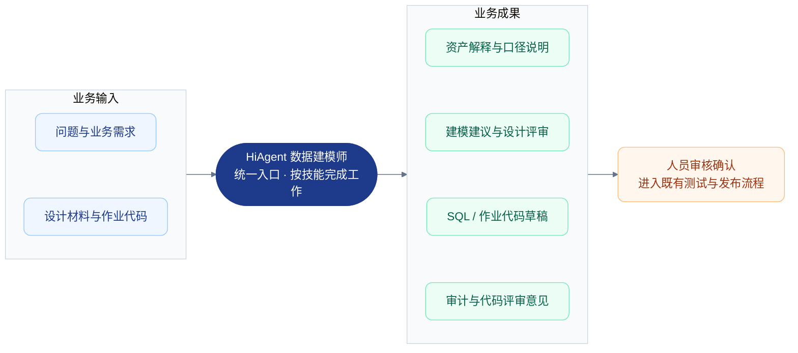
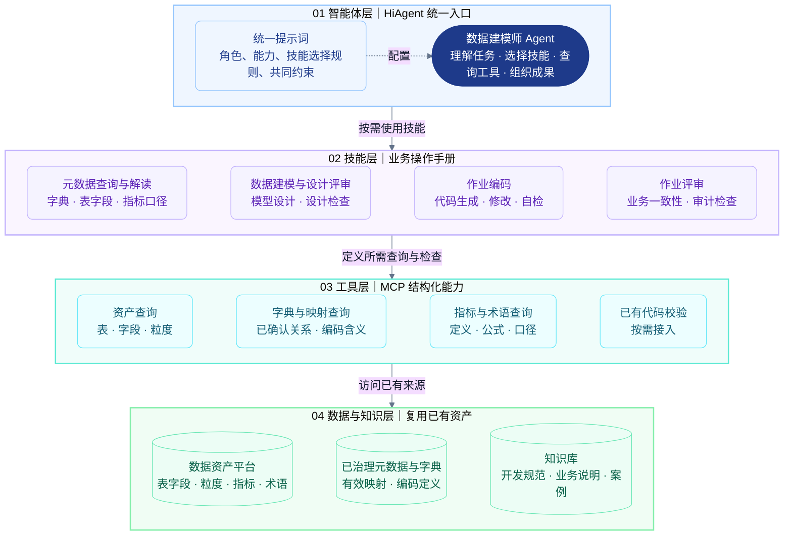
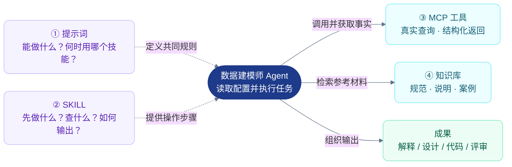
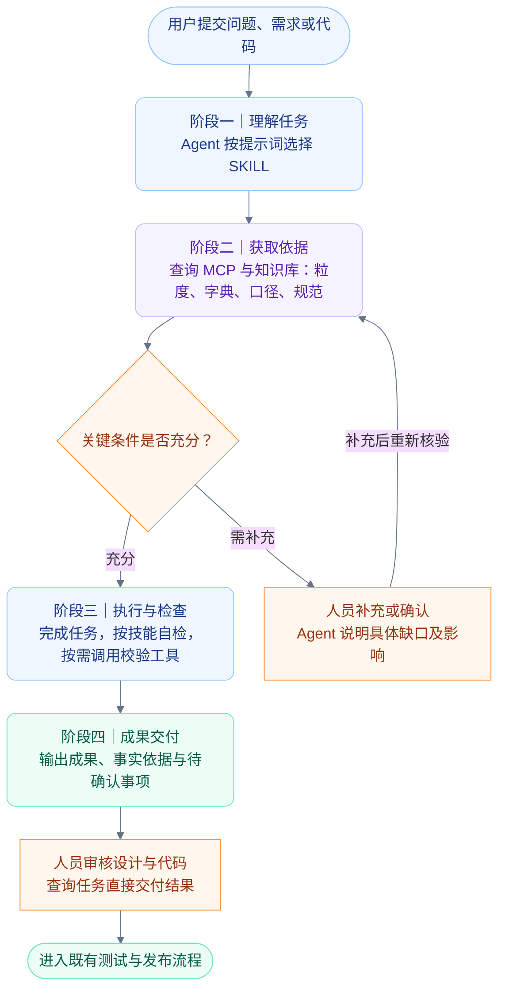
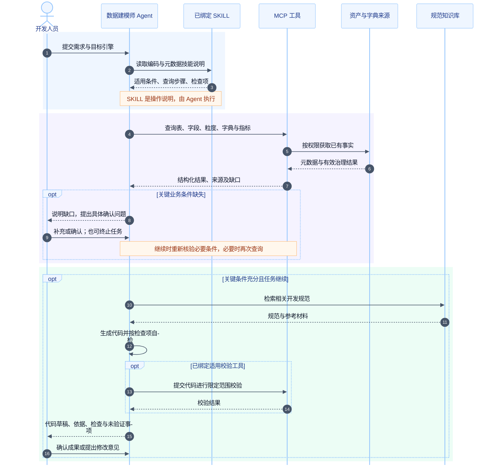
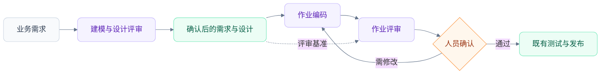

# 基于 HiAgent 的数据建模师智能体概要设计

> **方案评审稿｜2026-10-08**  
> **建设主线：一个 Agent + 一组 SKILL + 一组 MCP + 现有数据与知识。**  
> 本次请负责人确认建设方向、首期范围与协作职责；排期和工作量在能力核验后提交。

## 1. 方案概览

在 HiAgent 上构建一个“数据建模师”Agent，作为统一交互入口。用户通过自然语言提出问题或提交需求、设计、代码，Agent 根据提示词选择已绑定的 SKILL，按技能步骤查询 MCP 和知识库，输出解释、设计建议、代码草稿或评审意见。

**任务选择和执行步骤属于 Agent 的行为，通过提示词与 SKILL 配置实现，首期不单独建设“任务路由模块”或工作流引擎。**

### 图 1：领导汇报概览——建设什么，解决什么



### 1.1 设计前提

1. **部分数据资产已完成准确、有效的治理，结果可以通过 MCP 获取。** 本项目消费治理结果，不编写数据治理程序。
2. **数据资产管理平台已提供表的数据粒度说明。** Agent 通过 MCP 查询使用。
3. 已治理范围内的字段与字典映射准确、可用；范围外的资产不得默认视为已治理。
4. 指标、业务术语、关联条件等以实际可获取的资料为准；关键内容缺失或存在歧义时，由人员补充确认。

### 1.2 建设范围

| 能力 | 使用方式 | 交付成果 |
|---|---|---|
| 元数据查询与解读 | 查询字典、表、字段、指标、术语及口径，翻译业务编码 | 查询结果、业务解释、来源与适用范围 |
| 数据建模与设计评审 | 根据需求设计模型，或检查已有设计 | 模型建议、粒度与口径说明、问题清单 |
| 作业编码 | 根据已确认需求与设计生成或修改代码 | SQL 或代码草稿、依据、检查结果 |
| 作业评审 | 对照需求、设计、元数据与规范检查代码 | 问题位置、严重程度、依据和修改建议 |

审计评审首期聚焦字段与字典使用、指标口径、粒度、敏感字段使用及开发规范。检查项必须有明确依据；正式合规审计认证不属于本 Agent 的职责。

首期采用人工主导、智能辅助方式，不包含全量治理、自动生产发布或未经授权的数据查询和作业执行。

## 2. 总体架构：四层职责，一个 Agent

### 图 2：分层架构——上层使用能力，下层提供事实



**图示说明：** 层间箭头表示逻辑依赖，不代表 SKILL 是独立执行服务。实际由 Agent 调用 MCP、检索知识库并组织步骤；知识库可以由 HiAgent 原生绑定，无需强行封装成 MCP。“已治理元数据”是已有结果的逻辑来源，不要求新建数据库。四层也不意味着四套部署系统。

| 层级 | 配置或建设内容 | 职责边界 |
|---|---|---|
| 智能体层 | 一个 Agent，绑定模型、提示词、SKILL、MCP 与知识库 | 组织任务和交互，不凭空补造业务事实 |
| 技能层 | 四项业务技能，定义适用条件、步骤、工具要求和输出 | 是方法说明，不保存权威映射，不承担强制授权 |
| 工具层 | 复用资产 MCP，按需补充字典查询或适配能力 | 返回事实与校验结果，服务端执行权限检查 |
| 数据与知识层 | 资产平台、有效治理结果、字典、规范知识库 | 结构化事实与说明性材料分别管理 |

现有 MCP 能满足需求时直接复用。“一组 MCP”可以是一个或多个服务提供的工具集合，不要求每个工具独立部署。

## 3. 如何配置：提示词、SKILL 与 MCP 的分工

### 图 3：配置关系——提示词指方向，技能给步骤，工具供事实



虚线表示配置对 Agent 的指导，实线表示 Agent 使用能力或交付成果。首期不编写额外路由程序。

### 3.1 Agent 提示词写什么

提示词写角色、能力范围、技能选择规则和所有任务共同遵守的约束。每种任务的详细流程放入 SKILL，避免在两处重复维护。

**以下为可用于配置的提示词草案，技能名称需与平台实际绑定名称一致：**

```text
你是企业的数据建模师，帮助用户理解数据资产、设计数据作业、开发代码和开展评审。

能力范围：
- 查询和解释数据字典、表、字段、指标、业务术语与业务口径。
- 开展数据建模和需求设计评审。
- 根据已确认需求与设计开发 SQL 或数据作业代码。
- 根据需求、设计和规范开展作业评审及约定范围内的审计检查。

技能选择：
- 查询表、字段、字典、指标或口径：使用“元数据查询与解读”。
- 设计数据模型或评审需求、设计：使用“数据建模与设计评审”。
- 生成或修改 SQL、作业代码：使用“作业编码”。
- 检查已有 SQL、作业代码：使用“作业评审”。

一个任务可以使用多个技能，由你组织步骤。
例如开发代码，先按元数据查询与解读技能获取事实，再按作业编码技能生成代码。

共同约束：
- 表、字段、粒度、字典映射和指标口径，以 MCP 查询结果为依据，不凭记忆补造。
- 开发规范和业务说明优先检索已绑定知识库。
- 关键业务信息缺失或存在歧义时，说明影响并向用户确认。
- 可以继续完成不依赖缺失信息的部分。
- 不重复询问用户已提供或工具能够查询的信息。
- 输出关键业务口径、元数据依据和待确认事项。
- 区分代码草稿、模型检查结果与实际工具验证结果。
- 作业执行与发布遵循授权流程。
```

在提示词中写技能名称并不等于已经获得技能；必须在 HiAgent 中实际绑定相应 SKILL、MCP 和知识库，并验证技能是否被正确加载。具体界面与技能引用方式以现有版本为准。

### 3.2 SKILL 写什么

每个技能至少说明：适用场景、必要输入、处理步骤、所需工具、输出要求和职责边界。

| 技能 | 关键步骤 | 主要成果 |
|---|---|---|
| 元数据查询与解读 | 检索资产 → 定位唯一对象 → 查询有效映射或口径 → 解释并附来源 | 查询结果、业务解释、缺口 |
| 数据建模与设计评审 | 理解需求 → 查询元数据 → 明确粒度和关系 → 设计或检查 → 列出问题 | 设计建议、评审意见 |
| 作业编码 | 确认需求 → 获取元数据 → 查规范 → 编码 → 自检 | 代码、依据、检查说明 |
| 作业评审 | 理解代码与需求 → 查询相关元数据 → 对照检查项 → 输出问题 | 问题位置、依据、建议 |

**示例：作业编码 SKILL 草案。**

```text
技能名称：作业编码

适用场景：
根据业务需求或设计生成、修改 SQL 或数据作业代码。
仅查询字段含义时，使用元数据查询与解读技能。

必要输入：
业务需求、目标执行引擎，以及已有设计或代码（如有）。
对话或工具查询能获取的信息，不要求用户重复提供。

处理步骤：
1. 理解业务目标，明确统计对象、输出粒度、时间范围和指标口径。
2. 按元数据查询与解读要求，通过 MCP 查询表、字段、粒度、映射和指标定义。
3. 检查关联条件、去重要求、过滤条件、时间字段与金额单位是否明确。
4. 有影响正确性的缺口时，提出具体问题并等待确认。
5. 查询知识库中的相关开发规范。
6. 根据已确认信息生成或修改代码。
7. 对照需求、粒度、字典与指标口径自检；有适用校验工具时按支持范围调用。

所需能力：
资产查询、字段字典查询、指标口径查询、规范知识库检索。
代码校验工具为可选能力，未配置时明确说明未进行该类验证。

输出要求：
代码；关键实现说明与元数据依据；检查结果；待确认及未验证事项。

职责边界：
负责代码生成与修改。生成代码不等于运行成功，不自动执行生产作业。
```

这里引用公共技能表示复用操作要求，不预设技能之间存在直接调用机制；相关步骤由 Agent 组织执行。

### 3.3 MCP 配置什么

工具说明必须让 Agent 判断什么时候使用它、需要什么参数、返回结果能说明什么。

| 工具能力 | 输入约束 | 返回内容 |
|---|---|---|
| 资产检索 | 名称、业务域等检索条件，支持分页 | 候选资产及唯一标识 |
| 资产详情 | 资产唯一标识 | 表、字段、物理类型、表粒度、来源 |
| 字段字典查询 | 字段唯一标识；需要时提供业务上下文 | 已确认映射、编码含义、治理范围、来源 |
| 指标与术语查询 | 名称或唯一标识；有重名时先消歧 | 定义、公式、过滤条件、时间口径、单位等已有信息 |
| 代码校验（可选） | 代码与目标引擎 | 工具支持范围内的检查结果 |

例如，“字段字典查询”的功能描述为：**查询指定字段已确认的字典映射及编码含义。未映射、无权限、调用失败须分别返回，不能统一返回空结果。**

实际工具名称、参数和能力以现有接口为准，不在本方案中预设不存在的接口。

### 3.4 数据库与知识库如何使用

- 数据字典是结构化事实，现有查询能力可继续复用；多场景共同使用时优先统一为 MCP 工具入口。
- 字段与字典关联采用已经确认的治理结果，Agent 不在查询过程中自行建立正式映射。
- 知识库保存开发规范、业务说明与案例，不替代权威字段映射和指标定义。
- 同一类事实确定唯一查询入口，避免 Agent 同时查询数据库与 MCP 后自行选择相互冲突的结果。

## 4. 任务执行流程

### 图 4：分阶段流程——获取事实后再交付，关键缺口由人员确认



查询任务通常直接返回结果；代码和设计成果经人工确认后进入既有流程。人员提出修改意见时，Agent 重新理解约束，必要时补查元数据并修订成果。缺口只暂停受影响步骤，不阻止无依赖部分的处理。

### 图 5：编码时序——谁提供步骤，谁查询事实，谁确认成果



### 图 6：成果衔接——一个 Agent 支持完整作业过程



三项工作均由同一个 Agent 提供，使用不同 SKILL。评审发现需求或设计问题时，先修订并确认对应材料，再重新编码，不只修改代码。

## 5. 可靠性与运行边界

| 关注点 | 设计要求 |
|---|---|
| 元数据可信 | 使用已有有效治理结果，未治理资产提示缺口 |
| 粒度与口径 | 编码与评审前查询粒度、关联条件、去重、过滤、时间及单位 |
| 权限 | MCP 服务端执行授权，明确采用用户身份或受限服务身份 |
| 事实缺口 | 区分未找到、未治理、无权限和接口失败 |
| 执行边界 | 默认查询、设计、生成与评审，不自动执行生产作业 |
| 结果表述 | 区分模型自检、工具验证和实际运行结果 |
| 可追溯性 | 保留任务、技能版本、工具调用、元数据依据及人工确认记录 |

提示词和 SKILL 用于指导模型，不等同于程序强制约束。权限检查在服务端执行；以后确需强制审批顺序或校验门禁时，再接入 HiAgent 工作流或已有后端校验能力。

## 6. 首期落地路径与验收

先用一个业务域跑通公共元数据能力，再逐步增加场景技能。首期完成四项技能的试点，不要求一次性覆盖所有业务域。

| 步骤 | 工作内容 | 完成标志 |
|---|---|---|
| 1. 建立最小入口 | 创建数据建模师 Agent，配置提示词，绑定元数据 SKILL、现有 MCP 与知识库 | 能正确查询并解释字典、表字段与口径 |
| 2. 验证能力选择 | 用查询、歧义和未治理问题调试技能与工具说明 | 调用正确，依据清楚，不补造事实 |
| 3. 增加建模与编码 | 绑定设计评审和编码 SKILL，沿用公共查询能力 | 交付符合真实需求的设计和代码草稿 |
| 4. 增加评审并验收 | 绑定作业评审 SKILL，使用实际案例和预设问题验证 | 能定位业务问题并给出有依据的建议 |

验收同时检查“结果是否正确”与“过程是否正确”：是否使用匹配的技能、是否查询必要元数据、是否正确处理缺口、是否保留来源、是否区分已验证和未验证内容。具体通过率、时延及成本目标在样本与基线确定后制定。

## 7. 提请项目负责人确认

| 决策事项 | 建议确认方向 |
|---|---|
| 建设形态 | 一个数据建模师 Agent，绑定一组 SKILL、MCP 和知识库 |
| 架构方向 | 四层职责划分；任务选择和步骤通过 Agent 提示词与技能配置实现 |
| 项目前提 | 直接使用有效治理结果与已有表粒度说明，不建设治理程序 |
| 首期范围 | 一个业务域，完成元数据查询、建模与设计评审、作业编码、作业评审 |
| 协作职责 | 明确 HiAgent 配置、MCP 接入、业务口径与试点验收负责人 |
| 扩展条件 | 试点达标后扩大业务域；有强制流程要求时再接入工作流 |

**建议批准按上述形态开展试点，先验证公共查询能力，再逐步叠加编码与评审能力。**
