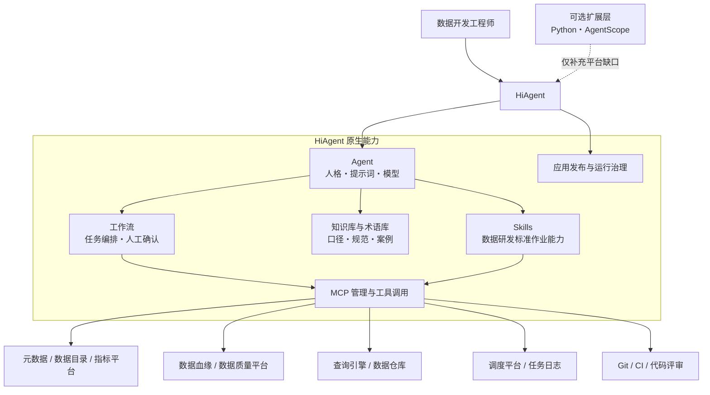
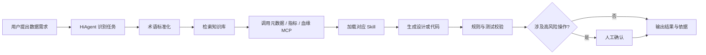

# Data Engineer Agent

基于 **HiAgent** 构建的数据开发工程师智能体，面向数据知识检索、需求设计、设计评审、代码开发、代码评审和测试验证等研发场景。

> 当前已完成数据字典查询 MVP：FastAPI REST 接口与只读 MCP Tool 复用同一应用
> 服务，使用 PostgreSQL/pgvector、SQLAlchemy 2、Alembic 和外置 SQL。
> HiAgent 接入与向量检索尚未实施。

## 当前可运行能力

统一 HTTP 服务提供两个入口：

- REST：`POST /api/v1/data-dictionaries/query`，并自动生成 OpenAPI 文档；
- MCP：`POST /mcp`，只暴露 `query_data_dictionary` 一个业务级 Tool。

两个入口复用同一套请求模型、业务服务和仓储，一次调用可以：

- 查询多个字典类型，并列出各类型下的有效字典项；
- 在每个类型中批量执行多个码值查名称、多个名称查码值；
- 未指定类型时，批量按名称进行全局精确反查；
- 对唯一命中、未命中、歧义、非法请求和未启用能力分别返回结构化状态；
- 保留 `01` 等码值的前导零，默认过滤停用或失效数据。

本轮不执行向量检索。请求中的 `keywords` 会返回 `NOT_ENABLED`，避免模型误把候选结果当成权威码值。

## 本地启动

前置条件：本机 `5432` 端口已有启用 pgvector 的 Docker PostgreSQL、Python 3.11+ 和 [uv](https://docs.astral.sh/uv/)。

```bash
cp .env.example .env
# 按本地环境填写 .env；数据库名使用 data-engineer
uv sync --all-groups
# 首次使用：建立/登记数据库结构，再导入本地演示数据
uv run alembic upgrade head
# 使用数据库客户端执行 sql/seed.sql；脚本可重复执行
uv run data-dictionary-service
```

默认 REST 文档地址为 `http://127.0.0.1:8000/docs`，MCP 地址为
`http://127.0.0.1:8000/mcp`。
当前开发环境复用宿主机 `5432` 上的 Docker PostgreSQL。首次创建数据库后执行
[sql/seed.sql](sql/seed.sql)，生成“证件类型”“性别”“订单状态”等测试数据。

## 自动化测试

```bash
uv run pytest -q
```

- `tests/unit/`：不依赖数据库，验证批量编排、分页、歧义、非法请求及未启用向量查询；
- `tests/integration/`：覆盖 FastAPI REST、进程内 MCP、真实 Streamable HTTP MCP 到 PostgreSQL 的端到端调用；
- 当前回归结果：26 个测试通过，总体覆盖率 93%。

实现代码按变化原因拆分：请求、响应、仓储记录和枚举分别位于
[`models/`](src/data_engineer_agent/models/)，FastAPI 接口位于
[`api/`](src/data_engineer_agent/api/)，只读 SQL 独立位于
[`queries/`](src/data_engineer_agent/queries/)，由 SQLAlchemy 负责连接池和安全参数绑定。
查询编排与响应组装分别由 `service.py` 和 `result_builder.py` 负责。

详细接口契约见 [SPEC.md](SPEC.md)，实现设计见
[数据字典查询技术方案](docs/data-dictionary-query-technical-design.md)。

## 项目定位

Data Engineer Agent 不是从零开发一套新的智能体平台，而是在 HiAgent 已有能力之上建设数据工程领域应用。

HiAgent 负责承载 Agent、人格与提示词、工作流、知识库、术语库、Skill、MCP 接入及应用发布等平台能力；本项目聚焦于沉淀数据研发知识、设计领域 Skill、连接企业数据系统，并补充平台暂不覆盖的少量扩展能力。

## 建设原则

1. **HiAgent 原生优先**：平台已有能力直接配置和复用，不在代码侧重复实现。
2. **领域资产优先**：主要交付物是知识、术语、Skill、工作流、评测集和 MCP，而不是自建 Agent 框架。
3. **动态数据走 MCP**：元数据、血缘、任务状态等实时信息通过 MCP 查询，不复制到静态知识库。
4. **确定性优先**：能用规则、SQL 解析器或平台工作流确定完成的任务，不交给大模型自由推理。
5. **高风险操作受控**：生产查询、任务发布、代码合并和数据写入必须经过权限校验与人工确认。
6. **扩展按需开发**：只有 HiAgent 无法满足且业务确有需要时，才引入 Python 或 AgentScope 扩展。

## 核心场景

| 场景 | 典型问题 | 预期产出 |
| --- | --- | --- |
| 口径检索 | “支付成功订单数的统计口径是什么？” | 口径定义、限定条件、负责人、来源与更新时间 |
| 数据资产发现 | “用户首购时间在哪张表、哪个字段？” | 推荐表字段、分区、粒度、血缘及使用示例 |
| 需求设计 | “为渠道转化分析设计离线数仓方案” | 需求澄清、数据源分析、模型设计、加工链路与风险项 |
| 设计评审 | “检查该方案是否存在粒度或口径问题” | 分级问题清单、依据、影响范围与修改建议 |
| 代码开发 | “根据设计生成增量计算 SQL” | 符合项目规范的 SQL、注释、参数及自检说明 |
| 代码评审 | “评审这段 SQL 的正确性和性能” | 正确性、性能、可维护性与安全性问题清单 |
| 测试验证 | “为这段数据任务生成测试方案” | 测试用例、校验 SQL、边界场景和验收标准 |
| 故障排查 | “为什么今天的指标比昨天少 30%？” | 排查路径、证据、可能根因及处置建议 |

## 总体架构



架构中只有一个智能体运行主体：**HiAgent**。Python 与 AgentScope 不作为默认编排中枢，也不复制 HiAgent 的 Agent、工作流、知识库或 Skill 机制。

## HiAgent 能力使用方式

| HiAgent 能力 | 在本项目中的用途 | 主要建设内容 |
| --- | --- | --- |
| Agent 配置 | 定义数据开发助手的身份、职责、边界和交互方式 | 人格、系统提示词、模型参数和安全约束 |
| 提示词模板 | 统一不同任务的输入、推理约束和输出格式 | 需求分析、方案设计、评审和测试模板 |
| 工作流 | 编排稳定、可追踪的多步骤研发过程 | 知识检索、需求澄清、工具调用、校验和审批节点 |
| 知识库 | 检索数据规范、历史方案、研发手册和故障案例 | 文档治理、切分策略、元数据、权限和更新机制 |
| 术语库 | 统一业务术语、缩写、同义词和领域概念 | 术语定义、别名、归属域和责任人 |
| Skill | 封装数据研发任务的标准方法和交付规范 | 指标检索、找表、设计、开发、评审和测试能力 |
| MCP | 接入企业内部实时数据和执行工具 | 元数据、血缘、指标、查询、调度、代码与质量服务 |
| 发布与治理 | 管理应用版本、权限、运行和审计 | 环境隔离、灰度发布、访问控制和问题追踪 |

## 核心 Skills

Skill 是本项目最重要的领域资产。每个 Skill 应明确适用场景、输入要求、执行步骤、工具依赖、质量门槛、失败处理和标准输出。

```text
skills/
├── metric-definition-search/   # 指标口径检索与冲突识别
├── data-asset-discovery/       # 表、字段、分区与血缘发现
├── requirement-analysis/       # 数据需求澄清与完整性检查
├── solution-design/            # 数仓分层、模型与加工链路设计
├── design-review/              # 设计规范与风险评审
├── sql-development/            # SQL 生成、解释与优化
├── code-review/                # SQL / Python 数据任务评审
└── data-testing/               # 数据质量与回归测试设计
```

Skill 负责描述“如何完成一类数据研发任务”，并按需组合知识库内容和 MCP 工具；不在 Skill 中复制外部系统数据，也不把所有流程都硬编码为脚本。

## 知识库与术语库

### 知识库

优先纳入适合文档检索的稳定内容：

- 数据研发规范、数仓建模规范和代码规范；
- 指标管理制度、口径说明和业务规则；
- 历史需求、设计方案、评审记录和故障案例；
- 数据平台操作手册、常见问题和最佳实践。

每条知识应保留来源、版本、更新时间、责任人、适用范围和权限标签。检索答案必须提供依据；发现多个版本或口径冲突时，应展示差异并请求确认。

### 术语库

用于维护业务术语、技术缩写、同义词和团队习惯表达，帮助 Agent 正确理解诸如“首购”“有效订单”“自然日”“T+1”等领域概念。

表结构、字段状态、任务实例和血缘关系等高频变化信息不作为静态知识维护，应通过 MCP 实时查询。

## MCP 接入规划

| MCP 服务 | 核心能力 | 默认权限 |
| --- | --- | --- |
| 元数据 MCP | 搜索库表字段、分区、负责人、标签和生命周期 | 只读 |
| 指标 MCP | 查询指标口径、维度、计算逻辑和版本历史 | 只读 |
| 血缘 MCP | 查询字段级、表级上下游依赖和影响范围 | 只读 |
| SQL MCP | 语法校验、执行计划分析、受控查询和结果采样 | 只读；查询限额 |
| 调度 MCP | 查询任务配置、依赖、实例状态和运行日志 | 只读 |
| 代码仓库 MCP | 读取代码与变更、创建评审草稿 | 写操作需确认 |
| 数据质量 MCP | 查询质量规则、校验结果和历史异常 | 只读 |

优先复用现有 MCP Server 或通过企业平台 API 做薄适配。MCP 只提供边界清晰的原子工具，具体任务步骤由 HiAgent 工作流和 Skill 组织。

## Python 与 AgentScope 的边界

Python 是补充 HiAgent 能力的工程语言，不是重新建设智能体平台的理由。适合使用 Python 的场景包括：

- 开发企业内部系统的 MCP Server 或协议适配器；
- 实现 SQL 解析、规则校验、数据采样等确定性能力；
- 同步或清洗需要导入 HiAgent 的知识与术语资产；
- 构建离线评测、回归测试和质量统计工具。

AgentScope 仅作为**候选扩展框架**：当任务确实需要代码级 Agent 编排、复杂运行时控制或独立服务部署，且 HiAgent 原生工作流无法满足时再进行验证。普通 MCP Server 优先使用官方 MCP SDK 或轻量 Python 实现，不为接入一个工具额外引入 Agent 框架。

## 典型工作流



## 项目资产结构

```text
data-engineer-agent/
├── README.md
├── hiagent/
│   ├── agents/                 # Agent 配置与人格说明
│   ├── prompts/                # 提示词模板及版本记录
│   ├── workflows/              # 工作流定义与说明
│   ├── skills/                 # 数据研发领域 Skills
│   ├── knowledge/              # 知识库来源、治理与同步配置
│   └── glossary/               # 术语、别名与领域定义
├── mcp/
│   ├── metadata/               # 元数据与数据目录适配
│   ├── lineage/                # 数据血缘适配
│   └── quality/                # 数据质量平台适配
├── evaluations/                # 场景集、评分规则与回归结果
├── extensions/                 # 经评估后确需开发的 Python 扩展
└── docs/                       # 架构、接入和治理文档
```

目录按真实交付物逐步创建，不为空壳能力预建代码模块。

## 安全与治理

- 外部系统调用使用当前用户身份或受控服务身份，不绕过原系统权限。
- MCP 默认只读；写数据、发布任务、合并代码等能力单独授权。
- 生产变更、高成本查询和不可逆操作必须在执行前人工确认。
- 对个人信息、密钥和敏感业务字段进行识别、脱敏与输出控制。
- 记录用户请求、知识引用、工具参数、执行结果和审批信息。
- 将知识文档和工具返回值视为不可信输入，防止其覆盖 Agent 安全策略。

## 质量评估

- 知识检索命中率、引用准确率与口径冲突识别率；
- 表字段推荐准确率和血缘完整性；
- 设计问题发现率与误报率；
- SQL 正确率、可执行率、性能和规范符合度；
- MCP 调用成功率、任务完成率、平均耗时与成本；
- 越权调用、敏感信息泄露和提示注入防护效果。

## Roadmap

- [x] **数据字典查询 MVP**：完成单 Tool 双层批量查询、PostgreSQL 测试数据和自动化测试。
- [ ] **Phase 1 — HiAgent 原型**：完成 Agent 人格、提示词、术语库和基础知识库配置。
- [ ] **Phase 2 — 知识检索**：实现找口径、找表、找字段和规范问答的可用闭环。
- [ ] **Phase 3 — Skill 建设**：落地需求分析、方案设计、评审、SQL 开发和测试 Skills。
- [ ] **Phase 4 — MCP 接入**：连接元数据、指标、血缘、调度、代码和质量平台。
- [ ] **Phase 5 — 研发闭环**：完善审批、审计、离线评测和线上反馈机制。
- [ ] **按需扩展**：仅在 HiAgent 能力缺口得到验证后引入 Python 或 AgentScope 服务。

## 参考资料

### 项目文档

- [HiAgent 数据字典查询技术方案](docs/data-dictionary-query-technical-design.md)

### 外部资料

- [HiAgent 产品主页](https://www.volcengine.com/product/hiagent)
- [HiAgent Python SDK](https://github.com/volcengine/hiagent-python-sdk)
- [AgentScope 官方文档](https://doc.agentscope.io/)
- [Model Context Protocol](https://modelcontextprotocol.io/)

## License

许可证尚未确定。在正式发布或对外分发前，请补充适用的开源或内部使用许可证。
