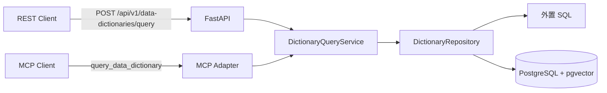

# 数据字典查询 FastAPI 与 MCP 技术方案

## 1. 文档信息

| 项目 | 内容 |
| --- | --- |
| 所属项目 | Data Engineer Agent |
| 版本 | 0.2.0 |
| 状态 | MVP 已实现 |
| 目标 | 通过统一应用服务向 REST 与 MCP 提供可批量、可审计的数据字典精确查询 |

## 2. 背景与目标

数据开发工程师经常需要回答以下问题：

- “证件类型有哪些？”
- “证件类型 `01` 代表什么？”
- “军官证的字典码值是多少？”

这类问题要求结果精确、来源稳定，并且必须保留码值前导零。首版因此不使用模型记忆、知识库片段或向量相似度直接回答，而是通过只读 MCP Tool 查询 PostgreSQL 中的权威结构化数据。

首版目标：

1. 一次 MCP 调用支持多个字典类型；
2. 每个类型支持多个码值和多个名称同时查询；
3. 支持只提供类型时列举字典项；
4. 支持未指定类型时按名称全局精确反查；
5. 单项失败不影响同批其他结果；
6. 对无结果、歧义、非法输入和未启用能力返回明确状态。

## 3. 当前范围

### 3.1 已实现

- 一个只读 Tool：`query_data_dictionary`；
- 一个 FastAPI REST 接口：`POST /api/v1/data-dictionaries/query`；
- 字典类型编码、名称和别名的精确匹配；
- 字典项码值、名称和别名的批量精确匹配；
- 基于游标的字典项分页；
- 默认过滤停用及不在有效期内的数据；
- 本地 Docker PostgreSQL 与 `vector` 扩展；
- 可重复执行的建表及测试数据脚本；
- 纯单元测试与真实 MCP/PostgreSQL 集成测试。

### 3.2 本轮不做

- 不实现向量生成、向量索引和向量检索；
- 不接入或测试 HiAgent；
- 不引入 AgentScope；
- 不提供字典新增、修改或删除能力；
- 不把动态字典项复制到 HiAgent 术语库或知识库；
- 不增加缓存、管理后台或复杂工作流。

## 4. 架构



| 模块 | 职责 | 不负责 |
| --- | --- | --- |
| FastAPI | 提供 REST、OpenAPI、请求校验和生命周期 | 不承载查询规则，不直连仓储 |
| MCP Adapter | 注册 Tool、校验协议对象、返回结构化响应 | 不拼 SQL，不承载查询规则 |
| Query Service | 识别参数组合、编排批量查询、生成状态与汇总 | 不管理数据库连接 |
| Repository | 使用 SQLAlchemy 执行参数化 SQL、映射数据库记录 | 不决定业务状态，不拼接 SQL |
| 外置 SQL | 独立保存字典类型、列举和精确查找 SQL | 不实现动态语言，不包含业务流程 |
| Result Builder | 执行状态判定、记录投影和统计汇总 | 不访问数据库 |
| PostgreSQL | 保存字典类型、字典项、别名、状态与有效期 | 不进行自然语言推理 |

HiAgent 后续只负责理解用户问题、生成 Tool 参数和组织答案；码值事实仍由 MCP 查询结果决定。

## 5. 为什么只提供一个 Tool

列举字典项、码值查名称和名称查码值属于同一个“查询数据字典”意图。如果拆成多个 Tool，用户的一句话可能先查类型、再查码值，增加 Agent 选错工具和多轮调用的概率。

首版因此使用一个业务级 Tool，并通过参数组合表达操作：

| 参数组合 | 行为 |
| --- | --- |
| 仅 `dictionary_type` | 列出该类型下的字典项 |
| `dictionary_type + item_codes` | 批量按码值查名称 |
| `dictionary_type + item_names` | 在指定类型内批量按名称查码值 |
| 仅 `item_names` | 全局批量精确反查 |
| `keywords` | 返回 `NOT_ENABLED` |

码值全局查询不开放，因为不同字典类型可以合法复用同一码值。

## 6. MCP 契约

### 6.1 Tool

名称：`query_data_dictionary`

属性：只读、幂等、无破坏性操作。

### 6.2 请求

```json
{
  "requests": [
    {
      "dictionary_type": "证件类型",
      "source_system": null,
      "item_codes": ["01", "02"],
      "item_names": ["护照"],
      "keywords": [],
      "cursor": null
    },
    {
      "dictionary_type": "性别",
      "item_codes": [],
      "item_names": [],
      "keywords": [],
      "cursor": null
    }
  ],
  "include_inactive": false,
  "page_size": 100
}
```

约束：

- `requests` 数量为 1～20；
- 所有码值、名称和关键词合计不超过 100 个；
- `page_size` 为 1～200；
- 码值始终为字符串；
- 未指定类型时不得传入 `item_codes`；
- 同一查询组可以同时包含码值、名称和关键词。

### 6.3 响应

```json
{
  "results": [
    {
      "request_index": 0,
      "dictionary_type_status": "FOUND",
      "matched_type": {
        "type_code": "IDENTITY_DOCUMENT_TYPE",
        "type_name": "证件类型",
        "source_system": "本地测试数据"
      },
      "lookups": [
        {
          "input_type": "ITEM_CODE",
          "input_value": "01",
          "status": "FOUND",
          "matches": [
            {
              "item_code": "01",
              "item_name": "身份证",
              "status": "ACTIVE",
              "match_method": "EXACT_CODE"
            }
          ]
        }
      ],
      "items": [],
      "candidates": [],
      "next_cursor": null,
      "error": null
    }
  ],
  "summary": {
    "request_count": 1,
    "lookup_count": 1,
    "succeeded": 1,
    "not_found": 0,
    "ambiguous": 0,
    "invalid": 0
  }
}
```

状态语义：

| 状态 | 含义 |
| --- | --- |
| `FOUND` | 精确且唯一命中 |
| `NOT_FOUND` | 查询完成但没有有效数据 |
| `AMBIGUOUS` | 命中多个类型或字典项，需要调用方选择 |
| `INVALID` | 参数组合不合法或游标无效 |
| `NOT_ENABLED` | 参数合法，但对应能力本轮尚未启用 |
| `NOT_PROVIDED` | 当前请求未提供该类输入 |

响应保持查询组顺序和组内输入顺序。任何单项失败都只记录在对应结果中，不中断整个批次。

## 7. 查询规则

1. 字典类型按编码、名称、别名精确匹配；
2. 若同名类型来自多个系统且未指定 `source_system`，返回歧义；
3. 指定类型后，码值按原始字符串精确匹配；
4. 名称按名称或权威数据源维护的别名进行不区分大小写的精确匹配；
5. 全局名称反查只在唯一命中时返回事实结果；
6. 默认只返回 `ACTIVE` 且处于有效期内的数据；
7. 码值禁止模糊匹配，任何候选结果不得冒充精确事实。

## 8. PostgreSQL 设计

本地开发数据库：

- 当前本地镜像：`pgvector/pgvector:0.8.6-pg14-trixie`；
- 数据库：`data-engineer`；
- 编码：`UTF8`；
- 宿主机端口：`5432`；
- 凭据：仅通过 `.env` 注入，不写入代码和版本库。

核心表：

| 表 | 用途 | 关键约束 |
| --- | --- | --- |
| `dictionary_type` | 字典类型、别名、来源与状态 | `source_system + type_code` 唯一 |
| `dictionary_item` | 字典项、别名、有效期与排序 | `dictionary_type_id + item_code` 唯一 |

两张表均预留 `VECTOR` 字段，只用于避免后续迁移时重建主数据表。本轮不写入向量、不建立向量索引，也不执行相似度 SQL。

测试数据脚本 [sql/seed.sql](../sql/seed.sql) 可重复执行，内置：

- 证件类型：`01` 身份证、`02` 军官证、`03` 护照、`04` 驾驶证、停用项 `99`；
- 性别：`01` 男、`02` 女、`00` 未知；
- 订单状态：待支付、已支付、已取消、未知；
- 跨类型同名“未知”，用于验证全局反查歧义。

## 9. 分页

列举字典项采用 `(sort_order, id)` 键集分页，不使用偏移分页。响应中的 `next_cursor` 是 URL 安全 Base64 编码的内部位置；调用方只能原样回传，不应解析或修改。

无效游标返回 `INVALID`，不会退化成首页查询，以免调用方误认为数据完整。

## 10. 测试策略

### 10.1 单元测试

单元测试使用内存仓储替身，不依赖 PostgreSQL，覆盖：

- 多类型、多码值、多名称的批量编排；
- 全局唯一命中、歧义和未命中；
- 非法参数组合；
- 游标分页；
- 停用项行为；
- `keywords` 返回 `NOT_ENABLED`。

### 10.2 集成测试

集成测试使用官方 MCP Client，并访问 Docker PostgreSQL，覆盖：

- 一个 Tool 调用查询多个类型和多个值；
- 全局名称反查允许部分成功；
- 前导零保留和停用项默认过滤。
- FastAPI REST 接口到真实 PostgreSQL 的完整链路；
- 启动独立 MCP 服务进程，经真实 Streamable HTTP `/mcp` 端点发现并调用 Tool。

当前全量结果：26 个测试通过，总体覆盖率 93%。向量与 HiAgent 不在本轮测试范围内。

## 11. 本地运行

```bash
cp .env.example .env
# 填写数据库账号、密码和服务端口
uv sync --all-groups
uv run alembic upgrade head
# 使用数据库客户端执行 sql/seed.sql，导入可重复执行的本地测试数据
uv run pytest -q
uv run data-dictionary-service
```

默认 REST 文档地址：`http://127.0.0.1:8000/docs`。

默认 MCP 地址：`http://127.0.0.1:8000/mcp`。

## 12. 安全与运行约束

- 所有数据库查询使用参数化 SQL；
- MCP 只提供查询能力，不暴露写入 Tool；
- 生产环境应替换为权限受限的只读数据库账号；
- 日志记录中文业务阶段、查询数量和错误分类，不记录密码或令牌；
- 单批请求数量和返回页大小均有硬限制；
- 上游异常必须显式失败，不使用模型记忆生成替代结果。

## 13. 后续接入 HiAgent

本轮接口稳定后，再在 HiAgent 中完成以下配置：

1. 注册 Streamable HTTP MCP Server；
2. 只向数据开发工程师 Agent 开放 `query_data_dictionary`；
3. 在 Skill 中定义参数提取、歧义追问和答案格式；
4. 明确禁止绕过 MCP 凭模型记忆回答码值；
5. 建立 HiAgent 端到端评测集。

术语库不参与字典项查询链路。只有多个 Agent 都需要理解、且权威字典源无法表达的稳定企业术语或缩写，才进入术语库。

## 14. 向量能力启用条件

仅当真实查询日志证明大量用户输入无法通过名称和别名精确命中时，才启用向量候选检索。启用时必须满足：

- 向量只返回候选，不直接确认码值；
- 设定可评测的召回率、误召回率和阈值；
- 记录嵌入模型及版本；
- 增加向量索引、回填任务和回归测试；
- 候选仍需用户确认或再次精确查询。

## 15. 验收结论

| 场景 | 结果 |
| --- | --- |
| 多字典类型批量查询 | 已通过自动化测试 |
| 单类型多码值、多名称查询 | 已通过自动化测试 |
| 类型列举与游标分页 | 已通过自动化测试 |
| 全局名称唯一命中/歧义/未命中 | 已通过自动化测试 |
| 前导零保留 | 已通过真实数据库测试 |
| 停用项默认过滤 | 已通过真实数据库测试 |
| 向量检索 | 按范围明确未启用 |
| HiAgent 联调 | 按范围留待下一阶段 |
