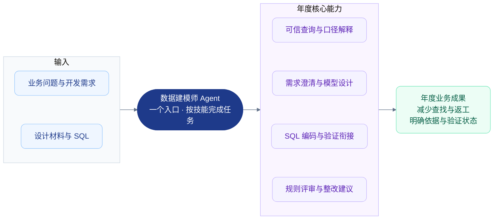
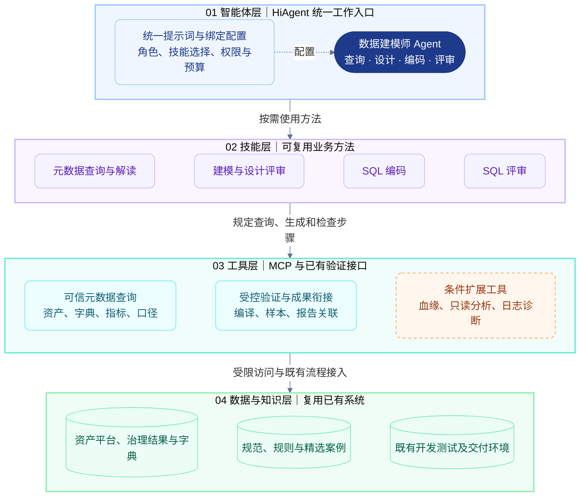
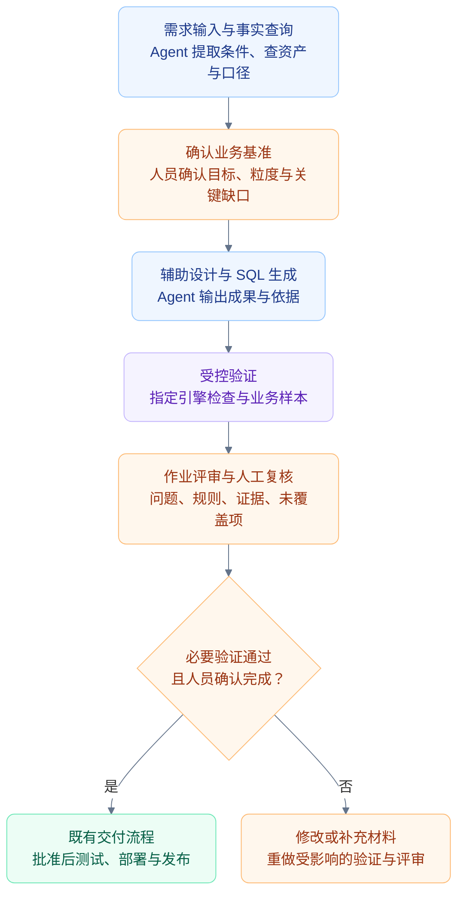
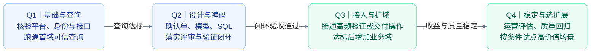
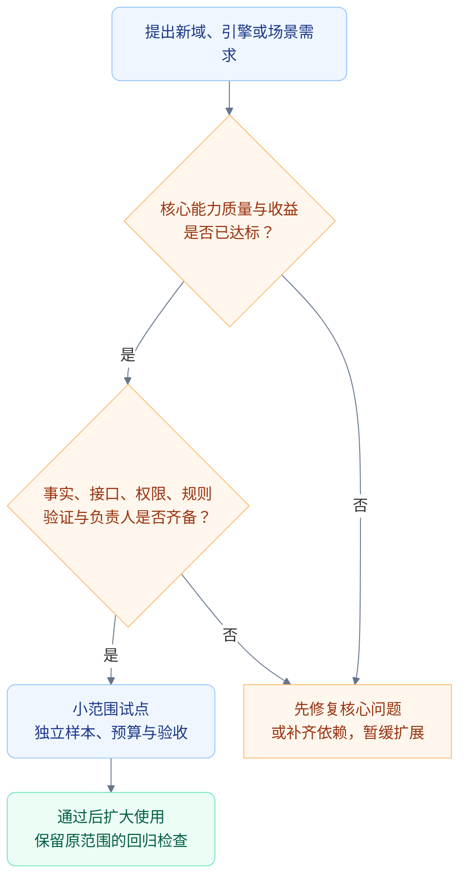

# 2027 年数据建模师智能体建设规划与目标架构

> **规划周期：2027 年 1—12 月｜编制日期：2026-10-09｜状态：年度规划建议稿**  
> **建议主线：先把事实查准，再把设计和代码做对，随后接通验证与评审，最后按收益扩大使用。**  
> 本文是新增年度规划，不替代现有[概要设计](数据建模师智能体概要设计.md)和[总体设计](数据建模师智能体总体设计.md)，不修改原方案。

## 1. 年度目标与规划依据

2027 年建议将当前探索发展为一个可持续使用、可复核、有验证依据的“数据建模师”助手，覆盖数据作业的查询、需求澄清、模型设计、SQL 开发与评审，并逐步接入已有开发测试和交付流程。

**年度目标不是让 Agent 自动包办全部工作，而是让它在明确范围内稳定承担重复查找、初稿编写和规则检查，人员保留业务口径与交付决策。**

### 1.1 当前基础与年度前提

| 类别 | 当前依据或规划前提 |
|---|---|
| 已有实践 | 已在 HiAgent 使用数据库与 SKILL 实现字典查询，用户反馈效果较好 |
| 已有设计 | 已形成单 Agent、四项 SKILL、MCP、知识库的试点设计；不等于已实施验收 |
| 继续采用的假设 | 部分治理结果准确有效，可通过 MCP 查询；资产平台已有表粒度说明 |
| 尚需核验 | 目标 HiAgent 版本的技能选择、组合、多轮恢复、身份与记录能力，以及验证系统接口 |
| 资源假设 | 业务、平台、MCP、开发测试和验收角色能够持续参与；人数与预算尚未确定 |

季度安排是有依赖的计划目标。若 2026 年底已完成部分工作，2027 年 Q1 可从实测差距开始；若未完成，先补基础，不直接跳到自动化接入。

### 图 1：2027 年业务目标——从查资料走向有依据的辅助交付

## 2. 明年可以做哪些事情

### 2.1 必须完成的六项建设

| 工作包 | 具体工作 | 可验收成果 | 主要依赖 |
|---|---|---|---|
| A. 公共元数据能力 | 接通资产、字典、映射、指标和术语；统一消歧、分页、来源与缺口处理 | 公共查询 SKILL、工具能力清单、查询测试集 | 资产 MCP、有效治理覆盖、访问权限 |
| B. 需求与设计助手 | 提取目标、粒度、时间、单位和关联条件；形成确认单；提出模型建议并评审设计 | 任务确认单、模型建议、设计评审检查表 | 业务口径负责人、核心元数据 |
| C. SQL 开发助手 | 针对选定引擎生成和修改 SQL，处理字典、去重、时间及必要写入语义 | 代码草稿、依据、自检及验证待办 | 已确认需求、开发规范、引擎范围 |
| D. 代码评审助手 | 对照需求和规范审查 SQL，给出位置、影响与证据 | 评审报告、覆盖状态、整改建议 | 规则清单、完整评审输入 |
| E. 验证与交付衔接 | 落实编译或语法检查、业务样本验证，记录版本并衔接既有交付 | 验证记录、成果归档、人工确认记录 | 已有测试环境与明确执行责任 |
| F. 质量与运营机制 | 固定测试集、回归、配置版本、问题反馈、权限和成本监测 | 评估报告、发布清单、回退说明、使用报告 | 配置及运维负责人、可获取记录 |

六项建设共享一个 Agent 和公共工具，按依赖逐步配置，不分别建设六套系统。验证责任必须落实；工具自动化接入可以分阶段。

### 2.2 达标后再扩展的能力

| 扩展项 | 可以做什么 | 启动条件与边界 |
|---|---|---|
| 多业务域或第二种引擎 | 复用技能和工具，增加域内规则与引擎规范 | 首域通过验收，新域治理覆盖与负责人齐备；逐域验收，避免一次全量铺开 |
| 变更影响分析 | 查询既有血缘或引用关系，定位受影响设计、SQL、指标，输出建议 | 源平台提供可靠关系与接口；无血缘时只分析已提供代码范围，不宣称全平台影响完整 |
| 受控数据分析 | 在授权、限量环境执行只读分析，解释结果与口径 | 身份隔离、敏感规则、查询预算和执行边界已核验；不是元数据查询权限的自然延伸 |
| 作业故障辅助诊断 | 读取已授权日志、任务状态和相关代码，提出原因与排查路径 | 有实际高频需求及日志接口；首期只建议，不自动重跑或修改生产配置 |
| 交付流程自动衔接 | 提交验证申请、关联需求与代码版本、回填报告 | 既有系统有接口且存在可量化重复操作；写入动作需独立授权与幂等控制 |

这些是年度候选项，不承诺全部完成。Q3 根据核心能力质量、收益和资源选择，Q4 最多优先试点一至两项有价值的扩展，数量也须经负责人确认。

### 2.3 暂缓事项

2027 年不默认建设新数据治理平台、知识图谱平台、多 Agent 协作系统、专用任务中心、自研工作流引擎或模型训练平台。不把自动生产执行、自动审批和自动修复纳入年度基础承诺。

若出现明确问题，先判断已有系统是否可复用。只有现有能力无法覆盖、需求和收益可证明时，才专项评估新增组件；不能因年度架构图出现某个能力就认定必须新建服务。

## 3. 2027 年目标架构

### 3.1 四层主架构，加横向交付与运营约束

延续单 Agent 的四层职责，年度增量重点是**增强验证工具与交付衔接，完善证据、评估和版本管理**。单 Agent 是统一逻辑入口，可按用户群或权限采用不同绑定配置，不承诺所有用户共享同一高权限身份。

### 图 2：年度目标架构——核心能力复用，扩展工具按条件接入

**图例：** 蓝色为 Agent 与配置，紫色为 SKILL，青色为核心工具，绿色为已有系统，橙色虚线为条件扩展。箭头表示职责依赖；SKILL 不是独立服务，实际调用由 Agent 执行。知识库可原生绑定 HiAgent，人工验证可作为过渡，不要求一开始全部 MCP 化。

权限与预算须在平台、工具或既有环境中实际配置，不能仅依靠提示词。开发测试和交付环境的接口是否支持自动提交与回填，须核验后确定。

### 3.2 横向能力如何承载

| 横向能力 | 优先承载位置 | 2027 年增强内容 |
|---|---|---|
| 任务基准与证据 | 现有需求、文档、附件及开发交付系统 | 基准、代码、证据、验证和评审关联；需要时补小范围适配 |
| 身份与工具权限 | HiAgent 绑定及 MCP 服务端、已有身份系统 | 用户与业务域隔离，默认只读，验证和写入权限分别授权 |
| 质量评估 | 现有评测能力与测试流程 | 固定验收样本、盲测、模型和技能回归 |
| 配置发布 | 现有配置与版本管理 | 提示词 `.st`、技能、模型、工具、规范的版本组合与回退 |
| 运行观测 | HiAgent、MCP 及已有日志 | 失败、耗时、调用成本、人工修改和缺口统计 |

横向能力是贯穿四层的要求，不是新增第五套系统。平台能力不足时先采用受控记录和人工操作，再按真实工作量判断是否自动化。

### 3.3 现状到年度目标的增量

| 当前探索 / 试点设计 | 2027 年目标 | 不需要增加的复杂度 |
|---|---|---|
| 字典查询可用 | 统一查询资产、映射、指标与口径，来源可定位 | 不复制全部资产平台数据 |
| 有设计和技能说明 | 真实任务中验证四项技能，形成有效规则与案例 | 不为每个能力创建一个 Agent |
| 人工验证路径 | 必要验证稳定执行，适合部分接入工具 | 不自建 SQL 引擎或测试平台 |
| 文件记录为主 | 成果与已有需求、代码、验证记录关联 | 不默认建设任务中心 |
| 单域试点 | 达标后逐域扩展，按权限和规范区分配置 | 不一次覆盖全部业务域和引擎 |

## 4. 年度业务流程与自动化边界

### 图 3：年度交付流程——自动辅助与人员决策各有位置

图面向编码交付；纯查询直接返回结果，设计成果执行适用审查，不要求 SQL 编译。验证可人工执行或通过已接入工具执行。失败后按影响返回对应步骤，不用继续对话的成功表述代替实际验证。

| 动作 | 年度基础范围 | 自动化升级条件 |
|---|---|---|
| 查元数据、解释编码 | 默认可在已授权范围内自动完成 | 来源与权限可靠，调用预算明确 |
| 生成设计、SQL、评审报告 | 自动生成草稿与建议 | 不能自动标为人工已确认 |
| 编译与样本验证 | 必须落实，可以人工执行 | 受控环境、预算、版本绑定与工具范围确认后自动接入 |
| 写入验证报告或创建申请 | 初期人工衔接 | 有明确授权、接口和幂等要求后受控接入 |
| 审批、生产执行、发布与重跑 | 沿用既有人员和系统职责 | 不列年度基础目标，另行专项评审 |

## 5. 2027 年分季度路线

### 图 4：季度路线——先验收核心，再扩展能力

### Q1：1—3 月，完成基础核验与可信查询

- 确认首个业务域、目标引擎、使用人员、身份边界、元数据覆盖和业务负责人。
- 验证 HiAgent 技能选择、组合、补充恢复和日志导出；不稳定时使用显式任务类型。
- 接通现有元数据 MCP 和字典入口，完成消歧、分页、来源及失败语义约定。
- 建立任务确认单、规则与证据模板；准备固定调试集、独立验收集和基线测量方法。
- 从平台已有模型中选择满足测试要求的配置，不默认训练新模型。

**完成条件：** 真实查询案例达到事先锁定的标准，未治理、歧义、无权限和失败被正确处理；下一阶段验证环境与责任人已落实。

### Q2：4—6 月，完成设计、编码与评审试点

- 配置建模与设计评审、SQL 编码和 SQL 评审技能，保持公共查询方法一致。
- 基于确认单形成模型建议与 SQL，完成指定引擎检查和关键业务样本验证。
- 区分编码自检与重新对照基准的作业评审；建立规则、问题级别和覆盖状态。
- 测量使用前后总人工时间、修改量、业务正确性和误报，形成闭环验收报告。
- 完成配置版本、回归测试及回退操作说明。

**完成条件：** 首域真实任务可完成有证据的辅助交付；有必要验证与人工确认，不存在硬性验收失败项。未达标时继续修复，不进入扩域。

### Q3：7—9 月，优先消除高频人工衔接，再按条件扩域

- 统计最耗时的重复步骤，优先接入已有编译、样本验证或成果关联接口。
- 对写入报告、创建申请等动作单独设计权限、幂等和失败恢复，不把它们混入只读查询工具。
- 核心闭环稳定后选择第二个业务域；若主要需求是另一引擎，先验证引擎差异，避免同时扩域和扩引擎。
- 建立使用反馈、问题分级、回归和按业务域限制的发布机制。
- 评估血缘、只读分析或诊断等候选扩展的接口与收益，形成是否建设的决策。

**完成条件：** 自动衔接减少实际重复操作且不降低质量；新增范围独立验收；成本和失败可观测。关键接口不具备时保持人工衔接，不强行新建平台。

### Q4：10—12 月，稳定运行、验证价值并选择扩展

- 按业务域评估质量、效率、使用覆盖、故障和成本，修复主要问题。
- 对模型、技能、规范和工具变更持续回归，检查回退路径。
- 在核心能力稳定且资源充足时，试点一至两项候选扩展；不与年度基础交付混算。
- 汇总年度收益、剩余限制和下一年建设建议，决定继续扩域、深化验证还是暂缓扩展。

**完成条件：** 已上线范围有明确维护人、可追溯成果和连续评估记录；有数据证明收益，或清楚说明未达到目标的原因及整改。

## 6. 阶段放行与年度验收

### 图 5：扩展决策——有条件才升级，没有条件先补齐

| 评价维度 | 测量方法 | 年度判断 |
|---|---|---|
| 查询与解释 | 人工核对资产、编码、指标和来源 | 在承诺范围达到锁定目标，并正确处理缺口 |
| SQL 业务正确性 | 指定引擎检查与有参考结果的业务样本 | 必要验证均有记录；未验证草稿不计通过 |
| 评审质量 | 固定预设问题集，人工确认检出与误报 | 同时看检出率和问题准确率，避免堆砌风险提醒 |
| 可追溯性 | 检查确认单、代码版本、证据、验证与评审关联 | 成果可复核，关键源版本不可得时如实记录限制 |
| 使用价值 | 同类任务总人工用时、修改量与重复使用 | 包含确认、测试和整改成本，不能只比生成速度 |
| 运行成本 | 调用量、耗时、可取得模型成本及维护投入 | 不可得项标记未知，收益覆盖成本或明确改善方向 |
| 权限与规则边界 | 越权、资料指令干扰、伪造来源或验证的必测案例 | 发现问题整改并回归，不以平均得分抵消 |

质量比例、效率改善和时延成本上限在 Q1 基线测量后、正式验收前确认，不凭空承诺固定提升百分比。可以先提出预算目标，但不能把预算目标当成效果已达成。

建议年终基础成果至少包括：一个通过核验的 Agent、四项实测技能、核心工具清单、任务与评审模板、有效规则与案例、固定评估集、指定引擎验证路径、版本与权限清单、运行及收益报告。扩展业务域数量与自动化数量单独记录，不作为唯一绩效。

## 7. 资源、预算与协作安排

### 7.1 角色与投入顺序

| 角色 | 核心责任 | 投入重点 |
|---|---|---|
| 项目与业务负责人 | 范围、口径、资源和阶段决策 | Q1 确认，全年参与重要变更 |
| HiAgent 配置负责人 | 技能、提示词、模型、绑定和回归 | Q1—Q2 为主，全年维护 |
| MCP 与平台接口负责人 | 查询约定、身份、适配、后续验证衔接 | Q1 接入，Q3 按收益深化 |
| 数据开发与测试人员 | 设计、代码、预期结果及指定环境验证 | Q2 闭环，扩域时持续参与 |
| 评审与运营负责人 | 检查表、样本、反馈、质量成本与回退 | Q1 建基线，Q2—Q4 持续评估 |

角色可以兼任，但口径确认、验证和维护不能缺人。当前未给出人力与接口清单，不能据此承诺固定人数、工期或费用。建议 Q1 先安排一个稳定的小组，核验后按实际适配和测试工作量估算。

### 7.2 预算项目

预算拆为平台与模型调用、必要接口适配、业务规则及样本整理、开发测试验证、运行维护五类。优先预算核心能力，条件扩展单列；不预先为知识图谱、多 Agent 或自研编排系统分配基础预算。

按季度复核投入、使用量和节省的人工成本。没有可信成本或收益数据时，维持小范围试点，而不是仅以调用次数增长申请扩容。

## 8. 关键风险与替代路径

| 风险 | 替代或处理方式 | 是否影响年度范围 |
|---|---|---|
| HiAgent 自动技能选择不稳定 | 用户显式选任务；场景技能包含必要公共步骤 | 不必停止单 Agent 方案，但限制自动化承诺 |
| 新业务域治理覆盖不足 | 保留首域，列出缺口交由原治理责任方处理 | 暂缓新域，不新增本项目治理程序 |
| 验证环境或接口不可用 | 先指定人员在已有环境验证；无法验证时只交付草稿 | 编码交付通过不能成立，需缩范围或补依赖 |
| 元数据版本变化 | 重查关键事实，检查受影响成果 | 暂停受影响结论，不自动沿用旧验证 |
| 用户权限无法隔离 | 限制用户群和资产范围，或不开放相关工具 | 不能以统一服务账户突破原有授权 |
| 实际收益不明显 | 分析人工修改、缺口和失败，优先修核心或停止低价值场景 | 不为完成年度功能数量继续扩建 |
| 平台版本或模型升级 | 用固定集回归并保留回退配置 | 先核验再升级，不预测未来产品能力 |

## 9. 建议负责人本次确认的事项

1. 确认年度主线：一个数据建模师入口，完成查询、设计、编码、评审及验证衔接。
2. 确认六项基础工作包；扩域、血缘、数据分析、诊断和流程写入作为条件扩展。
3. 指定首业务域、目标引擎、业务负责人、平台与 MCP 负责人及验证环境责任人。
4. 同意按季度完成条件推进；前置质量不达标时调整后续范围，不以日期强行放行。
5. 同意 Q1 测量后锁定效果与成本目标，Q2 闭环验收后决定扩域及自动化投入。

**推荐年度建设形态：单 Agent 入口、四层复用架构、明确人工决策、受控验证执行、持续质量运营。优先让已承诺范围可靠可用，再扩大场景。**

## 10. 资料与适用说明

- [HiAgent 官方历史发布说明](https://www.volcengine.com/news/detail/16)确认该产品已有 MCP 接入相关能力，但不能证明当前部署版本的全部行为，更不能预测 2027 年产品功能。
- [MCP 工具规范](https://modelcontextprotocol.io/specification/2025-11-25/server/tools)用于参考工具描述、输入输出约束与结构化结果；实际支持以目标环境核验为准。

本规划依据现有设计与当前可核实资料提出，季度安排、资源和扩展项均为建议。沿用有效治理结果和已有粒度说明两项前提，不把未来治理覆盖或平台升级作为已实现事实。
