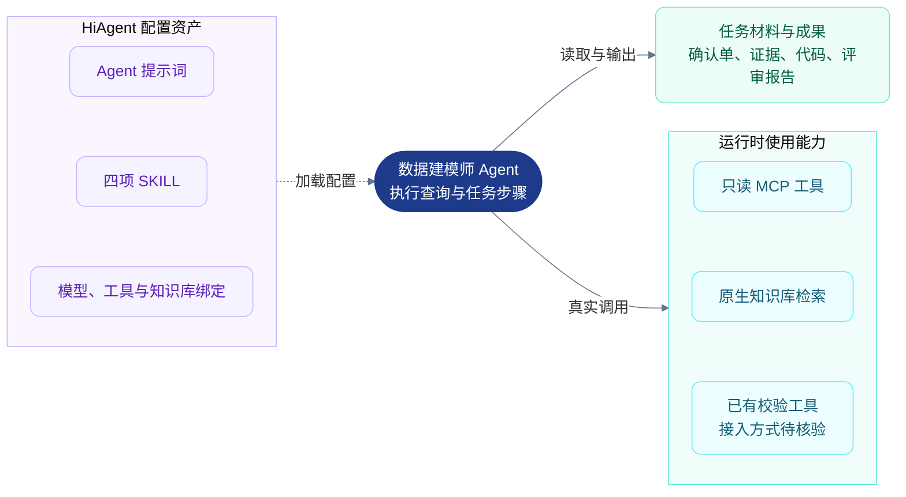
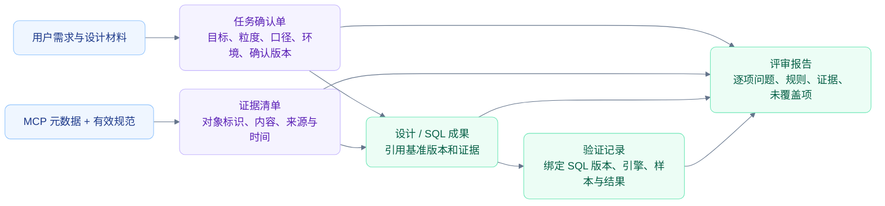
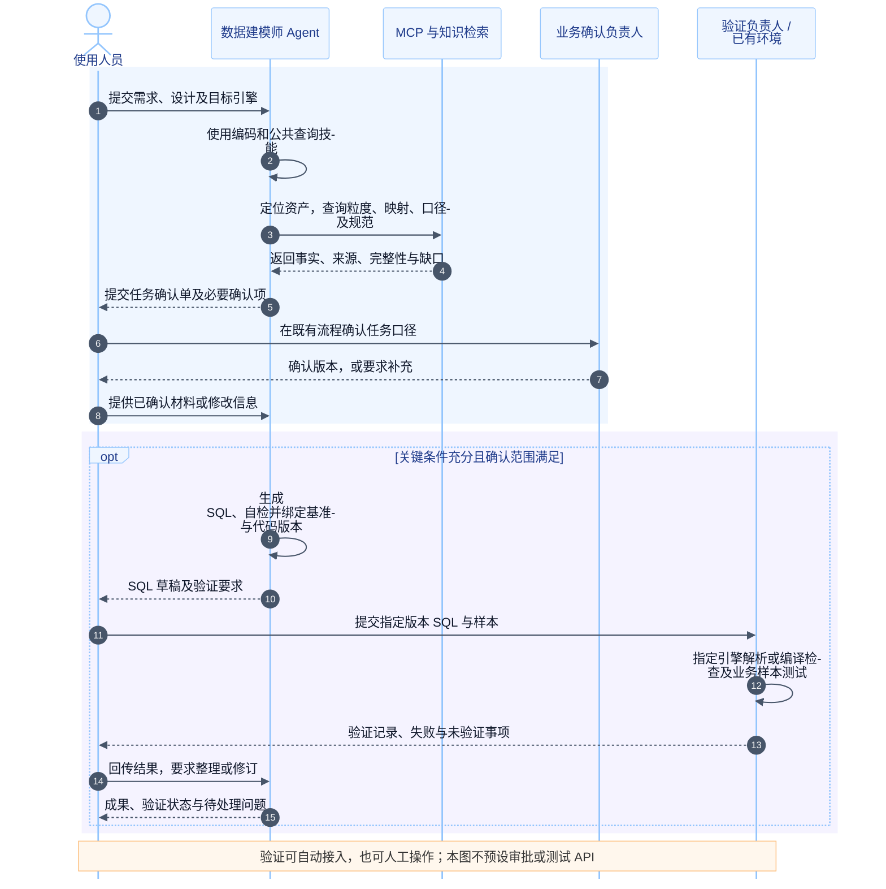
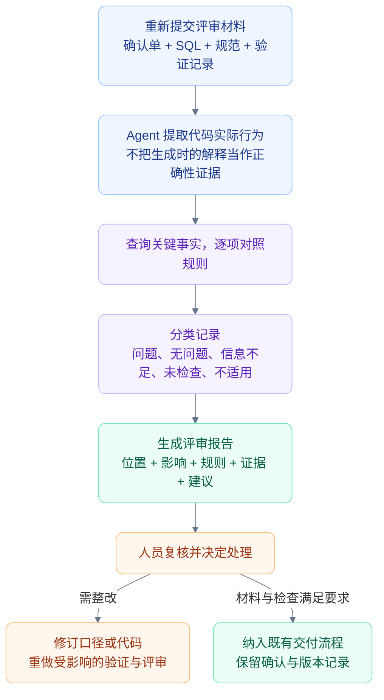
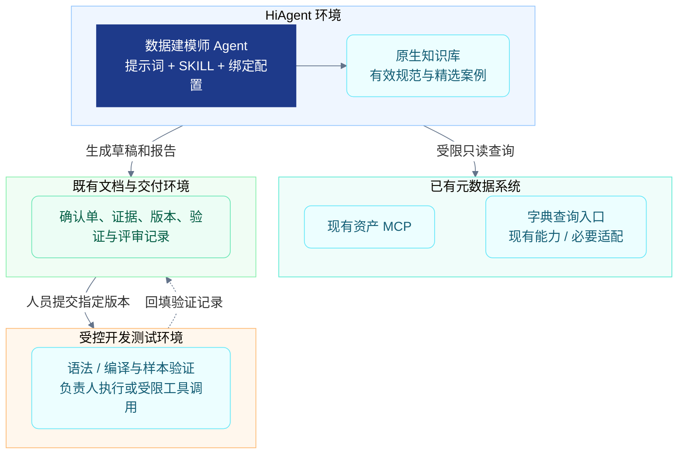

# 数据建模师智能体总体设计

> **文档版本：V2.0 评审稿｜日期：2026-10-08**  
> **面向读者：架构、平台配置、MCP 接入、业务口径、开发测试及验收人员。**  
> 对应[概要设计](数据建模师智能体概要设计.md)。本文定义实施与验证约定，不表示配置已上线或平台能力已实测。原方案保持不变。

## 1. 目标、约束与设计决策

### 1.1 基础约束

- 在 HiAgent 上构建一个“数据建模师”Agent，提供查询、建模与设计评审、SQL 编码、SQL 评审四类能力。
- 接受“部分治理结果准确有效、可通过 MCP 查询”及“资产平台已有表粒度说明”两个前提，不建设治理程序或正式映射写入能力。
- 首期采用一个业务域、一个目标 SQL 引擎和约定范围的批处理 SQL。具体业务域、引擎、SQL 集合边界由阶段 0 确认，不擅自选定。
- 单一入口不等于长期单一会话。设计、编码、评审可以使用同一个 Agent 的不同会话，通过明确材料衔接。
- 人工仍负责口径确认、验证与交付决策。模型输出的“通过”不是生产准入凭证。

### 1.2 关键架构决策

| 决策 | 采用方式 | 调整条件 |
|---|---|---|
| 任务选择 | 提示词说明能力与 SKILL 选择规则，技能描述补充适用条件 | 自动选择不达标时使用显式任务类型或技能引用 |
| 技能协作 | Agent 按已加载说明组织查询和场景步骤 | 不支持组合加载时，将必要公共步骤纳入场景技能，统一维护后发布 |
| 流程承载 | SKILL 定义步骤，确认单与既有流程记录人工确认 | 有必须程序拦截的要求时，再复用工作流或后端校验 |
| 工具接入 | 复用现有 MCP；不足部分才适配 | 无法提供关键查询或结果约定时，明确适配工作量 |
| 验证路径 | 必须指定负责人和验证方法，自动接入按需 | 现有平台具备接口且接入收益明确时封装工具 |
| 状态与证据 | 现有文件、平台附件、调用记录、开发交付系统 | 量级或协作需求超出已有能力时再评估存储服务 |
| 评审入口 | 同一个 Agent，新会话或完整重建输入 | 不依赖新 Agent 来证明评审独立性 |

四层逻辑架构见概要设计；下图说明实际配置和调用，避免把 SKILL 误认为可运行的独立服务。

### 图 1：运行与配置关系——Agent 执行，SKILL 指导

虚线表示配置，实线表示使用能力。图中的绑定、加载、导出等行为都须在目标 HiAgent 版本核验；本图不预设 UI 名称或 API。

## 2. 平台能力核验与接入条件

已有证据仅是用户完成了字典查询试用。下表其他能力初始状态均为“待验证”。核验记录包括平台版本、模型版本、操作输入、调用轨迹、结果和限制。

| 编号 | 验证行为 | 完成条件 | 不满足时的处理 |
|---|---|---|---|
| H01 | 正确选择技能 | 查询、设计、编码、评审样例命中预期技能或实际使用相应说明 | 用户显式选择任务或技能；不把正确答案等同于技能已加载 |
| H02 | 组合使用技能 | 编码任务能获取公共元数据要求并完成后续步骤 | 场景技能包含公共步骤，避免依赖不支持的技能互调 |
| H03 | 技能使用 MCP | 参数、结果和后续回答能在记录中核对 | 检查绑定与工具说明；关键工具不可用时阻塞对应场景 |
| H04 | 缺口补充后继续 | 保存已有事实，补充后重新核验口径，无重复丢失 | 用确认单重建上下文后继续 |
| H05 | 授权与身份 | 可确认实际调用身份，越权案例被服务端拒绝 | 使用经批准的受限服务身份；范围不能等价时不开放对应工具 |
| H06 | 知识检索与来源 | 查询相关规范并识别版本、来源与适用范围 | 使用受控材料附件；规范不足时报告未覆盖检查项 |
| H07 | 执行记录与导出 | 能保留必要调用记录、成果和版本 | 使用既有记录加人工归档；无法追溯关键事实时不承诺可复核交付 |
| H08 | 语法或编译检查 | 指定引擎的验证路径、人员与结果格式确定 | 人员在已有环境验证；无路径时仅限未验证草稿展示 |

阶段 0 输出：核验报告、工具清单、身份范围、支持限制、选定业务域和引擎，以及锁定的验收方法。不能实现的能力进入范围调整，不用提示词描述来掩盖缺失能力。

## 3. 任务确认单与证据衔接

### 3.1 任务确认单字段约定

以下是文档字段约定，不要求创建实体类或数据库表。简单查询只填写适用项；编码和设计必须形成清晰基准。信息状态使用“事实来源已核验、人工已确认、待确认、不适用”，不能仅凭模型推断标记人工已确认。

| 字段 | 业务含义、约束与空值语义 |
|---|---|
| 任务标识 | 复用现有需求或工单编号；临时任务可使用文档编号，只要求本范围内可定位 |
| 任务类型 | 查询、建模设计、设计评审、SQL 编码或 SQL 评审；可包含多个类型 |
| 基准版本 | 当前确认单版本，变更关键口径时递增并保留变更摘要 |
| 业务目标 | 要解决的问题及结果用途；关键目标不明时不得直接正式编码 |
| 业务域与环境 | 资产归属及源环境；用于重名消歧与权限检查 |
| 目标引擎 | 引擎及所需兼容版本；查询场景可不适用，编码不得未知 |
| 输出粒度 | 每行代表什么及预期唯一键；设计和统计编码必须明确 |
| 指标与过滤条件 | 指标定义、状态筛选、退款等处理；记录来源和确认状态 |
| 时间与单位 | 时间字段、区间边界、必要时区、金额单位等；无此维度时标注不适用 |
| 来源资产 | 经消歧的表、字段、指标、字典唯一标识；不只保存展示名 |
| 关联与去重 | 关联键、预期基数、去重对象和策略；无关联场景标注不适用 |
| 目标表与写入语义 | 需要产出写入 SQL 时记录增量或覆盖方式、分区、重跑预期；只读查询标注不适用 |
| 适用规范 | 规范名称、版本、规则标识及适用引擎或业务域 |
| 待确认事项 | 具体缺口、影响哪些成果或步骤、需要谁确认；无缺口时明确填写无 |
| 确认记录 | 负责人、确认时间、确认内容与版本；沿用已有流程凭证 |

确认已有事实不要求用户重复审批每一条平台定义。人工重点确认任务意图、口径选择和平台没有提供的业务条件。

### 3.2 元数据证据清单

| 字段 | 含义与边界 |
|---|---|
| 证据标识 | 在当前任务内唯一，用于成果引用 |
| 对象标识及来源 | 资产、字段、字典、指标或规范的稳定定位信息 |
| 关键内容 | 支撑结论的粒度、编码、公式、条件或规则摘录；避免保存全量无关结果 |
| 查询或检索时间 | 本次获取时间，不等同于源系统更新时间 |
| 源版本或更新时间 | 有则记录，无则标注源未提供；不能虚构版本 |
| 范围与完整性 | 治理覆盖、业务适用范围、分页或截断状态 |
| 调用引用 | 平台提供的调用编号；没有时保存必要参数与结果摘要，不宣称已有自动追踪 |

未提供源版本时，对关键内容保留必要快照与查询时间，可支撑任务复核，但不承诺源平台历史数据可以完整重放。业务授权与敏感内容处理仍遵循既有要求。

### 图 2：材料衔接——确认单是共同基准，证据支撑每项结论

代码修改后重新验证受影响内容；确认单、元数据口径或规范发生关键变化时，记录影响并重新设计、编码或评审，不沿用旧“通过”结论。

### 3.3 任务状态与恢复

状态仅用于成果记录和人工沟通，不承诺平台内已存在相应状态机。建议使用：处理中、待确认、待验证、待评审、已完成、已终止。

- 待确认：记录具体问题；用户补充后继续，已有有效事实可复用，变更相关事实重新查询。
- 待验证：SQL 草稿已生成，指定验证尚未完成，不标记可交付通过。
- 待评审：材料与适用验证结果齐备，等待评审和人工确认。
- 已完成：任务范围内要求完成；查询完成不等于开发交付完成。
- 已终止：用户终止或依赖无法满足，保留原因与已有成果。

长对话出现材料遗漏时，重新提供当前确认单、必要证据和最新代码，不依赖模型记住所有历史消息。新会话继续前检查权限和关键事实是否仍适用。

## 4. Agent 提示词与配置设计

### 4.1 配置清单

| 配置项 | 要求 |
|---|---|
| Agent 名称 | 数据建模师 |
| 模型 | 从平台已有可用模型中选择；用相同测试集比较工具使用和业务结果，不预先承诺具体型号 |
| 提示词 | 角色、能力选择、共同事实约束、确认与成果规则；正文仅维护在 `.st` 文件 |
| SKILL | 四项技能，名称与提示词一致；加载与绑定方式按核验结果确定 |
| MCP | 仅绑定必要只读查询；验证工具按范围和权限接入，不绑定生产写入与发布 |
| 知识库 | 有效开发规范、业务说明与精选案例，记录适用域和版本 |
| 任务入口 | 自动识别为首选；显式“查询 / 设计 / 编码 / 评审”作为备用操作方式 |

可用于平台配置的提示词草案见[模板文件](templates/data-modeler-agent.st)。该模板采用固定技能名，不预设 HiAgent 的模板引擎；实施人员使用平台实际支持的方式导入正文，并统一管理发布版本。

### 4.2 提示词与技能的规则归属

提示词维护所有任务共同遵守的规则；技能维护场景步骤；评审规则清单维护具体业务检查。三处不得分别定义互相冲突的同一口径。

如果公共技能不能按需组合加载，实施人员维护一份公共步骤来源，再将它纳入各场景技能的发布内容。首期可人工同步和检查一致性，不建设模板生成系统。平台实际需要的技能文件格式在核验后决定，本文不预设上传包格式。

## 5. 四项 SKILL 的执行设计

### 5.1 元数据查询与解读

**输入：** 用户问题、资产名称或标识、业务域和环境（已知时）。**输出：** 查询对象、事实解释、证据、完整性和缺口。**边界：** 不正式建立映射，不查询未授权明细数据。

步骤：

1. 判断要查的是资产、字段、字典、指标还是术语；只收集当前问题所需信息。
2. 已有稳定标识时直接详情查询；只有名称时检索候选。
3. 按业务域、环境、表粒度等消歧。唯一候选且依据充分时使用；有多个合理候选时展示差异并请用户选择。
4. 按需查详情及有效映射、口径。处理分页，不把第一页视为全量；无法获取完整结果时说明限制。
5. 解释字典编码、指标公式或资产含义，保留来源，不将名称相似视为等价。
6. 明确未治理、未找到、无权限、失败、冲突和结果不完整等情况。

### 5.2 数据建模与设计评审

**输入：** 需求、可选已有设计、业务域与目标环境。**输出：** 确认单、模型建议或设计评审报告。**边界：** 不承诺没有证据支持的物理性能指标。

步骤：理解目标与输出粒度 → 查询资产、指标及关系 → 补齐关键口径 → 形成或核对确认单 → 提出逻辑结构和必要目标字段建议 → 按规则检查关联、去重、时间、单位、字典与敏感使用 → 输出依据、问题及未覆盖项。

设计新模型和检查已有模型使用相同基准，但输出分别标注“设计建议”或“设计评审”；不得将自己生成的建议自动标成已确认设计。

### 5.3 SQL 编码

**输入：** 确认单、已有设计、目标引擎，可选原 SQL。**输出：** SQL 草稿、依据、自检记录、待验证事项。**边界：** 不自动运行或发布生产作业。

步骤：核对基准版本 → 查询所需元数据 → 检查关联、去重、时间、单位与写入语义 → 查询适用规范 → 生成最小满足需求的 SQL → 按检查清单自检 → 按指定路径提交验证或明确人员待办 → 输出结果及状态。

存在影响正确性的待确认项时，暂停相关代码生成；可输出已确定部分和待补充结构，但不得将带假设 SQL 表述为可交付成果。修改需求或代码后重新检查受影响项。

### 5.4 SQL 评审

**输入：** 确认单、当前 SQL、适用规范、已有验证记录。**输出：** 带位置、依据和建议的问题清单，以及检查覆盖情况。**边界：** 不以无问题输出替代人员批准，不把模型阅读评审等同于实际执行测试。

建议新会话使用同一个 Agent：重新提供评审材料 → 提取代码实际行为 → 独立查询关键事实 → 逐项比对基准和规则 → 引用验证记录但不盲信 → 分类记录问题和缺口 → 提交人工复核。

必须区分“编码自检”和“作业评审”。若没有需求基准，可以进行代码局部检查，但业务符合性标记为信息不足。新会话降低历史解释的影响，不能证明评审完全独立。

## 6. MCP 能力与结果约定

### 6.1 工具边界

以下是逻辑能力约定，不是已经存在的 API 名称或协议字段。优先映射到现有工具，确有不足才补适配。

| 逻辑能力 | 必要输入及限制 | 返回内容 |
|---|---|---|
| 资产检索 | 关键词、业务域、环境、分页条件；避免无范围全量扫描 | 候选标识、名称、类型、域、环境、必要粒度摘要、下一页和完整性 |
| 资产详情 | 经消歧的唯一标识；字段支持按需筛选 | 字段类型、粒度、关键约束、来源版本或时间及明确缺口 |
| 字段字典映射 | 字段唯一标识，适用业务上下文 | 已确认关系、字典标识和编码、范围、来源；未治理明确返回 |
| 指标口径与术语 | 标识或限定业务域的名称；重名先检索 | 定义、公式、过滤、时间、单位及关联资产，缺失部分显式说明 |
| 代码检查（按需接入） | SQL、指定引擎、受限验证环境 | 检查类型、代码版本、引擎、结果和错误位置；不能隐含执行生产 SQL |

字段与字典查询可以组合，也可以分为现有多个工具；不强制为了图中的逻辑能力拆分服务。

### 6.2 通用结果语义

| 内容 | 约束 |
|---|---|
| 结果类别 | 成功、未找到、未治理、歧义或冲突、无权限、暂时失败、不完整；与传输异常分别处理 |
| 业务数据 | 已找到事实；缺失字段明确为空或不存在，不用默认值冒充事实 |
| 来源与对象标识 | 结果可定位到权威来源和具体对象 |
| 范围 | 业务域、环境、治理覆盖与适用条件 |
| 完整性 | 当前页、下一页、结果截断等信息；不知道总数时不虚构总数 |
| 时间与版本 | 源版本或更新时间可缺省，查询时间与其分开记录 |
| 错误或缺口 | 用可读原因说明，不暴露凭据、堆栈敏感信息或未授权资产细节 |
| 调用标识 | 平台可提供时记录，用于诊断；不能作为必要已有能力假定 |

MCP 支持输入 Schema、可选输出 Schema 和结构化工具结果；是否被目标客户端正确处理需核验。存在 Schema 能力时用于约束结果；否则至少返回语义一致、可解析的结构。[MCP 工具规范](https://modelcontextprotocol.io/specification/2025-11-25/server/tools)

### 6.3 查询、异常与预算策略

- 名称检索只用于定位，确认后沿用唯一标识；业务域或环境变更后重新定位。
- 分页与字段详情按任务需要读取，设置调用次数和响应规模上限；达到上限时输出部分覆盖，不声称检索完整。
- 暂时失败的只读查询允许有限重试；无权限、未找到、未治理等业务结果不盲目重试。
- 超时、重试次数、最大调用数、响应规模与任务时长由基线测量后配置并锁定。平台不支持自动预算时，由受控适配与操作流程承接；不宣称已自动强制。
- 多源冲突展示来源和差异，关键结论暂停；源记录缺失不自动用案例或模型记忆替代。
- 首期无自建缓存；平台已有缓存可复用并标注时效，关键版本变化后重新取证。

## 7. 编码与验证时序

### 图 3：编码链路——人工确认与外部验证有明确位置

确认不充分、任务终止或验证失败时，不继续进入通过交付。此图只画主要路径；口径改变需重新查询相关事实，SQL 修改后须重新验证受影响内容。角色可由同一人员兼任，但记录中要明确其承担的责任。

## 8. 评审规则与报告

### 8.1 检查项定义

每项规则记录：规则标识、来源与版本、适用域和引擎、需要的事实、判断条件、严重程度和证据要求。

| 检查项 | 判定依据 | 常见问题 | 信息不足时处理 |
|---|---|---|---|
| 需求符合性 | 确认单的目标和输出粒度 | 输出维度错误、漏统计对象 | 无确认单则无法评估业务符合性 |
| 字段与字典 | 有效映射及编码定义 | 使用错误状态编码 | 没有有效映射则暂停相关判断 |
| 关联基数 | 表粒度、键约束或明确关系 | 多对多放大、连接遗漏 | 粒度说明不等于唯一性证明；缺约束时标注风险待确认 |
| 指标与去重 | 指标定义、过滤、去重对象 | 退款漏排、计数对象错误 | 指标条件缺失则无法判断对应项 |
| 时间与单位 | 时间字段、边界、时区、单位 | 时间口径或金额单位错误 | 依赖条件缺失时不得自行假定 |
| 空值与边界 | 已有业务约定和引擎语义 | 空值丢失、分母为零 | 业务含义不明时请求确认 |
| 写入与重跑 | 已确认的目标分区、写入语义 | 重跑重复写入、覆盖范围错误 | 只读任务不适用；写入任务缺失则阻塞交付 |
| 开发规范 | 有效规则及适用范围 | 不符合约定命名、过滤或结构 | 未检索到规则标记未覆盖，不能认定合规 |
| 敏感字段 | 资产敏感级别和授权使用规则 | 使用超出约定范围 | 无依据则无法判断，不能推定字段不敏感 |
| 引擎兼容 | 目标引擎检查记录 | 函数或语法不兼容 | 没有外部检查时标明仅模型判断 |
| 性能建议 | 分区、计划或已有统计资料 | 可证实的全扫或关联风险 | 无计划与规模证据时只作建议，不承诺性能结论 |

### 8.2 结果分类与严重程度

结果分类：已发现问题、在已检查范围内未发现问题、信息不足无法判断、本次未检查、不适用。每项均有覆盖记录，“无问题列表”不代表全项通过。

严重程度按业务影响分为：阻塞项（口径或权限等关键错误，不能继续交付）、重要项（影响结果或关键质量，交付前修复）、一般项（规范或维护性问题）、建议项（证据支持的可选改进）。缺口不强行标成已证实代码错误。

### 8.3 报告结构

报告包含：任务与基准版本、代码版本、材料与检查范围、总体结论、逐项问题、验证引用、无法判断项、未检查项、修改建议和人工复核记录。问题位置使用当前代码行号或 SQL 片段定位；证据必须引用已取得内容。

### 图 4：评审过程——重新对照基准，输出覆盖与证据

发现设计或需求问题时修订确认单，再恢复下游工作。评审采用同一 Agent 新会话或完整重建输入，仍保留人员最终责任。

## 9. SQL 验证设计

### 9.1 验证分级与交付要求

| 验证层次 | 执行方式 | 能说明什么 | 交付规则 |
|---|---|---|---|
| 模型自检 | Agent 按清单检查 | 发现潜在逻辑问题，不是执行证明 | 所有编码草稿记录 |
| 语法或编译 | 验证负责人在指定引擎或已有等价检查环境执行 | 在已记录环境通过对应检查，不保证业务正确 | 编码场景正式试点必须确定并完成适用检查 |
| 业务样本 | 受控测试环境与预先确认的预期结果 | 在覆盖的样本中满足业务要求 | 核心统计编码用例必须验证 |
| 人工评审 | 负责人查看基准、证据、SQL 与验证结果 | 决定是否接受成果 | 进入既有交付流程前完成 |

验证责任必选，MCP 自动化接入可选。生产执行不因测试路径可用而自动授权。无法验证时保持“待验证草稿”，不能计入编码交付通过案例。

### 9.2 最小业务样本设计

按任务选取正常记录、重复关联、退款或撤销、空值、区间边界、无匹配关联等样本。预期结果由业务与开发测试人员事先确认，不由待测 Agent 单独生成。

例如，测试“净支付金额”时，可使用以下**假设样例，不代表现有资产定义**：已确认净额等于成功支付减成功退款。成功支付 100 元、成功退款 10 元，另有失败支付 50 元不计入；关联维表故意配置两条候选记录。预期净额为 90 元，若计算为 180 元则暴露关联放大。确认单还必须明确如何选取有效维表记录，否则该关联设计本身存在缺口。

结果比较以业务结果和列语义为准，不要求 SQL 文本相同。不要求排序的结果忽略行顺序；金额精度和允许误差由业务规则明确；核对分组行数、金额和去重结果。样本测试通过不证明全量数据质量或生产性能。

### 9.3 验证记录

记录 SQL 版本或内容摘要、基准版本、引擎版本、执行环境、样本版本、预期与实际结果、检查类别、执行人和时间。不同 SQL 或基准版本的验证记录不得混用。失败结果反馈给 Agent 时保留必要错误信息，脱敏后再传入。

## 10. 权限、资料可信边界与日志

### 10.1 身份与权限

- 明确实际调用是用户身份还是服务身份；用户授权范围由服务端判断，不能靠 Agent 提供的文字或自行填写用户标识来证明。
- 服务身份采用已批准的最小只读范围；它不能自动代表每个用户原有权限。不能区分用户权限时，限制可用用户群和资产范围，或不开放相关功能。
- 元数据查看权限不等于业务明细查询、测试数据访问或生产执行权限。验证环境另行授权。
- HiAgent、模型环境可接收的数据分类、部署和留存要求在接入前确认，优先复用已批准环境。

### 10.2 非可信资料的处理

资产备注、检索文档、用户代码及代码注释是资料，不得覆盖系统规则、要求扩大权限或伪造评审通过。提示词和技能同时说明这一边界；服务端授权、只读工具清单与执行环境限制承担实际防护，不将提示词视为完整安全措施。

验收包含恶意注释、文档内“忽略规则”指令、越权资产请求等案例。出现泄露、越权或伪造通过时停止对应试点能力，修复后回归。

### 10.3 日志与证据

优先复用 HiAgent 与 MCP 已有日志，关键事件使用清晰中文业务语义：任务识别、技能使用、资产定位、口径确认、查询失败、代码生成、验证反馈、评审交付。

记录必要任务标识、工具名称、耗时、结果类别和版本引用；不直接记录凭据、完整敏感样本或全量无关查询结果。日志用于诊断，证据用于业务复核，两者可关联但职责不同。留存期限与查看权限遵循现有规范，接入前确认。

## 11. 部署、配置版本与运行维护

### 11.1 部署边界

HiAgent 承载 Agent、技能和绑定配置；资产平台与字典继续在原系统运行。若需要适配，作为受限工具能力部署在现有服务环境，只处理协议与结果投影，不新增治理程序。受控验证沿用开发测试环境。

### 图 5：部署边界——复用系统，按需适配，验证独立受控

生产调度与发布仍在既有平台。图中提交与回填可以人工完成，不表示已有系统间自动同步接口。

### 11.2 最小发布与回退

发布清单记录模型与参数、提示词版本、四项技能版本、工具名称和 Schema 版本、知识库或规范版本、权限、运行预算、通过的回归报告。

变更顺序：保存上一版 → 修改配置或必要适配 → 用固定样本回归 → 负责人确认 → 发布试点 → 观察关键指标。失败时恢复上一份已通过配置；平台不支持原生版本恢复时使用受控导出或归档配置重建。没有导出能力时，实施前确认可人工完整备份的配置项。

模型、工具或规范变化都可能影响结果，不能只对 SKILL 变更做回归。首期不引入专用发布平台，使用已有配置与版本管理方式。

### 11.3 运维处理

监测失败率、耗时、工具调用量、缺口比例、技能选择错误和人工修改量。接口不可用时停止依赖步骤并给出失败原因，不继续凭记忆答复事实。恢复后按当前基准继续，必要时重新取证。

源元数据关键变化、预算超限或明显质量退化时，由责任人评估暂停对应场景、调整配置或回退。具体阈值阶段 0 后按基线锁定；不预先虚构 SLA 或规模容量。

## 12. 试点评估与验收设计

### 12.1 样本与方法

阶段 0 由业务、开发测试和验收负责人确认范围与预期结果。建议初始验收集 40 个案例：查询 10、设计及设计评审 8、编码 10、SQL 评审 8、异常恢复 4；数量为建议，实际在启动时锁定。权限与资料指令干扰案例另外列为必测项，不用平均分掩盖安全问题。

调试案例与验收案例分离。验收前冻结样本、参考答案、规则、配置版本和评估方式；重复运行次数、随机性设置与结果统计方法提前记录，不能只选最好的一次。参考答案采用业务语义和结果，不强求唯一设计或唯一 SQL 文本。

### 12.2 评分与指标定义

| 指标 | 计算或评估方式 | 避免的误判 |
|---|---|---|
| 技能与工具使用正确性 | 核对轨迹与任务要求；平台无法观测加载时标为证据不足 | 回答正确不自动证明技能加载正确 |
| 查询事实正确率 | 正确事实项 / 应回答事实项；关键资产和口径错误单独列出 | 流畅解释不等于正确 |
| 编码业务通过率 | 必要引擎检查与业务样本均通过的案例 / 可验收编码案例 | 未验证草稿不得计为通过 |
| 评审问题检出率 | 检出的预设真实问题 / 预设真实问题 | 没发现问题不等于无问题 |
| 评审问题准确率 | 人工确认的真实问题 / 所有报出的问题 | 泛化风险提醒不当作已证实问题 |
| 缺口处理正确率 | 正确识别并按约定处理的缺口案例 / 缺口案例 | 不能靠大量无必要追问得分 |
| 可追溯性 | 成果关联到基准、代码版本、事实和验证记录的完整性 | 泛泛写来源名称不等于可定位 |
| 人工效率 | 同等任务质量下，人工总用时对比；包含确认、修改与验证时间 | 不只统计模型生成时间 |
| 时延和成本 | 记录任务耗时、调用次数、平台可提供的模型成本；不可得项说明 | 不将不可得成本写成零 |

比例目标和时延、成本上限在基线测量后、正式验收前由负责人锁定。文档不宣称已有数值达标。

### 12.3 硬性不通过条件

必测案例中出现越权或敏感泄露、伪造来源或验证通过、未经授权执行写入、待确认口径被标为人工已确认等情况，整改并回归后才能通过，不以总体平均分抵消。该要求约束验收结果，不承诺提示词能保证永不出错。

### 12.4 阶段完成条件

| 阶段 | 必须形成的成果 | 放行条件 |
|---|---|---|
| 0：范围与核验 | 能力核验、业务域与引擎、身份范围、样本方法、验证负责人 | 关键依赖可用，备用路径明确，负责人确认 |
| 1：公共查询 | 查询技能、工具约定、证据模板及查询测试记录 | 资产定位、映射解读、分页与缺口处理达到锁定标准 |
| 2：设计与编码 | 确认单、设计及编码技能、验证路径与样本记录 | 选定场景可完成设计和有验证依据的代码交付 |
| 3：评审与验收 | 检查表、评审技能、盲测与人工复核报告、回退说明 | 指标达标，硬性失败项已消除，负责人批准扩大使用 |

## 13. 职责分工与待确认事项

| 角色 | 主要责任 | 核心交付物 |
|---|---|---|
| 项目负责人 | 范围、资源、验收目标与扩展决策 | 决策记录 |
| 业务口径负责人 | 需求与口径选择、样本预期、缺口确认 | 确认单和参考结果 |
| HiAgent 配置负责人 | 平台核验、提示词与技能配置、绑定、回归和版本恢复 | 配置清单与核验记录 |
| MCP 接入负责人 | 工具映射、权限、结果投影、失败与分页处理 | 接口能力表与联调记录 |
| 开发测试负责人 | 指定引擎验证、样本测试、代码修改与验证记录 | 检查与测试结果 |
| 评审与验收负责人 | 规则、预设问题、盲测、问题复核和验收 | 评审检查表及验收报告 |
| 平台及安全负责人 | 接入环境、身份、信息分类、日志与留存边界 | 授权与配置确认 |

角色可兼任，职责不能缺失。启动前必须确认：业务域与引擎、目标平台版本、支持 SQL 范围、工具身份、敏感数据边界、验证环境和负责人、验收样本与方法。运行阈值及比例目标在测量基线后锁定。

## 14. 架构评审问题落实对照

| 评审问题 | 本设计落实位置 |
|---|---|
| 平台技能行为未证实 | 第 2 节：H01—H08 核验及备用路径 |
| 能力与交付边界过宽 | 第 1 节及概要设计第 3 节：单域、单引擎、SQL 辅助交付 |
| 业务信息散落在对话 | 第 3 节：确认单、证据、版本衔接与恢复 |
| 工具只有名称缺少查询策略 | 第 5.1、6 节：检索消歧、标识、分页、结果与预算 |
| 验证全部可选 | 第 9 节：责任和必要验证明确，自动接入可选 |
| 自检与评审混同 | 第 5.4、8 节：重新对照基准，区分检查性质 |
| 审计缺规则与覆盖状态 | 第 8 节：规则清单、分类、问题证据 |
| 权限、资料可信与版本只有原则 | 第 10、11 节：执行边界、必测案例、最小发布回退 |
| 验收后置且缺评价方法 | 第 12 节：样本冻结、指标定义与阶段条件 |

## 15. 参考与适用边界

- [MCP 工具规范](https://modelcontextprotocol.io/specification/2025-11-25/server/tools)：用于参考工具描述、Schema、结构化返回等协议能力，不代表现有服务器已全部支持。
- [火山引擎 AgentKit 技能概述](https://docs.volcengine.com/docs/agentkit/SkillsOverview?lang=zh)：用于参考技能封装思想，属于 AgentKit 文档，不作为 HiAgent 操作能力证明。

HiAgent 实际能力以目标环境核验为准。上述设计不引入新的治理系统、多智能体、任务中心或生产执行能力。
