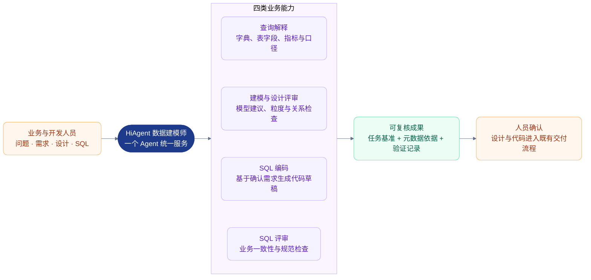
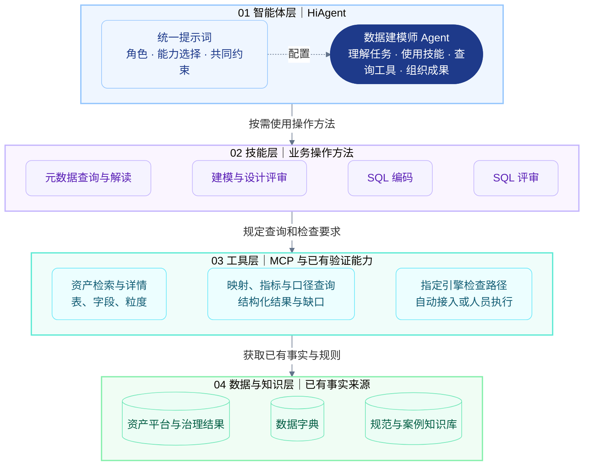
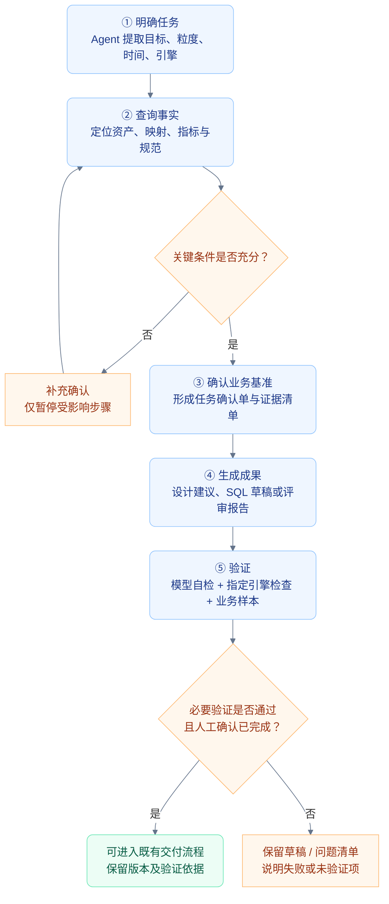

# 数据建模师智能体概要设计

> **文档版本：V2.0 评审稿｜日期：2026-10-08**  
> **面向读者：项目负责人、业务负责人、平台负责人。**  
> 本文是根据架构评审意见重新编写的新方案；原概要设计及其预览文件保留不变。实现约定见[总体设计](数据建模师智能体总体设计.md)。

## 1. 决策摘要

建议在 HiAgent 上构建一个“数据建模师”Agent，绑定四项 SKILL、必要的只读 MCP 工具与规范知识库，支持元数据查询、建模与设计评审、SQL 编码、SQL 评审。

建设重点是形成**任务确认 → 事实查询 → 成果生成 → 验证 → 人工确认**的可追溯链路。首期采用一个业务域、一个明确的 SQL 引擎开展辅助工作试点，不承诺自动完成生产作业。

本次申请确认试点建设方向和资源协作。业务域、目标引擎与验收样本须在试点启动前确定；HiAgent 技能组合行为须通过验证后才能作为正式能力承诺。

### 图 1：业务全景——一个入口，四类能力，三类依据

三类依据分别是确认后的任务要求、已有可信元数据、有效开发与评审规范。简单查询直接交付解释结果，不必经过代码发布流程。

## 2. 前提、现状与待验证项

| 类别 | 内容 | 本项目处理方式 |
|---|---|---|
| 已有试用经验 | 用户已在 HiAgent 通过数据库与 SKILL 实现数据字典查询，效果较好 | 作为起点，复用可用配置；不等同于多技能全过程已验证 |
| 设计前提 | 部分资产治理准确有效，字段字典映射可通过 MCP 获取 | 直接消费结果，不建设治理程序 |
| 设计前提 | 资产平台提供表粒度说明 | 查询并作为设计与评审依据 |
| 未作假设 | 所有关联关系、指标过滤条件、时间语义和单位都完整 | 缺失时补充确认，不自行补造 |
| 待验证能力 | 技能选择、组合使用、多轮恢复、工具授权、执行记录与导出 | 在目标 HiAgent 版本进行验证，保留证据 |

不将其他产品的 SKILL 能力直接认定为 HiAgent 已具备。支持方式按实测确定：自动选择优先；选择不稳定时，允许用户显式指定任务类型或技能。组合加载不支持时，在同一 Agent 的场景技能中包含必要公共查询步骤，统一维护后发布，不新增路由系统。

## 3. 首期范围与交付物

### 3.1 推荐首期范围

| 场景 | 首期支持 | 明确交付物与边界 |
|---|---|---|
| 元数据查询 | 已授权、已有元数据的资产检索与解释 | 资产标识、定义、字典编码、口径、来源与缺口 |
| 建模与设计评审 | 单业务域内的逻辑模型、目标表结构建议及设计评审 | 表粒度、字段、关联条件、指标口径；物理优化只作有依据的建议 |
| SQL 编码 | 一个已确认引擎下、约定范围的批处理统计 SQL | SQL 草稿、任务确认单、证据、验证状态；DDL 仅在明确要求时输出草稿 |
| SQL 评审 | 单 SQL 或约定的关联 SQL 集合 | 问题位置、规则、证据、影响、修改建议；先限定可读取的材料范围 |

调度配置、全作业依赖分析、流式作业、自动重跑、生产执行与发布不列为首期承诺。若试点案例依赖这些能力，需明确增加范围和验收条件。

“审计检查”首期仅指按已提供规则检查字典、指标、粒度、敏感字段使用和开发规范；不代表正式合规认证。没有敏感级别或使用规则依据时，必须标注无法判断。

### 3.2 首期交付清单

- 一个已配置的数据建模师 Agent，以及版本化的提示词、四项 SKILL、工具和知识库绑定清单。
- 一份任务确认单模板、一份元数据证据清单、一份评审检查表和统一成果模板。
- 现有 MCP 能力核验记录；仅对不足部分增加必要适配，既有数据库查询可作为经确认的过渡入口。
- 语法或编译检查路径、业务样本验证方法及明确执行负责人。
- 平台能力验证报告、试点评估报告、权限配置和最小版本回退说明。

这些成果以现有文档、平台配置及开发流程承载，首期不新建任务数据库或审批系统。

## 4. 分层架构与职责

### 图 2：四层架构——配置方法，复用工具，引用事实

图表示职责依赖，不表示四套部署服务。SKILL 是方法说明，实际工具调用由 Agent 执行；知识库可直接绑定 HiAgent。验证路径既可以是已有工具，也可以是人员在现有开发环境操作，不强制改造成 MCP。

| 配置项 | 负责什么 | 不承担什么 |
|---|---|---|
| Agent 提示词 | 角色、技能选择、共同约束 | 不重复写全部操作步骤，不替代授权 |
| SKILL | 各任务的前置条件、步骤、工具使用与输出 | 不建立正式治理关系，不保证程序强制执行 |
| MCP | 查询事实，规范结果，执行服务端权限检查 | 不替用户确认缺失口径 |
| 任务确认单 | 统一设计、编码、评审的业务基准 | 不把模型推断自动变成人工确认 |
| 既有验证与交付流程 | 编译、样本测试、人工评审、发布 | 不以模型自检代替测试 |

## 5. 核心闭环与成果衔接

### 图 3：交付闭环——先明确基准，再生成和验证

本图面向设计与编码交付；编译和业务样本验证仅适用于需要验证的 SQL，设计成果按适用规则与人员审查验证。纯查询不要求编译或业务测试，直接交付查询结果与来源。人工确认是既有流程中的记录，不意味着本项目已建设自动审批门禁。

任务确认单至少记录：目标、输出粒度、指标与过滤条件、来源资产、关联与去重、时间和单位、目标引擎、待确认项及确认版本。关键口径变化后，旧设计、SQL 和评审结果须重新检查。

编码自检与作业评审分别标注。评审仍可使用同一个 Agent，但以确认单、代码和规范重新开始审查；优先新会话传入完整材料，避免把此前解释当作正确性证明。

## 6. 风险控制与运行原则

| 风险 | 控制措施 | 责任方 |
|---|---|---|
| 平台行为未验证 | 先验证目标版本，保留自动选择与显式选择两种路径 | HiAgent 配置负责人 |
| 业务条件缺失 | 确认单记录缺口；不生成依赖未知条件的正式结论 | 业务负责人、使用人员 |
| 资产检索不完整 | 先候选、再消歧、再详情，区分分页与完整结果 | MCP 接入负责人 |
| 代码验证不足 | 验证责任必选，自动接入可选；未验证明确标注 | 开发与测试负责人 |
| 评审漏报或误报 | 使用明确规则、证据和结果分类，人工复核 | 评审负责人 |
| 权限与信息暴露 | 限定工具与身份，默认不绑定写入和生产执行能力，日志脱敏 | 平台及安全负责人 |
| 材料中的指令干扰 | 资产备注、文档、代码注释仅作资料，不覆盖系统规则；权限仍在服务端控制 | 配置与平台负责人 |
| 版本变更导致效果退化 | 记录模型、提示词、技能、工具和规范版本，回归后发布，失败回退 | 配置负责人 |

首期不新增缓存平台、任务中心或多智能体。只读查询设置超时、有限重试与调用预算；具体值通过平台能力核验与基线测量确定。

## 7. 分阶段实施与验收

### 图 4：试点路径——每阶段都有完成条件

验收样本、评分方法、负责人在阶段 0 确定，调试样本与验收样本分离。评估查询正确性、SQL 业务结果、问题检出与误报、缺口处理、来源可追溯性，以及人工时间、响应时延和成本。

硬性要求：验收集中不能出现无权限访问、把失败或未执行检查标为通过、把待确认口径标为已确认等问题。比例指标与成本、时延目标测量基线后锁定，正式验收前不根据结果临时下调。

## 8. 负责人需要确认的事项

| 决策 | 推荐方案 | 确认时间 |
|---|---|---|
| 是否开展试点 | 一个 Agent、四项技能、复用现有事实与工具 | 本次评审 |
| 首期交付边界 | 单业务域、单引擎、设计建议与 SQL 辅助交付 | 阶段 0 前 |
| 业务域和目标引擎 | 选择资料较完整、可提供测试样本的真实场景 | 阶段 0 |
| 人员与验证责任 | 业务口径、平台配置、MCP 接入、开发测试、验收职责明确 | 阶段 0 |
| 接入与安全边界 | 模型可接收的数据范围、身份和权限、日志要求 | 接入前 |
| 验收与扩展 | 先锁定样本和方法，达标后扩展 | 阶段 0 / 阶段 3 |

**结论：建议有条件批准试点。条件是先完成平台核验、范围确认、验证责任与验收方法确认，再进入场景配置。**
