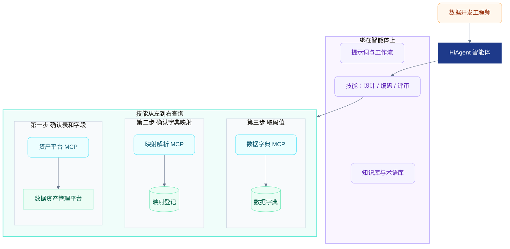

# 数据治理消费与技能 MCP 分层

> **文档版本：V1.0｜日期：2026-10-15**  
> **面向读者：架构、HiAgent 配置、MCP 接入。**  
> 本文记录“在数据资产管理平台之上做一层治理，并用技能层 + MCP 层支撑数据作业”这一想法的架构判断。实现约定仍以[数据建模师智能体总体设计](数据建模师智能体总体设计.md)和[概要设计](数据建模师智能体概要设计.md)为准。

## 1. 结论

这个方向可以实现，并与本项目已定分工一致：HiAgent 负责智能体、技能、知识库和提示词；动态元数据走 MCP；码值事实走结构化查询。

需要守住三件事：

1. 字段和字典类型的对应关系，使用已经确认的治理结果，经 MCP 读取。智能体运行时不临时“理解”出一条正式映射。
2. 表字段、指标、业务术语是三种对象，分开查询。
3. 映射未确认时，相关码值判断停止，并返回明确状态。不补一个看起来合理的码值。

对照现行评审稿：首期接受“部分治理结果准确有效、可通过 MCP 查询”，不在本项目中建设治理程序或正式映射写入能力。下图里的“映射登记”是已有治理结果的存放位置，不是新建的一套治理平台。

## 2. 各层各管什么

上层是绑在智能体上的材料，下层从左到右是一次查询顺序。每列只有一条竖线。提示词和知识库参与约束与解释，不往下查实时数据。

| 层 | 保存什么 | 适合放什么 |
| --- | --- | --- |
| 数据资产管理平台 | 表、字段、指标、血缘的权威定义 | 实时元数据，只读 |
| 数据字典 | 字典类型、码值、名称、别名、有效期 | 已经验证过的精确码值 |
| 映射登记 | 已确认的“资产字段标识 → 字典类型”及状态、责任人、生效时间 | 已有治理结果，经 MCP 读取 |
| MCP | 按标识查询上述事实，并返回结构化状态 | 原子、只读、可重复调用 |
| 技能 | 设计、编码、评审时先查映射、再查字典，缺映射就停 | 步骤、门槛、输出格式 |
| 知识库 / 术语库 | 规范、方案、业务术语解释 | 稳定文档，不放实时字段和码值 |
| 提示词 | 身份、边界、必须引用工具结果 | 不承载映射规则 |

技能描述“怎么做完一件数据作业”。MCP 返回“这个字段当前对应哪个字典、这个码值是什么”。提示词不代替这两层。

## 3. 需要守住的边界

### 3.1 映射是已确认的治理结果

字段和字典类型的对应关系目前并不完整。每次生成 SQL 时由技能按名字猜一次，前后结果会不一致，也无法审计是谁确认的。

读取映射时至少要能看到：

- 资产平台里的稳定字段标识，以及来源系统、库、表、字段。不用同名字段硬串。
- 字典类型编码。
- 状态：`MAPPED`、`UNMAPPED`、`AMBIGUOUS`、`CONFLICT`。
- 确认方式、责任人、版本、生效时间。

模型可以提出“这个字段可能是证件类型”作为待确认候选。生成 SQL 和做评审时，只使用已经确认的映射。候选确认仍由原治理责任方处理，不在本项目里写入正式映射。

### 3.2 资产平台数据留在原系统

数据字典适合放在可精确查询的库里，是因为它要精确匹配、保留 `01` 这类前导零，而且变更相对慢。表结构、字段口径、指标定义变化快，资产平台才是源头。

HiAgent 的数据库能力继续服务已经落地的字典查询。资产平台仍通过 MCP 访问。知识库继续放规范、历史方案和术语解释。字段清单切进知识库后，过期片段会被当成当前表结构。

### 3.3 字段映射、指标、业务术语分开

- 字段到字典类型：结构映射，走映射解析，再走字典查询。
- 指标：口径、粒度、维度、过滤条件和版本，走指标查询。指标里用到的状态字段，再回到字段映射。
- 业务术语：术语库。术语解释“首购是什么”，不代替字段落在哪张表。

三类对象合成一个“数据治理 MCP”后，工具边界会变糊，智能体选错工具的概率会上升。资产平台适配保持薄：原样返回平台上的表、字段、指标。映射解析单独返回字典类型和状态。字典查询继续沿用现有精确查询能力。

### 3.4 映射未完成时停止相关码值判断

过滤条件、枚举翻译、码值比较依赖字典时：

| 状态 | 后续动作 |
| --- | --- |
| `MAPPED` | 再查字典。只有精确命中的码值能写进 SQL |
| `UNMAPPED` | 设计评审列为待确认项，SQL 标注口径未确认 |
| `AMBIGUOUS` 或 `CONFLICT` | 列出候选，等人选择 |

没有这条门槛时，映射引用越多，错误码值越像“有元数据支撑”。

## 4. 与现有数据字典的衔接

数据字典查询保持精确、可审计。HiAgent 上“数据库 + 技能”已经跑通，说明这条路对码值有效。后续回答码值时，仍以字典查询结果为准，避免数据库查询和 MCP 各写一套口径。

一次数据作业里的调用顺序：

1. 用资产平台 MCP 确认表和字段是否存在、粒度是什么。
2. 用映射解析查看该字段有没有已确认的字典类型。
3. 有映射时，用字典查询取码值和名称。
4. 技能按这个结果写设计、SQL 或评审意见，并带上状态和来源。

映射没确认时，停在第 2 步。

## 5. 落地顺序

先做一条能挡住错误码值的闭环，再铺开整组场景。

1. 资产平台只读 MCP：按稳定标识查表和字段，原样返回。
2. 映射解析：返回映射状态；查不到就是 `UNMAPPED`。
3. 一个技能先接上，优先是 SQL 开发或设计评审：缺映射就输出待确认，不生成确定码值。
4. 由原治理责任方补齐高风险字段，例如状态、类型、标志类字段。
5. 再接指标查询、术语库，以及需求评审、代码评审技能。

一个 HiAgent 应用可以同时绑定技能、MCP、数据库、知识库和提示词。工具变多后，按场景拆开绑定：设计评审、编码、代码评审共用同一组 MCP，各自只挂完成该场景所需的技能。
