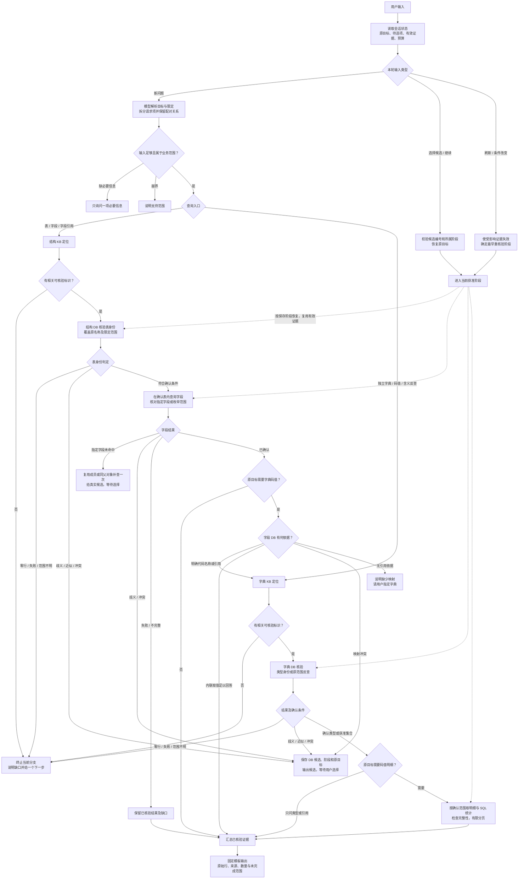
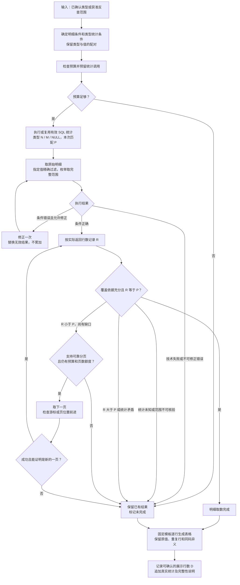
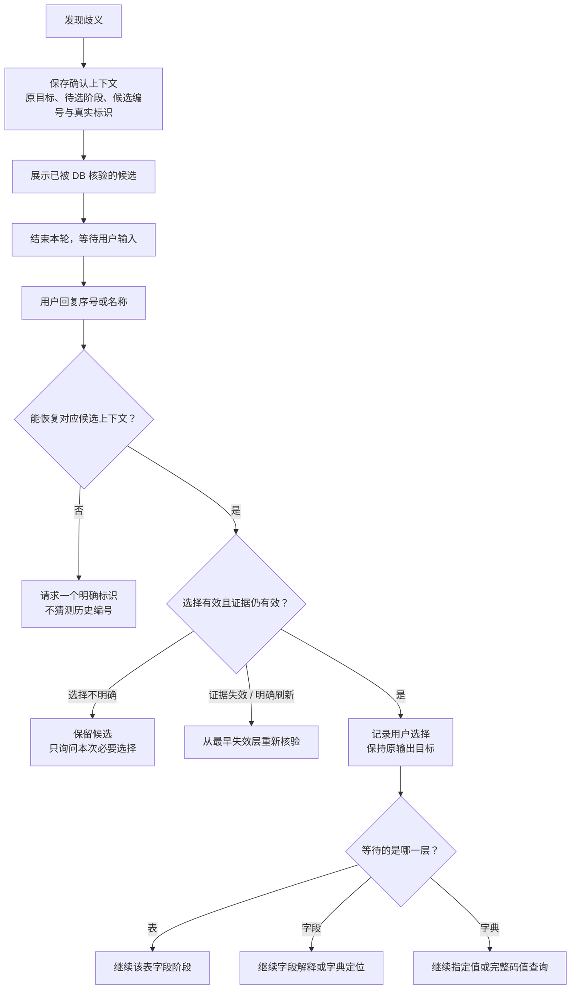

# HiAgent：V8 与工作流方案对比及实现设计

日期：2026-10-15。

本文是独立的方案分析与设计文档，不是部署文件，不修改或替代 V8 主提示词和四个 SKILL。

分析依据：[V8 README](skills/versions/v8/README.md)、[V8 主提示词](skills/versions/v8/agent-prompt/数据建模师.md)、V8 四个 SKILL，以及 [HiAgent 运行说明](../agent-prompt/HiAgent运行说明.md)。本文仅讨论这套独立运行在 HiAgent 的数据资产问答助手，不从仓库 Java 代码推断平台行为。

## 1. 建议与适用边界

建议采用“工作流控制执行，模型负责理解和语义定位”的方案。保留 V8 已明确的 KB 发现 → DB 核验 → 确认范围 → 精准取数 → 分层回答，把确认门槛、预算、停止、完整性检查和原始表格输出从提示词约束转为可执行规则。

V8 的业务规则已经比较完整，主要风险是执行仍依赖模型遵守提示词。工作流更适合解决反复查询、自动选择近似对象、码值被分类整理及统计口径混淆等问题，但不能自行修复知识库漏召回、数据库工具强制限行或界面截断。

本文节点名称表示职责，不代表当前 HiAgent 版本中的实际组件名称。公开的[对接文档](https://docs.volcengine.com/docs/DataAgentPrivate/ConnectwithHiAgent?lang=zh)提供知识调用的集成背景，不能证明内网版本支持参数化 SQL、跨轮状态持久化、暂停恢复或表格直出。这些能力需要在实际部署环境核对；不能将其他产品的节点能力直接视为 HiAgent 能力。

不建议只把四个 SKILL 分别包成模型节点，再让总控模型自由选择调用。这样只是换了形式，关键约束依然依赖模型。

## 2. 两种方案的优缺点

| 方面 | 当前 V8：主提示词＋四个 SKILL | 工作流方案 |
| --- | --- | --- |
| 执行顺序 | 模型决定何时调用哪个 SKILL | 显式连线约束 KB→DB，父对象确认后才能进入下游 |
| 歧义处理 | 依赖模型记住唯一近似项也要确认 | 判断节点拦截，未确认不能取下游数据 |
| 循环与预算 | 提示词要求记账和停止，可能不遵守 | 调用前检查变量，可限制流程自身发起的调用 |
| 查询准确性 | 依赖模型理解、生成查询和解释结果 | 可以检查查询合同、范围和结果，但仍有召回及 NL2SQL 风险 |
| 原始码值展示 | 模型容易分类、合并、改写或漏行 | 原始行直接进入固定模板，减少生成环节改动数据 |
| 数量统计 | 模型安排统计并区分 N/M/P/R/D | 固定统计及校验节点，口径更明确 |
| 多轮选择 | 依赖聊天历史恢复候选与原目标 | 保存候选映射、阶段和原目标；依赖可靠状态能力 |
| 速度 | 调度灵活，但可能重复推理与调用 | 可减少无效调度；节点过多或每节点都调用模型也可能更慢 |
| 灵活性 | 临时组合问题适配方便 | 预定义路径之外的问题需要澄清或扩展 |
| 维护 | 修改文字方便，实际行为不易验证 | 初期搭建成本更高，阶段故障更容易定位 |
| 平台依赖 | 主要依赖模型与工具绑定 | 额外依赖变量、分支、结果传递、状态和输出能力 |

工作流的确定性只能覆盖实际受控的部分。例如工作流可以限制自己调用数据库节点的次数，但工具内部不可见的重试仍然未知；将 NL2SQL 接入流程也不意味着 SQL 已变成确定性查询。

## 3. 模型和工作流的职责

| 模型负责 | 工作流规则负责 |
| --- | --- |
| 理解用户查询表、字段、字典还是码值 | 决定当前允许进入哪个阶段 |
| 提取名称、用途、限定与成组关系 | 检查父对象确认、证据有效性与预算 |
| 从知识库片段提取候选标识 | 管理候选编号与用户选择 |
| 根据已核验描述生成必要解释 | 管理补查、修正、分页和停止 |
| 生成友好的缺口说明 | 计算完整性、输出原始表格与统计页脚 |

模型解析结果仍是待校验输入，不能直接成为资产事实。原始行、计数、范围和确认依据应结构化传递，不能只保留模型总结。

## 4. 总体流程图

每个原始请求项独立记录状态，同阶段可执行项合批处理。某分支等待选择或失败时，其他没有依赖的分支可以继续。

图中相同出口仍需保留不同状态：零行是本次元数据未匹配；技术失败是未能查询；范围不明是证据不足，不能混写为“不存在”。只问表身份或属性时，在表确认并取得所需信息后直接汇总，不强制进入字段查询。字段关联请求按表→字段→字典→码值推进，独立字典请求无需查表。

所有 KB/DB 调用前都检查：阶段获准、依赖满足、剩余额度足够，以及没有覆盖目标的有效成功结果。节点返回后区分成功、零行、失败和截断。

新对象即使有精确英文名仍先 KB；已确认父对象内成员复用有效定位证据。KB 无可核验标识时停止，不改走全库 DB 探索。

无类型码值反查先 KB，但 DB 按原码值与用户限定范围核验，不能局限于 KB 召回类型子集。集合与比较请求保留所有获准目标，不一律要求选一个。

## 5. 码值取数与完整性流程图

统计失败不能丢弃已取得明细；若预算允许，仍可取原目标明细，但保留未完成状态。图中的统计步骤代表统计规划与执行位置，反查尚未确定实际类型时，先执行获准反查，再对真实返回类型合批统计，不猜类型。

| 指标 | 含义与来源 |
| --- | --- |
| N | 已确认类型完整范围的 COUNT(*)，含重复及 NULL 码值记录 |
| M | COUNT(DISTINCT code_value)，排除 NULL，遵循实际 SQL 比较规则 |
| P | 本次明细过滤条件的匹配总数；整类型查询可复用 N |
| R | 实际取得的有效原始行数，重复记录仍计行 |
| D | 可确认已展示的原始行数；若只能确认生成行数，必须注明边界 |

实现要求：

1. 类型总量 N 与本次匹配 P 分开。单值条件不能混入类型统计 WHERE，匹配量可用与明细一致的 CASE 条件统计。
2. 完整取数要求范围正确、统计可信、分页覆盖成立且 R=P；完整展示还要求 D=R。数量相等不能单独证明查对了范围。
3. 分页不能靠删除重复行消除重叠。原数据允许完全重复，需要稳定分页机制；没有唯一行标识或可靠快照时，不能仅凭行内容证明无重无漏。
4. 统计与明细并非同一快照时，数据变化可能造成数量差异；无法保证一致性就标待核对，不循环重查或删行凑数。
5. 服务端生成表格不代表界面完整显示。没有展示确认能力时，不能把生成行数冒充用户实际看到的行数。
6. 默认每类型一张原始表，逐行保留 SQL 返回顺序、原码值、原描述、重复行和同码异义。解释或翻译另列，不能替代明细。
7. 原始明细直接交固定模板或已有表格组件，模型只写必要说明。若最后仍让模型整理全量数据，分类、改写和漏行风险仍存在。
8. 模板仅做必要的表格分隔符、换行等展示转义，区分 NULL、空串与空白；原始值独立保存，不反向修改数据。

## 6. 多轮选择与恢复流程图

优先复用平台已有会话状态能力。如果变量只在单次执行中有效，不能假定下一轮仍能读取；需要平台支持的会话存储或获准的外部状态能力。无法可靠恢复时请求明确标识，不猜序号，也不假装已经实现暂停恢复。

候选编号必须绑定会话、原请求项、待选阶段及对应候选集合。用户选择字典用于查值，只证明本次查询选择，不自动证明业务字段实际引用该字典。

## 7. 节点实现清单

| 节点组 | 主要输入 | 输出和执行约束 |
| --- | --- | --- |
| 会话恢复 | 当前输入、保存状态 | 新问题／选择／继续／刷新，恢复原目标 |
| 目标解析 | 原问题、有效上下文 | 意图、请求项、名称、限定、配对；不生成资产事实 |
| 调用门禁 | 阶段、依赖、预算、查询签名 | 允许调用、复用结果或停止 |
| 结构定位与核验 | 原范围、KB 标识 | 表字段 DB 行、覆盖、候选及确认依据 |
| 字典定位与核验 | 独立目标或字段映射 | 类型 DB 行、映射一致性及反查范围 |
| 确认判断 | 标识来源、DB 行、范围完整性 | 自动确认／待选择／冲突／未匹配 |
| 明细与统计 | 已确认范围、过滤与配对 | 原始行和 N/M/P/R，有限修正或分页 |
| 输出与状态保存 | 有效证据、各项状态 | 固定表格、页脚、缺口、恢复信息 |

平台支持子流程时可按这些职责封装；首版无需额外引入调度框架或多 Agent。

### 7.1 确认规则

确认节点必须记录英文标识来源：用户明确提供、字段 DB 映射提供，还是 KB 推断。

- 用户明确英文标识或有效字段 DB 英文映射，与实际 DB 标识逐字匹配、查询合同及覆盖充分且无冲突时，可以确认。
- 仅有完整中文名时，需要原名称及限定范围内的唯一性证据，不能只核验 KB 候选子集。
- KB 推断英文名即使查到唯一一条，也不因此成为用户已确认对象。
- 唯一近似项、相似版本、同名多对象和映射冲突进入待选择。
- 用户选择的候选必须已有 DB 核验证据，且当前仍有效。

### 7.2 数据库执行方式

若平台支持参数化 SQL，优先复用 V8 九个查询形状，由流程选择模板并绑定参数：T_ID、T_PAIR、T_MEMBERS、D_ID、D_PAIR、D_MEMBERS、D_REVERSE、D_STATS_TYPE、D_STATS_PAIR。查询模板来源见 V8 两个 DB SKILL，本文不修改其内容。

若仍只能使用 NL2SQL，流程固定数据源、目的、父对象、原始标识、范围、配对和投影，核对实际 SQL 或工具返回的执行条件。执行条件不可见时，相关唯一性和完整性保持未核验，不能因进入工作流就宣称确定。

只读权限、允许的数据源和输入校验由实际执行边界保证；不得直接拼接用户输入。检索文本及元数据描述只作为数据，不得改变权限或流程门槛。

### 7.3 最小状态契约

| 状态项 | 用途与边界 |
| --- | --- |
| 原请求项与最终目标 | 区分身份、属性、引用、指定成员、枚举、集合及比较；选择后不丢原目标 |
| 当前阶段与状态 | 明确待定位、待核验、待选择、成员未匹配、部分、失败和完成 |
| 父对象及确认依据 | 保存表、字段、字典之间的真实依赖，避免跨表同名字段误用 |
| 三个范围 | 分别保存用户范围、KB 候选范围、实际 DB 范围 |
| 候选映射 | 保存稳定编号、真实标识、DB 证据及待选阶段 |
| 证据轮次及有效性 | 记录取得时点或数据版本；未知明确写未知，刷新撤销受影响证据 |
| 原始行与统计 | 保留行的重复性、N/M/P/R/D 及各自范围，未知不填零 |
| 查询签名与调用账本 | 区分目的、投影、过滤、分页位置及使用次数，防重复及越限 |
| 缺口与下一步 | 说明哪个目标未完成及继续条件，不把分支结束当目标完成 |

### 7.4 预算与日志

首版沿用 V8 预算作为对照，不为工作流自动放大额度：每用户回合结构 KB、字典 KB 各一次，DB 合计八次；每身份定位分支含相关 KB、身份 DB、计数及修正共三次；同父对象成员补查每请求项一次；每结果集计数至多一次、修正合计一次、取数据最多五页，含首次及纠正重取。

所有门槛同时生效，失败、计数、修正与分页也计 DB 次数。合批全局计一次，各参与定位分支和结果集分别登记。普通新用户回合重置回合次数，但同一有效结果集的计数、修正与页数沿用；刷新按 V8 证据失效规则建立新轮次，不能借分页或修正刷新额度。

日志至少记录请求项、阶段、父对象、查询合同、实际范围、耗时、返回行数、统计口径、调用次数与停止原因。业务标签使用清晰中文，例如“结构核验”“字典统计”“等待选择”“分页无进展”。工具内部不可见调用标未知，不能宣称已受硬限制。

## 8. 四个 SKILL 的迁移方式

| V8 文件 | 工作流中的去向 |
| --- | --- |
| 主提示词 | 保留定位与语言要求；阶段、预算、确认及停止规则迁入流程 |
| table-schema-query-kb | 结构检索与候选提取规则 |
| table-schema-query-db | 结构查询合同、SQL 模板、字段语义与结果检查 |
| dictionary-query-kb | 字典检索与候选提取规则 |
| dictionary-query-db | 字典查询合同、原始明细、统计模板与结果检查 |

迁移时另建工作流实验配置，V8 保留对照。不能把规则同时散落到主提示词、节点提示词和代码三处分别维护；执行门槛以流程规则为准，模型节点仅接收完成当前职责所需的合同。

## 9. 落地前需要核对的能力

| 能力 | 不具备时的处理 |
| --- | --- |
| 知识库节点能返回可处理的片段或标识 | 通过现有检索能力取得结果，模型提取标识，仍需 DB 核验 |
| DB 节点返回结构化行、执行范围或 SQL | 只能得到自然语言总结时，无法可靠实现原始行直出与确定性校验 |
| 规则／代码节点支持计数、条件和格式化 | 纯模型节点不能视为已实现硬门禁，应明确方案实现受限 |
| 跨轮状态可恢复且会话隔离 | 无法恢复则请求明确标识，不承诺序号续接 |
| 支持参数化 SQL | 否则保留 NL2SQL，并明确执行条件可见性的限制 |
| 真实分页与稳定顺序／快照 | 不具备时返回真实已得范围，不假分页、不宣称全量 |
| 固定模板或表格直出 | 若只能模型生成，保留逐行展示风险并实测 |
| 输出容量及界面展示可确认 | 无法确认时区分已取得、已生成和实际可见范围 |

这些是设计落地条件，不是当前内网能力的既成事实。

## 10. 对照验收

沿用 V8 验收场景，保持模型、数据、知识库、问题和初始会话一致；V8 与工作流分别运行，不用本地 SQL 检查代替平台实测。

优先验证：

1. 未确认表、字段或字典时，下游节点确实不执行；唯一近似项也必须等待选择。
2. KB 无标识或 DB 身份零行后确实停止；技术失败不写成不存在。
3. 用户选择序号后恢复原目标，复用有效证据，不重复定位和询问是否列全。
4. 大字典保留全部原始重复行、同码异义和前导零，不分类、合并或改写。
5. 单值 P 与类型 N 分开，统计未知不填零，列表与计数不符不循环重查。
6. 工具限行、重复页、预算不足和界面截断均如实标记部分结果。
7. 刷新从最早失效层重新核验，旧确认不能支撑当前事实。
8. 批量请求保留配对与逐项状态，失败项不阻断独立成功项。

记录实际调用顺序、次数、SQL／执行条件、原始行、N/M/P/R/D、Agent 耗时及失败原因。费用、隐藏调用或界面展示无法确认时记未知。业务完成与约束遵循分别判定；正确停止的部分结果不算全量完成。

速度以同条件实测判断，先区分 KB、SQL、模型解释和输出耗时。工作流值得优先验证的是执行顺序、停止及原始数据保真，不预先承诺准确率或速度提升比例。
