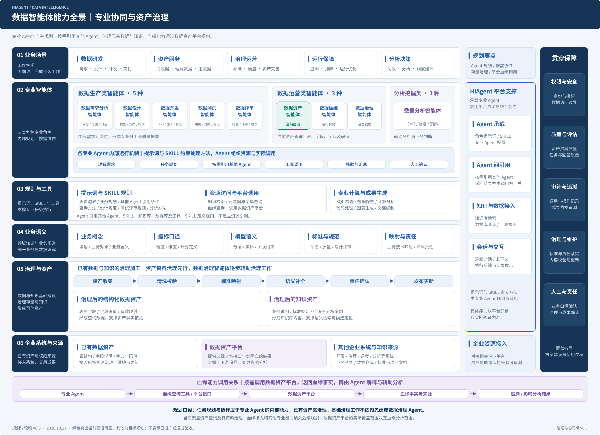

# 数据智能体能力全景 V0.3

规划讨论稿，2026年10月27日。

[可编辑 draw.io 源图](diagrams/01-数据智能体能力全景-V0.3.drawio) · [SVG 矢量图](diagrams/01-数据智能体能力全景-V0.3.svg)

本版依据最新讨论明确三个关系：

- 取消独立任务编排层。各专业 Agent 根据提示词与 SKILL 理解和规划任务，按需引用其他 Agent，调用工具并汇总结果。
- 已有资产需要进行数据与知识治理，形成可查询、可检索、可维护的基础。资料治理属于建设工作，数据治理智能体作为后续专业角色逐步辅助；两者不是同一个层次。
- 血缘通过数据资产平台提供的查询能力获取。Agent 经工具或接口调用平台，解释实际返回的血缘及来源，支持追溯与影响分析；不以表字段或字典映射推断真实加工血缘。

主结构为六层：业务场景与工作空间、专业智能体服务、规则与工具、业务语义、治理与资产基础、企业系统与来源。HiAgent 平台支撑和贯穿保障在右侧表达。

当前仍以数据资产智能体的表、字段、字典及码值查询为切入点，其资料治理需要同步开展。血缘接入纳入规划，不据此认定接口已完成或调用已验收。平台实际覆盖范围决定血缘与影响分析能够覆盖的范围。

三类九种专业角色保持不变。Agent 引用资源并执行调用，SKILL 定义任务规则。知识库用于候选定位，查询数据用于事实核验。图中治理后的结构化资产和知识内容均可持续维护。

V0.1、V0.2 原图保留。本次仅新增规划全景修订图，不修改现有正式方案或其他规划图。
