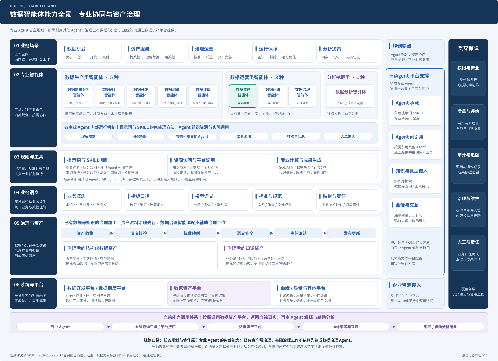

# HiAgent数据智能体独立规划图集 V0.8

[下载14页原生图集](diagrams/HiAgent数据智能体规划图集-V0.8.drawio) · [全景图源](diagrams/01-数据智能体能力全景-V0.8.drawio) · [图集预览](独立图集预览.png) · [配套PPT](../../hiagent-leadership-report/v7-illustrated/HiAgent企业数据智能体建设规划_架构视觉版_V7.pptx)

## V0.3全景保留说明

完整保留原V0.3的238个对象：位置、分组、样式和连线不变；只修订系统与平台层文字及版本日期。对照结果见panorama-preservation-check.json。第06层纳入数据开发平台、数据调度平台、数据资产平台、血缘工具、质量工具及其他平台。

总体架构、专业协作与路线继承V0.4，其他视图用同类原生模块绘制。与PPT分别编排，不再从PPT页面导出原生图集。全部包含关系和边均为真实draw.io对象，无嵌入整页位图。

| 图页 | 图源 | PNG |
| --- | --- | --- |
| 01-数据智能体能力全景 | [draw.io](diagrams/01-数据智能体能力全景-V0.8.drawio) | [PNG](diagrams/01-数据智能体能力全景-V0.8.png) |
| 02-HiAgent总体规划架构 | [draw.io](diagrams/02-HiAgent总体规划架构-V0.8.drawio) | [PNG](diagrams/02-HiAgent总体规划架构-V0.8.png) |
| 03-功能全景与建设范围 | [draw.io](diagrams/03-功能全景与建设范围-V0.8.drawio) | [PNG](diagrams/03-功能全景与建设范围-V0.8.png) |
| 04-概念数据模型 | [draw.io](diagrams/04-概念数据模型-V0.8.drawio) | [PNG](diagrams/04-概念数据模型-V0.8.png) |
| 05-内容治理与供给数据流 | [draw.io](diagrams/05-内容治理与供给数据流-V0.8.drawio) | [PNG](diagrams/05-内容治理与供给数据流-V0.8.png) |
| 06-专业Agent工作原理 | [draw.io](diagrams/06-专业Agent工作原理-V0.8.drawio) | [PNG](diagrams/06-专业Agent工作原理-V0.8.png) |
| 07-跨专业Agent协作 | [draw.io](diagrams/07-跨专业Agent协作-V0.8.drawio) | [PNG](diagrams/07-跨专业Agent协作-V0.8.png) |
| 08-指标服务与建设闭环 | [draw.io](diagrams/08-指标服务与建设闭环-V0.8.drawio) | [PNG](diagrams/08-指标服务与建设闭环-V0.8.png) |
| 09-跨平台集成架构 | [draw.io](diagrams/09-跨平台集成架构-V0.8.drawio) | [PNG](diagrams/09-跨平台集成架构-V0.8.png) |
| 10-逻辑部署架构 | [draw.io](diagrams/10-逻辑部署架构-V0.8.drawio) | [PNG](diagrams/10-逻辑部署架构-V0.8.png) |
| 11-场景赋能与收益地图 | [draw.io](diagrams/11-场景赋能与收益地图-V0.8.drawio) | [PNG](diagrams/11-场景赋能与收益地图-V0.8.png) |
| 12-在线任务数据流 | [draw.io](diagrams/12-在线任务数据流-V0.8.drawio) | [PNG](diagrams/12-在线任务数据流-V0.8.png) |
| 13-分阶段建设路线 | [draw.io](diagrams/13-分阶段建设路线-V0.8.drawio) | [PNG](diagrams/13-分阶段建设路线-V0.8.png) |
| 14-企业语义与存量适配 | [draw.io](diagrams/14-企业语义与存量适配-V0.8.drawio) | [PNG](diagrams/14-企业语义与存量适配-V0.8.png) |

## 维护

先运行build_landscape.py生成保留V0.3结构的全景，再运行build_atlas.py生成或汇聚其余视图；使用Inkscape将SVG导出为3600像素宽PNG。引用需连同diagrams目录交付。

当前与规划能力分别表述；逻辑部署不是实际网络和机器规格，概念模型不是建表设计。血缘从数据资产平台查询，业务语义和字典映射不得冒充真实加工血缘。