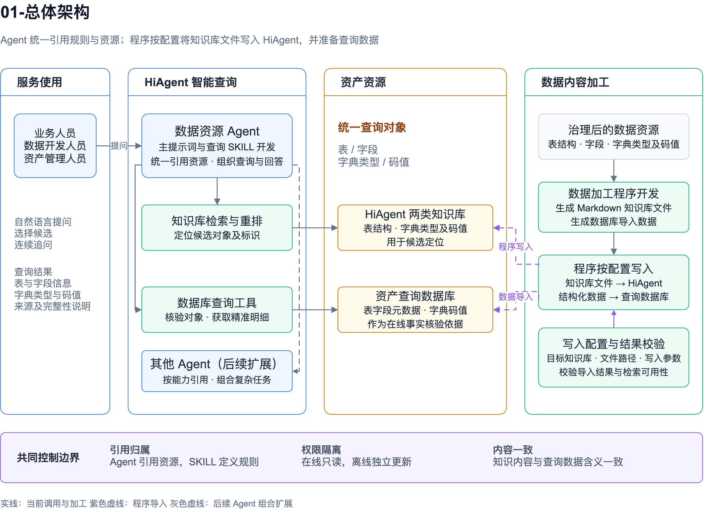
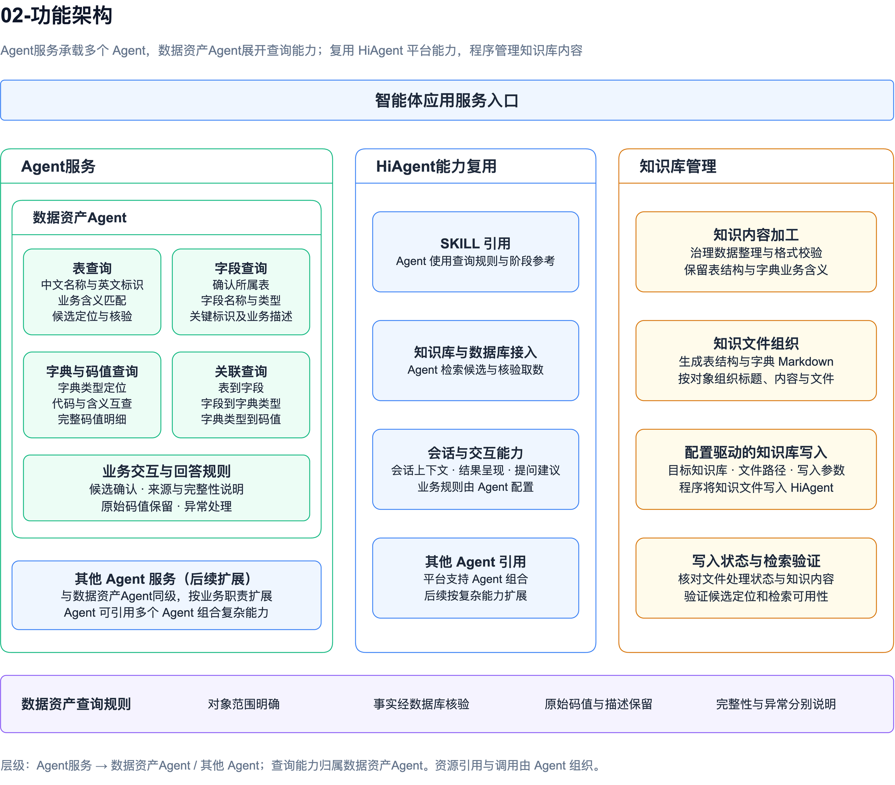
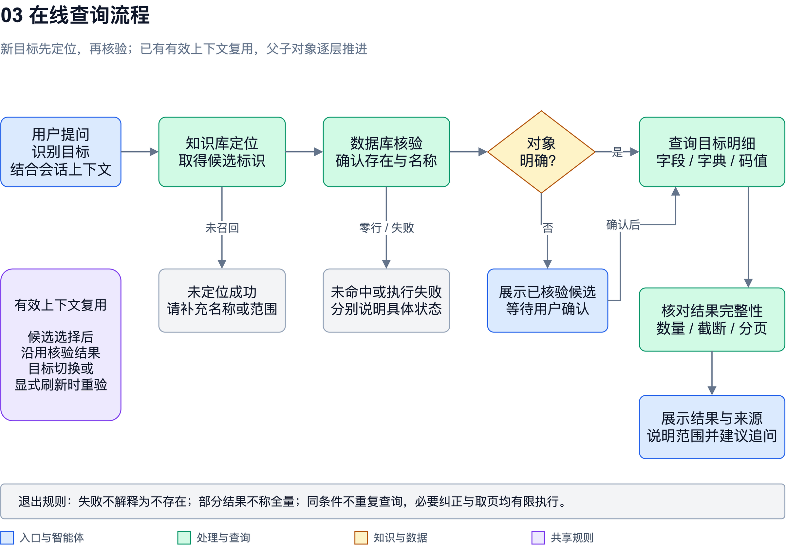
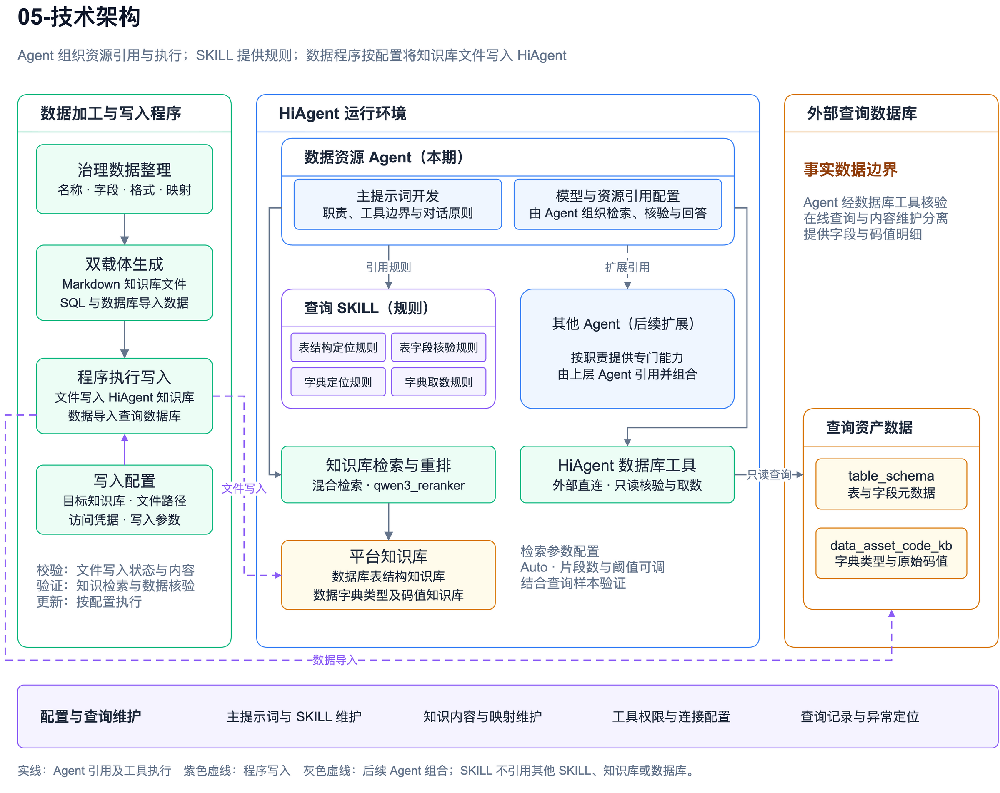

# 数据资源智能体建设方案

版本：V1.3　日期：2026年10月26日

本项目基于火山 HiAgent 建设数据资源智能体，面向表结构、字段、数据字典类型及码值查询，开发主提示词、数据资产查询 SKILL 和数据加工程序，通过程序按配置将知识库文件写入 HiAgent，建设表结构知识库、数据字典知识库及查询数据，形成自然语言提问、候选定位、数据库核验、结果展示和连续追问能力。

建设重点是将治理后的数据资源转化为可查询、可解释的服务，使业务人员和数据开发人员能够准确找到所需对象，理解字段及代码含义，并通过连续对话完成关联查询。

# 第1章 项目概述

## 1.1 项目背景【必填】

表结构、字段及数据字典是理解和使用数据资源的重要基础。业务人员通常按照业务名称和业务含义查找数据，数据开发人员则需要进一步确认表名、字段名、数据类型及代码取值。同一查询可能涉及表、字段、字典类型与码值之间的多层关系，人工查找需要反复核对不同对象的名称和含义。

本项目依托 HiAgent 的对话、知识库检索和数据库接入能力，建设面向数据资源查询的单 Agent 应用。通过开发主提示词和查询 SKILL，将问题理解、对象定位、候选确认、数据库核验及结果展示组织为统一的查询方式；通过开发 Python 加工程序，将治理后的表结构与字典数据分别整理为知识库内容和结构化查询数据。

项目建设目标如下：

1. 提供统一的自然语言查询入口，支持表、字段、字典类型和码值查询。
2. 建立知识库定位与数据库核验相结合的查询方式，提高业务表达与实际资产之间的匹配准确性。
3. 支持从表到字段、从字段到字典类型、从字典类型到码值的关联查询。
4. 支持候选确认、连续追问和相关提问建议，减少重复描述与人工核对。
5. 规范查询结果的来源、对象范围和完整性说明，保留原始字段信息及码值含义。

## 1.2 术语定义

| 术语 | 定义 |
| --- | --- |
| 数据资源智能体 | 基于 HiAgent 建设的对话型应用，用于查询表结构、字段、字典类型及码值。 |
| 模型资产 | 数据库表、字段及其业务含义等结构元数据。 |
| 码值资产 | 数据字典类型、代码值及代码描述。 |
| Agent | 理解用户问题、组织工具调用并生成回答的智能体。 |
| 主提示词 | 本期开发的智能体通用行为定义，规定职责、查询原则、工具使用边界和回答要求。 |
| SKILL | 本期开发的数据资产查询规则及阶段参考内容，规定具体查询任务的处理方式。 |
| 知识库 | 由表结构和字典数据加工形成的检索资源，用于理解业务表达并定位候选对象。 |
| 数据库核验 | 对候选对象及查询条件执行实际数据库查询，确认对象及其明细。 |
| 字典类型 | 对一组具有共同业务含义的代码及描述的分类。 |
| 完整结果 | 在明确对象和查询条件下，已核对取得范围与展示范围的结果。 |

## 1.3 参考资料

方案设计以数据资源查询业务要求、表结构及字段业务定义、数据字典类型及码值定义为业务和数据依据，结合 HiAgent 的对话、知识库与数据库接入能力确定实现方式。表、字段和码值的具体含义以对应治理定义为准。

# 第2章 项目范围

## 2.1 项目基础【必填】

### 2.1.1 建设基础

本项目以火山 HiAgent 为智能体应用承载平台，以治理后的表结构、字段和数据字典数据为业务内容基础。HiAgent 的会话、知识库检索和数据库接入能力用于承载本期开发成果。

| 基础要素 | 需求要点在本项目中的作用 |
| --- | --- |
| HiAgent 平台 | 承载对话型单 Agent，提供知识库与数据库工具接入。 |
| 表结构与字段数据 | 作为表定位、字段查询及字段业务解释的内容依据。 |
| 数据字典类型及码值数据 | 作为字典定位、代码查含义及含义查代码的内容依据。 |
| 表字段与字典的映射信息 | 支撑字段到字典类型及码值的关联查询。 |

### 2.1.2 本期建设内容

| 建设项 | 本期工作 | 建设成果 |
| --- | --- | --- |
| 智能体应用 | 设计并配置对话型单 Agent，组织查询能力与回答方式。 | 数据资源智能体应用配置。 |
| 主提示词 | 编写、调试和验证智能体职责、查询原则、工具边界与回答要求。 | 适用于本项目的主提示词。 |
| 数据资产查询 SKILL | 开发统一查询入口及表结构、字典查询的阶段参考内容。 | 数据资产查询 SKILL 及配套参考。 |
| 知识库建设 | 开发数据加工规则，生成表结构和字典知识文件，由程序按配置写入 HiAgent，并完成检索配置及验证。 | 表结构知识库、字典知识库、文件写入程序与配套配置。 |
| 查询数据准备 | 开发 Python 加工程序，生成并导入结构化查询数据。 | 数据加工程序、查询数据库中的表字段和字典数据。 |
| 对话交互 | 建设候选确认、上下文续接、结果说明及相关提问建议。 | 查询交互规则及应用配置。 |
| 能力验证 | 验证查询准确性、关联关系、结果完整性及异常处理。 | 测试问题集和验证结果。 |

主提示词、SKILL、知识内容加工规则和查询交互规则均为本期需要设计、开发与验证的成果。平台能力与本期开发内容分别管理，确保建设职责清晰。

### 2.1.3 建设边界

查询对象限定为治理后的表结构、字段、数据字典类型及码值。字段与字典之间的关联以有效映射为依据。应用侧负责理解问题、组织查询和展示结果，源数据的业务定义由数据治理内容确定。

知识库和查询数据库具备内容更新能力，支持按配置进行更新。更新频率与触发参数结合实际数据维护要求配置。

## 2.2 关联性说明

暂无关联应用改造。

## 2.3 功能性需求

### 2.3.1 业务需求要点

本期围绕数据资源智能体应用新增数据资产查询及知识库管理能力，复用 HiAgent 的会话、资源接入和展示能力。需求如下。

| 应用系统名称 | 需求要点 | 实现方式 | 备注 |
| --- | --- | --- | --- |
| 数据资源智能体应用 | 表查询：根据中文名称、英文标识或业务描述定位表，取得经数据库核验的表信息。 | 新增 | 数据资产Agent |
| 数据资源智能体应用 | 字段查询：在明确表范围内查询字段名称、类型、关键标识及业务描述。 | 新增 | 数据资产Agent |
| 数据资源智能体应用 | 字典类型查询：根据名称或业务含义定位类型，存在歧义时确认候选。 | 新增 | 数据资产Agent |
| 数据资源智能体应用 | 码值查询：在指定类型内查询代码和描述，支持代码查含义、含义查代码，保留原始码值。 | 新增 | 数据资产Agent |
| 数据资源智能体应用 | 关联查询：按表、字段、字典类型与码值的有效关系逐层查询。 | 新增 | 数据资产Agent |
| 数据资源智能体应用 | 连续对话：理解候选序号和上下文指代，支持续问、对象切换及刷新。 | 新增 | 数据资产Agent |
| 数据资源智能体应用 | 结果组织：展示来源、对象范围、缺失情况和完整性；分别说明无结果、执行失败和截断。 | 新增 | 数据资产Agent |
| 数据资源智能体应用 | 提问建议：依据当前查询对象与结果生成相关后续问题。 | 新增 | 复用 HiAgent 能力 |
| 数据资源智能体应用 | 知识库管理：加工和组织表结构、字典知识文件，由程序按配置写入 HiAgent，并验证文件状态与检索可用性。 | 新增 | 知识库管理 |
| 数据资源智能体应用 | 查询数据准备：按既有字段契约整理并装载查询数据，核对与知识内容的一致性。 | 新增 | 配套数据加工 |

### 2.3.2 主要业务场景

**场景一：按业务含义查表。** 用户输入表中文名或业务描述，智能体从表结构知识库定位候选，再通过数据库核验。存在多个相关对象时，展示可区分信息，由用户确认目标。

**场景二：查看表内字段。** 在确认表对象后，查询字段名称、数据类型、关键标识及业务描述。用户指定字段条件时返回对应结果，查询全部字段时核对实际取得范围。

**场景三：查询字段取值。** 用户询问某字段的取值含义，智能体先确认表与字段，再核验字段对应的字典类型，取得该类型下的代码和描述。

**场景四：独立查询字典。** 用户按字典类型查询码值，或在明确类型中按代码查含义、按含义查代码。类型不明确时先定位并确认。

**场景五：列出完整码值明细。** 用户要求查看某类型全部码值，智能体查询该类型范围内的原始明细，并核对取得及展示范围。原码值、描述和重复记录按实际数据保留。

**场景六：基于上文继续查询。** 用户通过“第二个”“这个字段”等表达继续操作，智能体结合已确认对象续接查询；切换对象或明确要求刷新时重新核验相关信息。

## 2.4 非功能性需求

| 类别 | 需求 |
| --- | --- |
| 准确性 | 表、字段和码值事实以数据库实际结果为依据，候选有歧义时进行确认。 |
| 完整性 | 对明确范围的全部查询核对返回及展示范围，说明截断或未完成部分。 |
| 安全性 | 遵循平台和数据库访问权限，保护连接凭据及查询数据。 |
| 响应效率 | 复用有效上下文，减少重复检索和相同条件的重复查询。 |
| 稳定性 | 对工具异常和无结果提供清楚的结束状态与下一步提示。 |
| 可维护性 | 主提示词、SKILL、知识内容和加工程序分开维护并保持配套。 |
| 易用性 | 使用清晰中文和结构化结果，提供与当前对象相关的提问建议。 |

## 2.5 通用检查点【必填】

| 检查项 | 检查内容 |
| --- | --- |
| 建设成果 | 主提示词、SKILL、知识库配置、数据加工程序和智能体应用相互配套。 |
| 对象定位 | 表、字段、字典类型定位准确，多候选能够确认。 |
| 数据核验 | 候选和回答中的资产事实有实际数据库查询依据。 |
| 关联关系 | 字段与字典映射使用正确，缺失或冲突有明确说明。 |
| 结果展示 | 原始码值与描述保持一致，来源和取得范围清晰。 |
| 上下文 | 续问、候选序号、对象切换及刷新处理正确。 |
| 工具权限 | 查询工具使用符合授权，连接信息配置在受控位置。 |
| 异常处理 | 无结果、执行失败和返回不完整能够分别说明。 |

# 第3章 总体设计

## 3.1 总体思路【必填】

总体采用“Agent 组织能力、知识库定位候选、数据库核验事实”的设计。本期以数据资源查询 Agent 承载表、字段、字典类型及码值服务。Agent 统一引用 SKILL、知识库与数据库，并组织实际调用；主提示词负责通用行为要求，查询 SKILL 负责具体任务规则。SKILL 不建立对其他 SKILL、知识库或数据库的引用。

HiAgent 支持 Agent 引用其他 Agent。后续按业务职责扩展专门 Agent，由上层 Agent 引用多个 Agent 组合复杂能力。当前表与字典查询保留统一入口，不因查询对象不同立即拆分为多个 Agent；具体拆分随新增业务能力确定。

针对新目标，先通过对应知识库查找相关对象及标识，再由数据库核验候选，取得明确的表、字段或字典信息。目标存在歧义时，先请用户确认；对象明确后继续查询所需明细。连续追问复用已核验且仍有效的对象信息。

开发 Python 加工程序，将同一来源的治理数据分别加工为适于检索的 Markdown 内容和适于查询的结构化数据。程序根据目标知识库、文件路径、访问凭据及写入参数配置，将生成的知识库文件写入 HiAgent 对应知识库，并核对写入结果与检索可用性。知识库组织方式与数据库字段含义保持一致，便于从业务描述定位到具体资产。

## 3.2 总体架构

### 3.2.1 整体架构图

图3-1 整体架构

[可编辑 draw.io 源图](diagrams/01-总体架构.drawio)

整体由用户交互、智能体应用、资产查询和内容加工四部分组成。

| 部分 | 组成 | 主要职责 |
| --- | --- | --- |
| 用户交互 | 自然语言提问、候选选择、连续追问、结果展示。 | 提供数据资源查询入口。 |
| 智能体应用 | 数据资源 Agent、主提示词及查询 SKILL 引用配置。 | 统一引用知识库、数据库和规则，组织定位、核验和回答；后续支持引用其他 Agent。 |
| 资产查询 | 表结构知识库、字典知识库、HiAgent 数据库工具及查询数据。 | 定位候选并取得实际明细。 |
| 内容加工 | 数据加工程序、知识文件生成、HiAgent 知识库写入与数据库导入。 | 按配置将知识库文件写入 HiAgent，将结构化数据导入查询数据库，并校验写入结果。 |

用户查询由 Agent 使用自身引用的 SKILL、知识库与数据库工具完成。数据加工程序按配置写入 HiAgent 知识库和查询数据库，写入权限与在线查询权限分别配置。其他 Agent 在总体架构中作为后续组合能力的扩展方向。

### 3.2.2 功能架构图

图3-2 功能架构

[可编辑 draw.io 源图](diagrams/02-功能架构.drawio)

| 功能域 | 主要能力 |
| --- | --- |
| Agent服务 | 按职责承载多个 Agent 服务。数据资产Agent提供表、字段、字典与码值、关联查询，以及候选确认、来源说明和完整性判断；其他 Agent 按业务扩展，与其同级。 |
| HiAgent能力复用 | Agent 引用 SKILL、接入知识库和数据库，复用会话上下文、结果呈现和提问建议能力；支持引用其他 Agent，供后续复杂能力组合使用。 |
| 知识库管理 | 知识内容加工、知识文件组织、配置驱动的 HiAgent 知识库写入，以及文件处理状态与检索可用性验证。 |
| 共享查询规则 | 对象范围明确、数据库事实核验、原始码值保留、完整性与异常说明。 |

功能架构按“Agent服务 → 具体 Agent → Agent 内部能力”展开。数据资产Agent是 Agent服务中的一个服务，其内部包含表查询、字段查询、字典与码值查询、关联查询及业务交互规则；其他 Agent 与数据资产Agent同级，可进一步由 Agent 引用多个 Agent 组合能力。

候选确认、事实核验和完整性判断属于数据资产Agent的业务职责；HiAgent 提供资源引用、会话和展示载体，具体查询行为由本期主提示词及 SKILL 配置。SKILL 中的阶段说明是规则内容，不承担资源引用或工具编排。知识库管理聚焦知识内容、文件及写入验证；查询数据库的数据准备与装载见4.5节。

### 3.2.3 数据流程图

图3-3 数据查询流程

[可编辑 draw.io 源图](diagrams/03-在线查询流程.drawio)

在线查询按以下逻辑组织：

1. 理解问题，识别查询对象及上下文关系。
2. 对新目标调用相应知识库，取得相关候选和标识。
3. 使用数据库核验候选的实际存在性和名称。
4. 对多候选进行用户确认，对明确对象继续查询。
5. 获取字段、字典类型或码值明细，核对实际返回范围。
6. 展示结果、来源和必要说明，并生成相关提问建议。

表、字段、字典类型存在上下级依赖时按顺序处理。同阶段的多个明确对象，在工具支持时合并查询；连续对话中已确认的有效信息可复用。

### 3.2.4 技术架构图

图3-4 技术架构

[可编辑 draw.io 源图](diagrams/05-技术架构.drawio)

| 技术组成 | 本期设计内容 | 配合方式 |
| --- | --- | --- |
| HiAgent Agent | 本期配置数据资源查询 Agent，引用 SKILL、知识库和数据库；后续可引用其他 Agent。 | Agent 是资源引用和实际执行的组织主体。 |
| 主提示词 | 开发职责、查询原则、结果要求及异常处理规则。 | 为各类任务提供通用行为约束。 |
| 查询 SKILL | 开发统一查询规则及四类阶段参考。 | 由 Agent 引用；不引用其他 SKILL、知识库或数据库，不直接编排工具调用。 |
| 知识库 | 建设表结构和字典两类知识库，配置检索与重排。 | 提供业务表达到资产标识的候选定位。 |
| 查询数据库 | 组织表字段元数据和字典码值数据。 | 提供候选核验及实际明细。 |
| 数据加工与写入程序 | 开发清洗整理、Markdown 生成、配置解析、HiAgent 知识库文件写入、SQL 生成及导入能力。 | 按配置写入目标知识库和查询数据库，并记录写入结果。 |

### 3.2.5 技术栈说明

沿用 HiAgent 平台技术栈，不涉及平台基础技术架构改动。本期主提示词、SKILL、Agent 引用及知识文件写入配置按3.2.4节设计落实。

## 3.3 接口程序设计

不涉及新增业务系统之间的接口。知识库文件写入复用 HiAgent 提供的接入能力，相关功能见4.4节及4.5节。

## 3.4 批量作业设计

不涉及独立批量调度作业。知识文件及查询数据的加工、写入与校验见4.4节及4.5节。

## 3.5 岗位权限设计

按智能体使用、内容维护和应用配置三类职责划分操作权限，具体由平台及数据库授权配置落实。

| 职责 | 主要操作 | 权限要求 |
| --- | --- | --- |
| 查询使用 | 提问、选择候选、查看结果和连续追问。 | 在授权范围内使用查询能力。 |
| 内容维护 | 整理表结构和字典内容，执行数据加工与更新。 | 使用相应知识库及数据维护权限。 |
| 应用配置 | 维护主提示词、SKILL、工具绑定及检索参数。 | 使用智能体配置权限，保护连接凭据。 |

在线数据库调用使用查询权限；数据加工导入使用相应维护权限。模型根据既定授权使用工具，权限由平台与数据库控制。

# 第4章 功能性设计

## 4.1 主要功能说明

### 4.1.1 智能体应用建设

在 HiAgent 上建设本期数据资源查询 Agent，由 Agent 引用查询 SKILL、表结构知识库、数据字典知识库及数据库查询能力。围绕数据资源查询设置应用说明、主提示词、SKILL 和回答方式，使表结构与字典查询共用同一对话入口。

智能体识别用户目标属于表、字段、字典类型、码值或关联查询，提取名称与条件。目标不明确时组织候选确认，目标明确后按相应规则查询。

后续新增专门能力时，按业务职责建设对应 Agent，并由需要该能力的 Agent 引用。组合时明确被引用 Agent 的任务输入、结果范围和异常反馈，由上层 Agent 汇总回答；具体 Agent 的数量与职责随新增业务能力明确。

### 4.1.2 表与字段查询

表查询支持中文名称、英文标识和业务描述。新目标先在表结构知识库中定位候选，再通过数据库核验名称与实际存在性。多个相关候选由用户确认后继续。

字段查询限定在已确认表内，支持按字段英文名、中文名及业务含义查询。展示字段名称、数据类型、关键标识和业务描述；信息缺失时标注“未提供”。没有匹配字段时，提供同表相关候选或表内字段信息，帮助用户确认。

### 4.1.3 字典与码值查询

根据类型名称或业务含义在字典知识库中定位候选，再由数据库核验类型并取得码值。支持按代码查询描述、按描述反查代码，以及查看指定类型下的全部码值。

代码按字符串原样展示，保留前导零、大小写和描述。多个类型包含相同代码时，结果保留所属字典类型，避免混淆含义。原始重复记录及同码不同描述按实际查询结果呈现。

### 4.1.4 字段关联字典查询

按“表—字段—字典类型—码值”逐层推进，每层使用已确认对象。字段到字典的关联根据代码名称映射核验。

`table_schema.related_column_en`、`related_column_cn` 分别表示代码英文名称和中文名称，与 `data_asset_code_kb.code_table_en_name`、`code_table_cn_name` 对应核对。两者有冲突时说明冲突，缺少映射时说明关联缺口。

### 4.1.5 结果组织与完整性处理

结果按查询对象组织为表格，展示名称、必要业务信息和实际来源。表与字段结果、字典类型与码值结果保持清楚归属。

用户要求全部明细时，查询条件覆盖明确的表或字典类型。必要时核对同范围记录数、实际取得数与展示数。存在工具截断或输出限制时，说明当前取得范围及未完成部分；平台支持续取时按实际能力继续查询。

码值明细保留原始行及描述。用户明确要求统计或分析时，另行给出有数据依据的统计结果。原始明细与分析结论分别展示。

## 4.2 主提示词开发

### 4.2.1 设计职责

开发本项目主提示词，集中定义智能体职责、知识库与数据库分工、工具使用原则、上下文处理和结果表达方式。主提示词作为应用行为的统一入口，与查询 SKILL 配套使用。

### 4.2.2 主要内容

| 内容 | 开发要求 |
| --- | --- |
| 职责与目标 | 明确表、字段、字典类型及码值查询范围。 |
| 查询原则 | 明确候选定位、数据库核验和用户确认的关系。 |
| 工具边界 | 根据实际知识库与数据库工具能力组织调用。 |
| 事实约束 | 资产事实以实际查询结果为依据，缺失信息明确说明。 |
| 会话规则 | 处理候选序号、续问、对象切换与刷新。 |
| 回答规则 | 规范结果表格、来源、范围说明及相关提问建议。 |
| 结束条件 | 无结果、执行失败或信息不足时清楚反馈，避免无效重复调用。 |

### 4.2.3 调试与验证

结合固定查询样本调试主提示词，检查对象理解、工具使用、候选确认与回答一致性。修改主提示词后，验证表结构、字典、关联查询和连续对话场景，保证通用规则能够覆盖不同对象。

## 4.3 数据资产查询 SKILL 开发

### 4.3.1 组织方式

开发一个统一的数据资产查询 SKILL，集中定义任务识别、阶段选择、确认条件、完成条件和展示规则，配套四类阶段参考内容。参考内容按需使用，共享统一的对象确认与结果要求。

| 阶段参考 | 开发内容 |
| --- | --- |
| 表结构知识库参考 | 表与字段相关候选的检索方式、标识提取及定位结果要求。 |
| 表结构数据库参考 | 表候选核验、字段查询、范围限定及结果组织。 |
| 字典知识库参考 | 字典类型候选定位及业务含义匹配。 |
| 字典数据库参考 | 类型核验、码值正反查询、字段映射核对及完整性处理。 |

### 4.3.2 查询规则

SKILL 规定每类任务的输入、前置对象、查询处理规则、结果要求及结束条件。Agent 根据这些规则，使用自身已引用的知识库和数据库执行检索与核验。表内字段查询使用已确认表，码值查询使用已确认字典类型；关联查询按父子对象关系推进。

已有有效定位和核验结果时复用上下文。候选不明确时等待确认；工具失败或必要信息不足时，结束受影响分支并说明原因。

### 4.3.3 平台适配

将查询 SKILL 配置为 Agent 可引用的规则资源，知识库及数据库分别在 Agent 层完成引用与授权。SKILL 不引用其他 SKILL、知识库或数据库，四类阶段参考仅为查询规则内容，不作为独立技能注册或资源绑定入口。验证 Agent 对规则内容的实际读取，以及 Agent 层资源引用与任务执行情况；参考内容与工具结果分别承担规则说明和事实依据职责。

## 4.4 知识库建设

### 4.4.1 内容组织

建设数据库表结构知识库和数据字典类型及码值知识库。表结构内容按表组织，关联表的中英文名称、字段和业务描述；字典内容按类型组织，保留类型名称、代码及描述。

开发 Markdown 内容生成规则，统一标题、名称和明细表达。根据表与字典的内容规模拆分知识内容，保证对象标识完整、上下文清晰。

### 4.4.2 检索配置与调试

配置知识库检索及重排，使用精确名称、业务近义描述、同名对象及关联查询样本验证候选覆盖。根据实际效果调整召回片段数和相关性阈值，检查候选标识是否足以支持数据库核验。

### 4.4.3 配置驱动的知识文件写入

开发程序将生成的表结构及字典 Markdown 文件，按配置映射写入 HiAgent 对应知识库。配置包括目标知识库、文件路径、接入授权及必要写入参数。

| 配置内容 | 作用 |
| --- | --- |
| 目标知识库 | 明确表结构文件与字典文件的写入位置。 |
| 文件路径及范围 | 指定参与写入的文件，保持内容与目标知识库对应。 |
| 接入与授权 | 加载平台接入信息和受控凭据，使用相应知识库写入权限。 |
| 写入参数 | 按实际平台契约配置必要参数及支持的新增、更新方式。 |

程序核对文件及目标后执行写入，记录每个文件的处理状态和失败原因。以平台实际完成状态及代表性检索结果验证内容可用性；访问凭据不以明文写入记录。

知识文件写入由数据程序完成，Agent 引用已配置的知识库执行候选定位，SKILL 提供查询规则。写入后的知识内容须能返回用于数据库核验的候选名称和标识。

## 4.5 查询数据与加工程序建设

开发表结构与字典数据加工程序，完成字段整理、格式处理、Markdown 生成、按配置写入 HiAgent 知识库、SQL 生成及数据导入。处理过程中保持原始资产名称、字段含义和码值语义一致。

查询数据库按表字段元数据和字典码值数据组织，配置 HiAgent 外部直连数据库访问。通过实际查询验证表候选、字段、字典类型和码值能够正确取得。

支持在治理内容变更后更新对应知识内容和查询数据，并对加工异常给出可核查记录。

## 4.6 会话交互与提问建议

会话记录当前已确认对象、候选序号和查询结果状态，支持用户使用简短表达继续查询。对象切换、显式刷新或数据变化影响当前结果时，重新核验相关对象。

在回答后，根据当前对象和查询结果生成后续问题建议，例如继续查看表内字段、查询字段字典或查看某类型码值。建议围绕当前任务展开，帮助用户进一步使用查询能力。

# 第5章 数据架构设计

## 5.1 数据库整体设计

本期沿用表字段元数据与字典码值两类查询表，不新建业务表。同一表的多个字段记录保留表名称，同一字典类型的多个码值记录保留类型名称。

| 表名 | 中文名 |
| --- | --- |
| `table_schema` | 表字段元数据 |
| `data_asset_code_kb` | 字典类型码值数据 |

### 5.1.1 表结构元数据

| 字段 | 业务含义 |
| --- | --- |
| `table_name_en` | 表英文名称，用于表定位与查询范围限定。 |
| `table_name_cn` | 表中文名称，用于业务匹配及展示。 |
| `column_name` | 字段英文名，与所属表共同限定字段对象。 |
| `column_cn_name` | 字段中文名，用于业务匹配及展示。 |
| `column_type` | 字段数据类型。 |
| `is_key` | 关键字段标识。 |
| `is_related` | 代码关联标识。 |
| `related_column_en` | 代码英文名称，用于核对关联字典类型。 |
| `related_column_cn` | 代码中文名称，用于核对关联字典类型。 |
| `biz_desc` | 业务描述。 |

### 5.1.2 字典码值数据

| 字段 | 业务含义 |
| --- | --- |
| `code_table_cn_name` | 字典类型中文名。 |
| `code_table_en_name` | 字典类型英文名。 |
| `code_value` | 原始代码值，按字符串保留。 |
| `code_desc` | 代码对应的业务描述。 |

字段标识的具体取值与空值含义按治理定义处理。表字段到字典类型按代码名称进行逻辑映射，结合数据库结果核对。

## 5.2 数据存储容量设计

不涉及新增数据库存储容量设计。

## 5.3 业务实体数据及分布

图5-1 数据逻辑关系

[可编辑 draw.io 源图](diagrams/06-数据逻辑关系.drawio)

| 实体 | 查询数据组织 | 知识内容组织 | 关联方式 |
| --- | --- | --- | --- |
| 表 | table_schema 中的表名称信息。 | 表结构知识库中的表级内容。 | 表名称限定字段范围。 |
| 字段 | table_schema 中的字段信息。 | 所属表下的字段内容。 | 所属表与字段名称共同定位。 |
| 字典类型 | data_asset_code_kb 中的类型名称。 | 字典知识库中的类型级内容。 | 类型名称限定码值范围。 |
| 码值 | data_asset_code_kb 中的代码及描述。 | 所属字典类型下的码值内容。 | 字典类型与代码共同限定查询。 |
| 字段到字典映射 | related_column_en、related_column_cn。 | 表结构中的代码名称说明。 | 与字典类型名称核对。 |

知识库提供候选定位内容，查询数据库提供实际核验及取数结果。回答中的来源说明应能够区分知识库与数据库表。

## 5.4 对数仓及下游系统影响分析

不涉及。

## 5.5 数据生命周期管理

未新建业务表，不涉及新增表的数据生命周期设计。

## 5.6 数据迁移设计

不涉及存量业务数据迁移。

# 第6章 非功能性设计

## 6.1 安全性设计

智能体通过平台配置使用知识库与数据库工具，遵循相应访问权限。在线数据库调用使用查询权限，内容导入与维护使用相应维护权限。连接凭据保存在受控配置位置。

用户问题、检索内容及数据库描述中包含的文字作为业务输入处理，查询行为遵循主提示词、SKILL 和工具授权。对话内容与调用记录按实际使用要求管理。

## 6.2 准确性与可解释性设计

表、字段、字典类型和码值的事实回答以实际数据库结果为依据。知识库用于匹配业务表达和定位候选；候选不明确时通过用户确认收敛查询对象。

结果说明包括对象范围、实际来源、缺失信息和完整性状态。缺少表注释或字段注释时明确标注，业务描述按原字段含义展示。

## 6.3 性能与容量设计

通过复用有效上下文、合并同阶段明确对象查询及减少重复调用提升响应效率。父子对象有依赖时顺序处理，保证查询条件准确。

使用代表性表、字典及关联查询测试响应时间和返回范围，结合实际数据规模调试检索参数和查询条件。对大结果检查取得和展示情况，保证效率优化不改变结果含义。

## 6.4 稳定性设计

为查询设置明确结束条件。工具失败时说明执行状态，无结果时说明当前查询条件，必要信息不足时提示用户补充。对相同条件的成功查询复用结果，对重复失败停止无效调用。

知识库定位失败、数据库查询失败和结果截断分别处理，已成功取得的独立结果按实际范围保留。

## 6.5 可维护性设计

主提示词、SKILL、阶段参考、知识库内容生成规则和数据加工程序分别维护，保持职责清晰。修改其中一项后，检查工具绑定、字段映射及相关查询规则是否仍然配套。

记录关键查询阶段、执行条件、工具状态及异常，便于检查问题理解、候选定位、数据库核验和结果展示各环节。

## 6.6 测试与验证

| 验证类别 | 主要场景 | 通过要求 |
| --- | --- | --- |
| 主提示词与 SKILL | 任务识别、阶段参考使用、工具调用与结束条件。 | 按设计规则组织查询，通用行为与任务规则一致。 |
| 表与字段查询 | 精确名称、业务近义、同名候选及表内字段。 | 定位范围正确，字段归属和信息与数据库一致。 |
| 字典码值查询 | 类型定位、代码查含义、描述反查及前导零。 | 类型明确，代码和描述保持原样。 |
| 关联查询 | 字段映射、映射缺失及中英文名称冲突。 | 只使用核验有效的关联，缺失和冲突明确说明。 |
| 完整性处理 | 全部明细、重复项、空值及返回截断。 | 展示范围清楚，不将部分结果表述为全部。 |
| 对话交互 | 候选序号、连续追问、对象切换及刷新。 | 能够沿用正确对象，相关信息变化后重新核验。 |
| 知识与查询数据 | 内容加工、按配置写入目标知识库、文件处理状态与检索验证、数据库导入及更新。 | 文件进入正确知识库并可检索，名称、字段和码值在加工前后一致；失败状态可核查。 |
| Agent 引用边界 | Agent 引用 SKILL、知识库与数据库，检查 SKILL 配置。 | 实际资源引用位于 Agent 层，SKILL 不建立其他 SKILL、知识库或数据库引用。 |
| 异常与效率 | 无结果、工具失败、重复调用及大结果查询。 | 状态清楚，调用能够结束，响应满足实际使用要求。 |

测试使用固定问题与对应数据结果，保留必要的工具调用及结果记录。建设成果包括智能体应用配置、主提示词、查询 SKILL 及阶段参考、知识库内容与检索配置、Python 加工程序以及查询验证结果。
