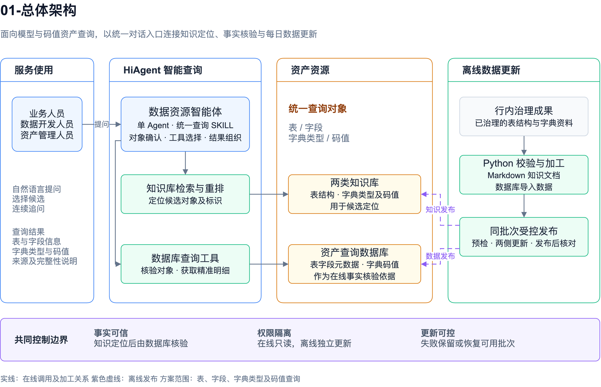
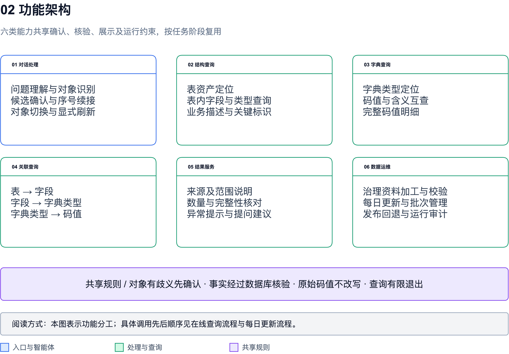
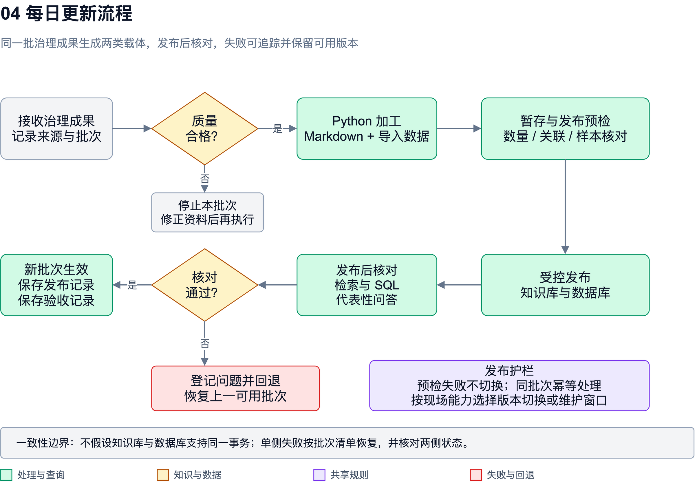
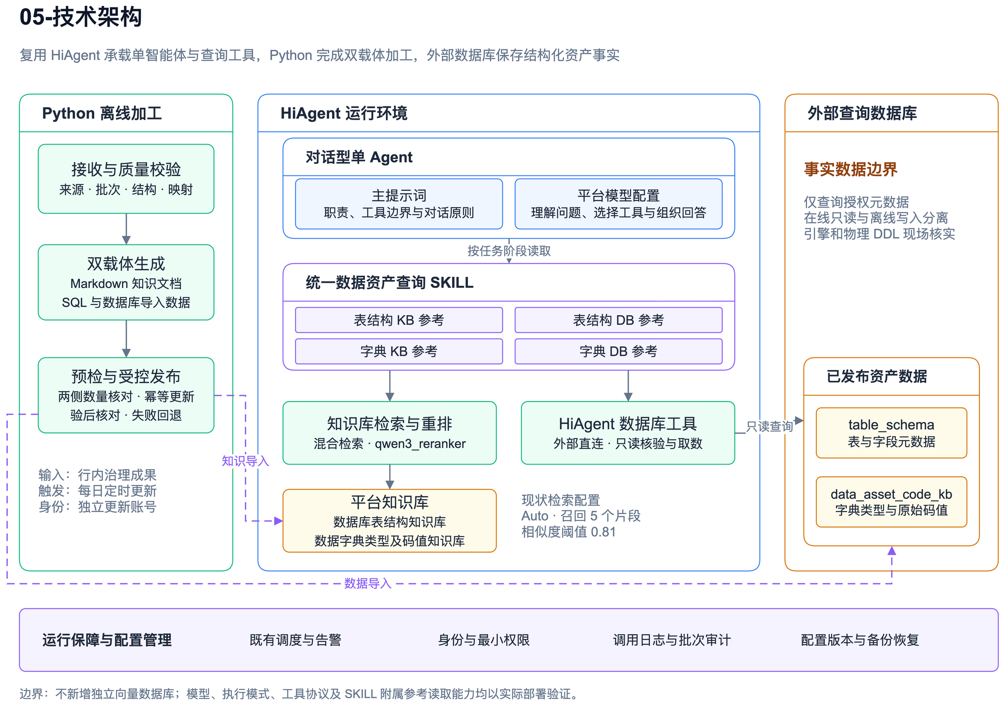
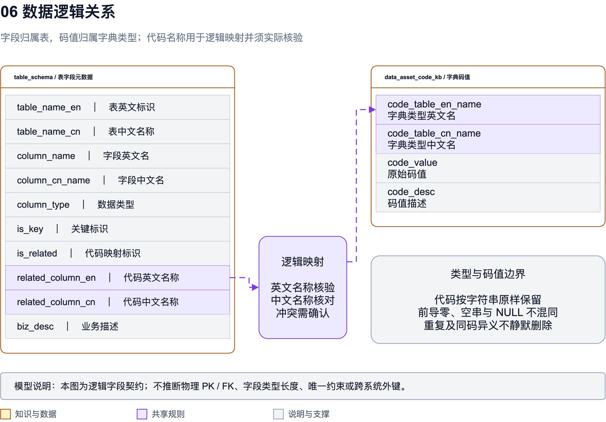

# 数据资源智能体建设方案

版本：V1.0　日期：2026年10月22日

本方案面向模型与码值资产的智能问数场景，在现有 HiAgent 数据资源智能体基础上，完善表结构、字段、数据字典类型及码值查询能力，形成“自然语言提问—知识库定位—数据库核验—结果展示—连续追问”的服务链路。建设重点为准确查找、清晰解释、结果可核验与数据持续更新。

方案范围为第一章至第六章。正文中“现状”表示已提供的项目实现情况，“本期设计”表示建议纳入建设和验收的内容；外部系统职责、容量、性能和平台能力等尚未确定的信息，在对应章节列出确认条件，不作为已完成能力或既定承诺。

# 第1章 项目概述

## 1.1 项目背景【必填】

行内已经形成经过治理的数据库表结构、字段及数据字典类型和码值资料。这些资料是业务理解、数据开发、模型分析和系统联调的重要依据。使用人员需要在业务名称、技术标识和代码含义之间建立对应关系，查询过程往往涉及多张表、多个字段以及相应的字典类型。

现有项目基于火山 HiAgent 建设数据资源智能体，采用对话型单 Agent 形态，为使用人员提供表、字段、字典类型及码值查询。项目通过 Python 将治理成果加工为 Markdown 文档并导入知识库，同时生成 SQL 导入查询数据库，利用知识库与数据库共同支撑问答。

本期在现有实现基础上形成规范化建设方案，明确查询流程、数据组织、更新机制、权限边界及验收要求。知识库用于理解用户表达并定位候选对象，数据库用于核验资产事实及获取精确结果；通过候选确认和连续对话，降低同名、近义和不完整问题造成的误查风险。

本期目标包括：建立统一的数据资源自然语言查询入口；支持从表到字段、字典类型再到码值的逐层查询；在回答中保留来源、原始码值及实际取得范围；建立可追踪的数据更新和异常处理机制。具体收益通过查询正确率、任务完成率、查询耗时与人工核对工作量等指标评估，基线和目标值在试运行阶段确认。

## 1.2 术语定义

| 术语 | 定义与本项目边界 |
| --- | --- |
| 数据资源智能体 | 基于 HiAgent 的对话应用，负责查询和解释已纳入范围的资产元数据，不承担业务交易处理。 |
| 模型资产 | 本方案主要指数据库表、字段及其业务含义等结构元数据；不扩展解释为机器学习模型管理。 |
| 码值资产 | 数据字典类型及其代码值、代码描述，包含字段到字典类型的已确认映射。 |
| Agent | 负责理解问题、选择执行路径、组织工具调用和生成回答的单一对话智能体。 |
| SKILL | 数据资产查询的任务规则与参考材料，规定输入、执行步骤、输出和边界；文档数量不等于工具调用次数。 |
| 知识库 | 由治理成果加工形成的检索资料，用于自然语言候选定位，不能单独作为资产事实的最终核验依据。 |
| NL2SQL | 将自然语言或结构化查询意图转化为 SQL 的平台数据库查询能力；实际执行 SQL 与返回范围需要核对。 |
| Rerank | 对初步召回结果再次排序的过程，用于改善候选相关性，不证明候选必然正确。 |
| 全量结果 | 在明确的业务条件和授权范围内，已核对完整性的数据集合；单次返回记录不能直接称为全量。 |
| 数据批次 | 一次治理成果接收、校验、加工和发布的管理单位，用于更新追踪、问题定位和版本回退。 |

## 1.3 参考资料

| 编号 | 资料 | 使用范围 |
| --- | --- | --- |
| R01 | 项目现状截图 | 现有 HiAgent 形态、查询范围、知识库配置、Python 加工和数据库接入方式。 |
| R02 | 甲方方案结构截图 | 第一章至第五章的章节编号和名称，以及第六章“非功能性设计”标题。 |
| R03 | 现有 HiAgent 运行说明及已确认元数据字段契约 | 核验原则、字段含义、数据边界及待验证的平台能力。 |
| R04 | 行内数据治理标准、数据安全规范和系统接入规范 | 后续由甲方提供，用于细化质量规则、权限、审计、保留周期及接入要求。 |
| R05 | 实际部署版本的 HiAgent 使用与运维资料 | 后续按现场版本核实，用于确认知识库限制、工具协议、身份集成和运维能力。 |

本方案不以其他应用代码推断 HiAgent 的内部实现。平台能力以本项目部署版本、实际配置和联调记录为准。

# 第2章 项目范围

## 2.1 项目基础【必填】

### 2.1.1 现有建设基础

| 项目 | 现状 |
| --- | --- |
| 应用平台 | 火山 HiAgent。 |
| 智能体形态 | 对话型单 Agent，现状未采用对话流型或流程编排型实现。 |
| 查询范围 | 表、字段、数据字典类型及码值信息。 |
| 技能组织 | 图片列示 data-asset-query-md 总入口，按任务加载表结构 KB、表结构 DB、字典 KB、字典 DB 四类 Markdown 参考。具体部署名称以现场配置核对。 |
| 知识库加工 | Python 将行内治理成果加工为规范 Markdown，按标题组织和拆分后导入 HiAgent。 |
| 知识库划分 | 数据库表结构知识库、数据字典类型及码值知识库。 |
| 查询数据准备 | Python 将表结构和字典数据生成 SQL 并导入数据库。 |
| 数据库接入 | 通过 HiAgent 数据库模块配置外部直连数据库。 |
| 更新与交互 | 现状描述支持每日定时更新，并配置基于对话内容生成的提问建议；具体调度及更新保障机制需进一步落实。 |

现状图片记录单个知识库支持 1000 个文件、每文件小于 10M。该值作为项目现状记录，实际可用额度和计量单位需依据部署版本确认；上线前还应以真实文件数、文件大小和更新方式核验容量，不能仅据此认定任意规模均可全量导入。

### 2.1.2 本期建设内容

本期完善单智能体查询应用、查询 SKILL、两类知识库与查询数据库的协作，补齐数据加工校验、每日更新管理、结果完整性核对、权限控制和验收材料。优先复用 HiAgent 已有会话、知识库、数据库工具及可用日志能力，Python 继续承担离线加工，避免另建同类智能体平台和独立检索服务。

当前设计保持单 Agent 形态。若实测证明提示词和技能规则不能稳定保证关键查询顺序，再评估部署版本已有的工作流或确定性节点能力，并单独确认范围。是否采用平台工作流由验证结果决定，不作为本期现状描述。

### 2.1.3 建设边界

本期查询治理后的资产元数据，不默认接入客户明细、账户、交易流水等业务数据，不执行数据写入、业务审批、报表开发和自动建模。原始治理标准的制定和源端数据整改仍由对应数据责任方负责。知脉/知蕴、知观及 SmartBI 的具体职责和接口尚未确认，本期保留方案章节和协同边界，不默认承诺新增平台、全量接入或改造上述系统。

## 2.2 关联性说明

| 关联方 | 与本项目的关系 | 责任边界 |
| --- | --- | --- |
| 治理成果提供方 | 提供表结构、字段、字典类型、码值和修订资料。 | 确认内容权威性、有效范围及变更口径。 |
| HiAgent 平台 | 承载智能体、会话、知识库检索和数据库工具调用。 | 提供实际可用能力及平台运行保障。 |
| 查询数据库 | 保存经过校验的结构元数据和字典数据。 | 提供受控只读查询；生产业务数据库不作为默认查询对象。 |
| 数据加工及运维人员 | 执行加工、导入、定时更新、异常处置及发布回退。 | 对发布批次、加工日志和核验记录负责。 |
| 业务及数据开发人员 | 使用自然语言查询资产并参与候选确认。 | 结合查询范围和来源理解结果，反馈资产问题。 |
| 相关数据平台 | 可能提供元数据、治理成果或分析入口。 | 对接方式在职责、接口和授权明确后确定。 |

智能体消费已发布治理成果，不修改其权威定义；发现描述冲突、缺失映射或疑似过期数据时，应保留证据并反馈责任方，不能由模型自行纠正后当作正式资产发布。

## 2.3 功能性需求

### 2.3.1 业务需求要点

| 编号 | 需求 | 业务要求 |
| --- | --- | --- |
| F01 | 表资产查询 | 根据中文名称、英文标识或业务描述定位表，返回已核验的表信息。 |
| F02 | 字段查询 | 在已确认表范围内查询字段名称、类型、关键标识和业务描述。 |
| F03 | 字典类型查询 | 根据名称或描述定位并核验字典类型，必要时提供候选供用户选择。 |
| F04 | 码值查询 | 按字典类型查看码值，支持代码查含义、含义查代码以及明确范围的全部查询。 |
| F05 | 字段关联字典 | 根据已有映射识别并核验关联字典，支持“表—字段—字典—码值”查询。 |
| F06 | 连续对话 | 识别候选序号、沿用已确认对象，支持对象切换及显式刷新。 |
| F07 | 结果溯源 | 标明事实来源及本次查询范围，区分知识库定位信息与数据库核验结果。 |
| F08 | 不完整与异常处理 | 区分歧义、无结果、权限不足、查询失败和数据截断，给出可执行的下一步。 |
| F09 | 数据更新 | 按日执行数据加工发布，记录校验结果、数据批次和失败处置。 |
| F10 | 对话建议 | 在回答后给出与已确认对象相关的后续提问建议。 |

### 2.3.2 主要业务场景

场景一，业务人员按业务名称查找表。智能体从表结构知识库定位相关候选，再通过数据库核验；存在多个同名或近义对象时，展示名称及可区分信息，请用户选择后继续。不能仅根据召回排序将第一名当作最终对象。

场景二，开发人员查询指定表的字段。确认表身份后，从数据库取得对应字段的中英文名、数据类型、关键标识和业务描述。用户只查询部分字段时按条件返回，查询全部字段时核对完整性后展示；没有独立注释时明确标注“未提供”。

场景三，用户询问某字段对应的代码及含义。先确认表和字段，再依据字段中已提供的代码名称映射核验字典类型，最后查询码值。没有映射、映射冲突或存在多个候选时，说明具体缺口，请用户确认，不能根据字段名相似直接建立绑定。

场景四，用户独立查询字典。按“字典类型定位—数据库核验—码值查询”处理，支持某类型内按代码或描述查询。只有代码、没有字典类型时，应先缩小范围；相同代码在不同类型中可具有不同含义。

场景五，用户要求列出某类型全部码值。直接执行明确类型范围的明细查询和必要统计，保留原码值、描述、重复记录及冲突。发生截断时按真实工具能力继续取数或明确当前范围，不能以摘要代替全部明细，也不能将模型自行分类当作原始数据。

场景六，用户选择“第二个”或继续问“这个字段有哪些取值”。复用本轮会话已核验对象和选择关系继续处理；切换目标、明确要求刷新或已知发生数据更新时，重新核验受影响对象，避免沿用失效结果。

## 2.4 非功能性需求

| 类别 | 需求与验收方向 |
| --- | --- |
| 准确性 | 事实有实际数据库证据，歧义需确认，缺失信息不补造。 |
| 安全性 | 身份验证、最小权限、数据库只读、数据脱敏及审计按行内规范落实。 |
| 性能 | 分别度量简单查询、候选确认、多层查询及全量查询，避免用单一平均值掩盖差异。 |
| 稳定性 | 查询超时、知识库失败和更新失败有明确结束路径及可追踪记录。 |
| 一致性 | 知识库与数据库关联同一发布批次，更新不一致时优先核验并说明影响。 |
| 可维护性 | 主提示词、SKILL、参考文件和数据加工规则独立版本管理。 |
| 可用性 | 中文表达清晰，结果结构稳定，异常提示可理解，后续建议与上下文相关。 |

性能目标、并发量、服务时段、保留周期和恢复指标应结合现网资源及甲方要求确定，具体设计见第六章。

## 2.5 通用检查点【必填】

下表为本期通用检查基线，甲方正式检查表提供后进行逐项映射和补充。

| 检查项 | 本期落实内容 | 验收证据 |
| --- | --- | --- |
| 范围与资产责任 | 确认数据来源、使用范围、责任人及排除项。 | 范围确认单和来源清单。 |
| 平台与模型使用 | 核实模型接入、数据传输和留存方式符合行内要求。 | 配置及安全评审记录。 |
| 访问与数据权限 | 验证用户访问边界及数据库执行权限。 | 授权矩阵和越权测试。 |
| SQL 安全 | 限制查询对象和语句类型，核验超时及返回限制。 | 只读账号验证与工具轨迹。 |
| 结果准确与完整 | 核验候选、字段映射、码值原样和全量判定。 | 固定样本及逐题结果。 |
| 更新及回退 | 检查定时触发、校验、失败保留及版本回退。 | 更新日志和回退演练。 |
| 运维审计 | 关联会话、调用、SQL、批次和错误记录。 | 脱敏日志及追踪样例。 |
| 上线交付 | 完成配置、操作、运维、验收材料交接。 | 发布记录及验收签认。 |

# 第3章 总体设计

## 3.1 总体思路【必填】

总体采用“统一入口、单智能体协调、知识库定位、数据库核验、离线批次更新”的设计。HiAgent 承载在线问答，Python 承担离线加工，两者通过治理后的知识文件和查询数据协作。

在线流程围绕对象确认展开。新目标先通过对应知识库定位自然语言候选，再由数据库核验候选和获取事实；用户确认对象后逐层查询，重复追问复用仍有效的结果，避免无意义重复检索。知识库未命中时，应说明未定位成功并请求更精确的名称或业务上下文，不能把检索未命中解释为数据库不存在。

离线流程以同一份治理成果为输入，分别生成知识库文档和数据库导入数据，统一批次核对。发布前校验结构、数量和关联关系，发布后执行抽样问答与数据库核对；失败时保留上一可用版本。批次管理先作为加工侧控制能力建设，只有确认查询契约需要时才新增对外字段。

事实核验、最小权限和可追踪记录共同构成控制基础。模型负责理解、选择和表达，数据库承担事实查询；提示词和 SKILL 只能约束执行行为，不能替代数据库权限、工具限制或确定性执行保障。

## 3.2 总体架构

### 3.2.1 整体架构图

【图3-1 整体架构】

在线查询与离线更新分离。用户查询只访问已授权的检索与数据库能力，Python 加工使用独立更新权限；智能体不能借用加工账号执行写入。

### 3.2.2 功能架构图

【图3-2 功能架构】

功能按职责划分，单一入口根据任务阶段加载相应参考材料。表结构和字典能力共享会话确认、查询次数约束与结果规则，避免多个入口维护互相冲突的流程。

### 3.2.3 数据流程图

【图3-3a 在线查询流程】

【图3-3b 每日更新流程】

父子对象存在依赖时顺序执行；同阶段、同范围且工具支持的查询可以合批。不同对象不能只把关键词拼成一个检索字符串就视为分别完成定位。

### 3.2.4 技术架构图

【图3-4 技术架构】

技术方案优先利用已部署能力，不新增独立向量数据库。数据库引擎、模型服务、调度组件和身份系统的产品版本、部署拓扑及可用接口，由现场核实后补入配置清单。

### 3.2.5 技术栈说明

| 技术或组件 | 本项目用途 | 配置与边界 |
| --- | --- | --- |
| HiAgent | 对话型智能体及工具接入。 | 复用现有部署；执行模式及迭代限制通过同条件测试确定。 |
| 大语言模型 | 问题理解、执行决策和结果组织。 | 型号、上下文及输出限制现场确认；不替代数据库事实。 |
| 数据资产查询 SKILL | 统一查询流程，按阶段使用结构 KB/DB 和字典 KB/DB 参考。 | 单一入口能否读取附属文件需实测；文档引用不等于实际加载成功。 |
| Markdown | 治理成果的知识库导入载体。 | 按表或字典类型组织标题、标识和明细，控制单文件大小。 |
| Python | 离线清洗校验、文档加工和数据库导入数据生成。 | 保留可重复执行的批次、校验报告及失败记录。 |
| SQL 与查询数据库 | 保存、核验和查询结构化资产事实。 | 使用只读账号及受控查询范围，数据库版本现场确认。 |
| 检索与重排 | 定位语义相关候选。 | 现状为 Auto、混合检索、qwen3_reranker、召回5个片段、相似度0.81。 |

上述检索参数为现状起点。相似度阈值与片段数需要通过固定样本评估召回覆盖和误匹配，不宜直接认定当前取值最优。查询数据库引擎尚未确认；若新增 MySQL 库表，字符集统一使用 utf8mb4，排序规则遵循行内约束，并验证代码字符串比较语义。

## 3.3 接口程序设计

本期优先使用 HiAgent 已有知识库与数据库接入，不预设新增 REST 服务。下表定义业务层交互约定，具体字段名、协议和路径应映射到实际工具能力；不能把约定直接当作平台现有接口。

| 接口类别 | 业务输入 | 业务输出 | 控制要求 |
| --- | --- | --- | --- |
| 会话查询 | 问题、会话标识、用户身份、已确认对象。 | 回答、候选、来源、范围及后续建议。 | 身份由可信入口取得，不能由用户在问题中自报权限。 |
| 知识库检索 | 查询意图、目标类型和可用标识。 | 候选名称、标识、相关片段及可用来源信息。 | 仅作定位，不宣称片段为完整数据。 |
| 数据库查询 | 明确对象、业务条件及所需投影。 | 实际结果、错误状态，以及工具可提供的 SQL、行数或分页信息。 | 只读、限定对象和时间；核对实际执行条件。 |
| 离线导入 | 经校验的治理成果和批次清单。 | 导入统计、质量报告、发布与失败记录。 | 更新账号独立，失败数据不自动发布。 |

数据库工具至少应支持核验候选、获取字段、查询字典类型和码值；统计、分页及批量条件以真实协议为准。计数或分页信息不可得时，回答应说明范围未知，不能虚构总数、游标或已完成状态。

查询返回零行表示当前条件下未命中；权限不足、网络失败和超时属于执行失败；返回部分记录属于不完整结果。这些状态在业务展示和日志中分别处理，不能统一转换成“资产不存在”。

提示词和查询意图不能直接形成无限制 SQL。应复用平台已有的只读控制与工具校验；若部署版本无法限制写语句和查询对象，必须通过数据库账号权限、授权视图或现有查询网关补足后再上线。

## 3.4 批量作业设计

### 3.4.1 每日数据更新

更新作业每日执行一次，具体时点选择行内允许的非高峰窗口。由现场既有调度设施触发 Python 程序，调度产品、运行环境及失败通知方式在部署时确定。

作业按接收、校验、加工、预检、发布、验后核对六个阶段执行。接收时记录来源、批次、文件清单和内容摘要；校验时检查必填字段、编码、重复和映射；加工时同时生成 Markdown 和数据库导入数据；预检时比较源端与目标数量并检查示例；发布后验证知识库检索、数据库查询和代表性问答。

### 3.4.2 一致性与失败处理

不假设知识库和数据库支持同一事务。若平台支持版本切换或暂存资源，则先完成两侧准备，再按受控步骤启用新批次；若不支持，则采用维护窗口或限制查询的方式完成同步发布，并明确不一致窗口。准备失败不切换，单侧发布失败时依据批次清单恢复上一可用状态。

同一批次重复执行不得重复追加有效数据。采用暂存校验后替换、幂等导入或其他与实际引擎兼容的方式，避免以持续累积和简单去重掩盖异常。重试次数和间隔配置化，仅对可恢复故障执行有限重试，质量校验失败应修正源数据后重新运行。

### 3.4.3 作业监控

每次作业记录开始结束时间、处理文件数、表与字段数、字典类型与码值数、成功失败数、异常明细和发布批次。知识库侧与数据库侧均记录本次发布状态。日志可采用“[数据更新][质量校验] batchId=… sourceRows=… rejectedRows=…”等中文业务标签，便于按阶段定位。

## 3.5 岗位权限设计

| 岗位 | 查询资产 | 维护提示词及 SKILL | 维护连接及权限 | 导入发布数据 | 查看审计 |
| --- | --- | --- | --- | --- | --- |
| 业务及开发用户 | 授权范围内 | 否 | 否 | 否 | 仅允许的本人记录 |
| 资产维护人员 | 授权范围内 | 提交变更建议 | 否 | 维护资料并提交发布 | 相关数据批次 |
| 智能体配置人员 | 联调范围内 | 是，按变更流程 | 按授权配置 | 否 | 必要的脱敏调用记录 |
| 平台及数据库运维 | 按岗位授权 | 发布配置 | 是，按审批执行 | 执行受控发布 | 运维范围 |
| 安全审计人员 | 按审计授权 | 否 | 否 | 否 | 授权审计范围 |

矩阵为岗位划分建议，最终由甲方确认。知识库和数据库应落实一致的可见范围，防止数据库受限而知识库仍泄露资产描述。单一共享查询账号不能天然实现用户级权限；存在按部门、岗位或资产范围隔离要求时，必须核实平台是否传递可信身份并执行过滤，或采用独立资源、授权视图等已有机制实现隔离。

# 第4章 功能性设计

## 4.1 主要功能说明

### 4.1.1 智能体平台

#### 4.1.1.1 问题理解与任务识别

智能体识别用户目标属于表、字段、字典类型、码值或关联查询，并提取名称、代码和筛选条件。问题中未给出的资产身份不能补造；字段查询应归属明确表，码值查询应归属明确类型。只有业务描述时先定位候选，保留用户原始意图，不能把召回到的近义对象悄然替换为目标。

#### 4.1.1.2 技能加载与查询组织

由一个数据资产查询 SKILL 统一定义业务流程，阶段参考分别承载表结构知识库定位、结构数据库查询、字典知识库定位和字典数据库查询。SKILL 不进行递归调用，不为每个对象重复加载整套规则。

主提示词承担通用职责、工具边界与对话原则，SKILL 承担业务步骤及完成条件。必需参考文件无法加载时，结束受影响分支并说明问题；不能假装读取成功或改用模型记忆。上线前确认平台附属文件上传和相对路径读取能力，当前入口名称与既有技能绑定以部署清单为准。

#### 4.1.1.3 表与字段查询

新表目标通过结构知识库定位，再由数据库核验名称和实际存在性。对唯一精确对象继续查询；对多候选或仅有近似候选展示列表，由用户确认。字段查询限定在已确认表范围，支持按列英文名、中文名或业务描述筛选。

表信息展示表英文名、中文名及可用来源；字段信息展示英文名、中文名、数据类型、关键标识和业务描述。独立表注释或字段注释未提供时写“未提供”，不把业务描述挪作其他字段的事实值。找不到目标字段时，优先给出同表相关候选；必要时在实际查询范围内列出该表字段以帮助确认。

#### 4.1.1.4 字典与码值查询

字典查询先定位和确认类型，再获取码值。按代码查描述时保留代码的字符串形式，前导零、大小写及空串均不得擅自转换；按含义反查代码时，保留类型范围与可能的多条匹配。

关联查询中，table_schema 的 related_column_en、related_column_cn 在本项目中分别表示代码的英文和中文名称，用于与字典类型英文名及中文名核对，不能当作外键字段或业务表连接列。中英文映射冲突时先报告冲突，不静默择一。

码值结果默认按字典类型分别列示原始明细，保留描述、重复项及同码异义。用户明确要求汇总分析时，另行提供并与原始明细区分。不同码值数只用于统计，不能据此删除原始记录。

#### 4.1.1.5 完整性核对与展示

对“全部”请求，查询条件必须覆盖用户指定的完整类型或表范围。必要时统计同范围原始记录数，并核对实际取得数与展示数；工具自动追加 LIMIT、分页未结束或输出长度受限时，明确未完成范围。

字典结果建议在表格下显示：当前类型原始记录数、不同非空码值数、实际取得记录数与本次展示记录数；未知项写“未取得”。统计类型总量时不能混入单一码值筛选条件。数据库比较规则下的 COUNT DISTINCT 不等于逐字节不同值，实际计数语义需在部署时验证。

用户要求全量时不重复询问是否需要全部。平台支持分页则按真实协议有限续取；没有可用分页或展示能力时说明限制与剩余范围，通过经确认的替代方式交付，不承诺未经验证的前端交互分页或文件导出。

#### 4.1.1.6 会话续接与对话建议

会话保存已确认对象、候选序号、核验范围和结果状态，用户选择序号后继续相应分支。普通续问复用有效证据；显式刷新、对象切换或已知版本更新时，从最早受影响阶段重新核验。

对话建议基于已确认对象生成，例如继续查看字段、关联字典或类型码值。建议仅引导下一次查询，不能将尚未核验的对象写成已存在事实，也不能诱导用户访问超出授权范围的数据。

#### 4.1.1.7 异常处理与运行追踪

知识库未命中时提示补充名称和业务范围；数据库零行时说明当前条件未命中；超时或权限问题说明执行失败；缺少映射时说明无法完成关联；返回截断时说明取得范围。已成功取得的独立结果可保留，失败分支单独标明。

对同条件成功查询避免重复调用，对纠正、分页和暂时故障设置有限次数和总时限。具体额度通过验收样本测量后配置；文字约束不等同于平台硬限制。记录会话、任务阶段、知识库与数据库调用、执行条件及错误，便于将答案与实际证据对应。

## 4.2 知脉/知蕴

本节按甲方目录暂记“知脉/知蕴”，系统正式名称和职责需确认。本期不以该名称推断其为数据目录、治理平台或知识管理系统。

如该系统经确认承担治理成果提供职责，可复用既有文件交换或经批准的接口提供表结构及字典资料，进入本方案统一校验加工链路。具体设计需补充数据责任方、字段映射、更新频率、访问权限及对账口径。

如现有治理成果已经通过其他正式渠道提供，则保持该渠道，不额外增加重复链路。本期该章节的交付为职责与边界确认，不默认包含新建接口、实时同步、智能体回写及该系统自身功能改造。

## 4.3 知观

知观在本项目中的业务定位、数据范围和接入方式尚未明确。本期智能体查询能力不依赖未确认的知观接口。

若后续确认需要从知观进入智能体或跳转查看资产，应基于已有入口和权限体系设计，只传递必要的资产标识及允许的上下文，并由目标系统重新校验访问权限。尚未验证的单点登录、页面嵌入及接口联动不写入已实现能力。

本节需在需求确认时明确是否对接、接入目的、入口位置、用户范围及验收案例；未确认前，范围仅为协同设计说明。

## 4.4 SmartBI

本项目查询对象为表结构和码值元数据，现有信息未确认涉及 SmartBI 报表开发、指标计算或报表数据查询。因此，本期不默认建设报表问数、自动生成报表、报表血缘分析或生产报表接口。

若甲方确认需要为 SmartBI 使用人员提供字段和码值解释，可优先将本智能体作为辅助查询入口；只有在提供报表到表字段的权威映射并明确接口后，才设计与具体报表的关联查询，不能由模型根据名称猜测报表依赖。

涉及 SmartBI 的账号、授权、报表内容及现有运行链路由原系统负责。本期是否新增入口或调用，以范围确认结果为准。

# 第5章 数据架构设计

## 5.1 数据库整体设计

查询数据围绕表字段元数据和字典码值数据两类组织。当前已确认逻辑对象为 table_schema、data_asset_code_kb；具体库名、Schema、主键、字段长度、索引及约束以现场数据库结构为准，本方案不虚构现存 DDL。

### 5.1.1 表结构元数据

| 字段 | 业务含义与约束 |
| --- | --- |
| table_name_en | 表英文标识，需保留原始值；定位时使用，不将中文名当作全局唯一键。 |
| table_name_cn | 表中文名称，可用于语义定位及展示；缺失时标注未提供。 |
| column_name | 当前表内字段英文名，与表标识共同确定字段范围。 |
| column_cn_name | 字段中文名称，用于解释和匹配；同名字段仍需保留表范围。 |
| column_type | 数据类型，以治理成果为准，不由模型推断类型或精度。 |
| is_key | 关键字段标识，实际值域和含义以源端字典为准，不自行假设 0/1。 |
| is_related | 是否存在代码映射的标识，实际取值及空值语义需核对源端。 |
| related_column_en | 代码英文名称，用于核验关联字典类型英文名，不表示外键目标列。 |
| related_column_cn | 代码中文名称，用于核验关联字典类型中文名，与英文映射冲突需报告。 |
| biz_desc | 业务描述，不能替代未提供的独立表注释或字段注释。 |

### 5.1.2 字典码值数据

| 字段 | 业务含义与约束 |
| --- | --- |
| code_table_cn_name | 字典类型中文名，支持定位和展示；同名时需结合英文名或来源确认。 |
| code_table_en_name | 字典类型英文名，用于类型核验及字段映射。 |
| code_value | 码值，按字符串保留；前导零、空串和 NULL 不混同。 |
| code_desc | 码值描述，保留原文；缺失及同码不同描述需作为质量问题呈现。 |

表字段到字典类型属于逻辑映射，只有核验通过后才在回答中使用。不默认建立跨系统物理外键，不将重复码值当作可直接删除的冗余数据。

### 5.1.3 查询与索引建议

在确认实际引擎和执行计划后，评估按表英文名与字段英文名、字典类型英文名与码值组合建立索引，中文名按查询频率评估。描述模糊匹配优先依赖知识库定位，避免在线工具无范围扫描大文本。索引和唯一约束的建立需先核查现有重复、大小写规则及字段空值，不能为了查询方便改变资产语义。

## 5.2 数据存储容量设计

容量分别估算数据库、知识库、加工暂存、历史版本、日志及备份。当前未提供实际规模，因此采用计算口径并在联调时填入实测值。

| 对象 | 测算方式 | 所需输入 |
| --- | --- | --- |
| 表字段数据 | 字段记录数 × 平均记录字节数，加实际索引空间。 | 表数、平均字段数、字段平均长度和索引方案。 |
| 字典数据 | 码值记录数 × 平均记录字节数，加实际索引空间。 | 字典类型数、每类型码值数及描述长度。 |
| 知识文件 | 各表及字典 Markdown 文件大小求和。 | 实际加工文件、拆分策略和编码。 |
| 检索资源 | 依据实际知识库计费或资源统计测量。 | 分段数量、索引策略及平台实际资源信息。 |
| 日志与备份 | 每日新增量 × 保留周期，加备份副本空间。 | 调用量、日志粒度、保留天数及副本策略。 |

数据库总空间可按“数据及索引实测空间 × 保留版本数 × 增长系数”估算，并单独计入备份；增长系数由真实增长趋势确定。知识库文件容量不代表底层索引容量，两者不能直接等同。

上线前盘点每库文件数、最大单文件大小和总分段数，以实际部署限制校验。超出单文件或文件数限制时，按表、主题或类型分卷并保留完整标识，重新验证检索覆盖，不能简单截掉超限内容。

## 5.3 业务实体数据及分布

【图5-1 数据逻辑关系】

| 逻辑实体 | 查询数据库分布 | 知识库分布 | 关联方式 |
| --- | --- | --- | --- |
| 表 | table_schema 中由字段记录承载表名信息。 | 表结构知识库。 | 以已核验表标识组织字段。 |
| 字段 | table_schema。 | 表结构知识库中对应表的字段内容。 | 表英文名与字段英文名共同定位。 |
| 字典类型 | data_asset_code_kb 中由码值记录承载类型信息。 | 字典类型及码值知识库。 | 以类型英文名、中文名核验身份。 |
| 码值 | data_asset_code_kb。 | 字典类型下对应明细。 | 所属类型与原始代码共同限定查询。 |
| 字段到字典映射 | table_schema 的 related 两列，结合标识字段。 | 可在表结构资料中记录以辅助定位。 | 核对字典类型实际存在性及中英文一致性。 |

源治理成果是内容责任依据，发布数据库是本应用在线事实核验依据，知识库是定位副本。数据库表与知识库可能具有相近名称，回答中应明确“数据库表来源”或“知识库定位来源”，避免混淆。

## 5.4 对数仓及下游系统影响分析

本期消费已治理元数据和字典资料，原则上不修改数仓表结构、不更改业务码值、不回写业务数据。若治理成果采用离线文件提供，在线查询对源业务系统无直接访问；若后续改为直接采集，需要单独评估采集窗口、账号、查询负载及网络影响。

知识库索引更新可能消耗平台资源，数据库导入和索引调整可能影响查询性能，应避开高峰并进行更新前后对比。禁止以“仅查询元数据”为由忽略数据库连接数、全量扫描和大结果输出的资源影响。

现状未确认下游系统直接调用本智能体结果。后续如形成接口消费，应冻结字段契约、版本和错误语义，不能让下游解析不稳定的自然语言表格作为正式系统协议。外部平台相关改造以第四章范围确认为前提。

## 5.5 数据生命周期管理

数据生命周期划分为接收、校验、加工、待发布、有效、停用和归档。只有校验通过且完成发布确认的批次对查询生效；停用和删除按照源治理规则及审批要求处理，不由模型决定。

保留源文件摘要、校验报告、发布清单和回退依据。历史数据、知识文件、日志、备份及会话分别确定保留期限和访问范围，不能一律无限期保存。到期按行内规范清理，同时核对备份和导出副本；清理不得破坏仍在要求保留的审计证据。

全量文件中某资产缺失，只有确认该文件确为完整快照且源端规则允许时，才能据此停用；增量文件未出现某资产不表示删除。字典停用后需检查引用字段，防止留下无法解释的代码映射。

## 5.6 数据迁移设计

本节迁移指治理资料向本应用知识库和查询数据库的初始化装载，以及后续数据版本升级，不涉及生产业务数据搬迁。

初始化按“盘点来源—确认映射—样本试装—全量校验—受控装载—问答核对—发布确认”执行。映射文档明确列名、编码、值域、空值和重复处理方式，保留码值字符串及中文描述原貌。治理问题先登记和处理，不能静默删行使数量对齐。

验收同时核对文件级、实体级和记录级数量，覆盖表、字段、字典类型及原始码值记录，抽查前导零、NULL、同名对象和同码异义。知识库侧验证候选定位覆盖，数据库侧验证事实与关联，不能以成功导入代替查询验收。

迁移前备份当前配置及可用数据，记录恢复顺序和责任人；知识库与数据库无法原子切换时采用受控窗口。失败恢复需验证两侧同批次且代表性查询通过，具体恢复时长通过演练测量后确定。

# 第6章 非功能性设计

## 6.1 安全性设计

入口认证优先复用行内既有身份体系与 HiAgent 可用能力，具体接入方式需现场验证。查询权限由可信配置和数据访问层执行，不能仅依靠提示词中“禁止越权”的文字。

数据库在线账号只授予必要元数据表或视图的查询权限，与离线导入账号分离；连接凭据使用平台受控配置管理，不写入知识文件、提示词、SKILL 或普通日志。知识库资料按元数据分类分级要求管理，上传前清除连接密码、访问令牌及不必要的业务明细。

用户输入、知识片段及数据库描述字段都可能包含与查询无关的指令性文字，应作为待解释资料处理，不能据此扩大权限、改变系统规则或执行写入操作。模型出站传输、输入输出留存及审计脱敏按行内规范核实，未经批准的资料不进入模型上下文。

## 6.2 准确性与可解释性设计

对外展示的表、字段、字典和码值事实应能追溯到实际数据库结果。回答提供对象范围、事实来源、缺失说明与完整性状态，知识库命中只用于解释定位过程。

验收样本应覆盖精确查找、中文近义、同名候选、字段映射、中英文冲突、代码反查、完整明细、缺失、查询失败及截断。业务任务完成与规则遵循分别判定，不能只评价语言是否流畅。固定样本在相同模型、数据和工具配置下重复执行，保存预期结果、执行轨迹和人工复核意见。

## 6.3 性能与容量设计

减少重复召回和相同条件的重复 SQL，已确认父对象的成员查询复用上下文。同阶段查询在真实工具支持时合批，父子依赖查询按顺序执行。控制大结果对数据库、模型上下文和界面的影响，但不能用静默截断换取更短耗时。

性能统计覆盖端到端耗时、知识库耗时、数据库耗时、模型耗时以及调用次数，分别报告中位数、P95、超时率和错误率。若平台无法提供分段耗时，至少记录端到端与实际可观察调用，不虚构内部时间。

| 指标 | 验收口径 | 目标确定方式 |
| --- | --- | --- |
| 简单查询耗时 | 从提交到完整答案，使用固定精确对象样本。 | 现网基线实测后由甲方确认。 |
| 多层查询耗时 | 覆盖表—字段—字典链路，不包含用户等待确认时间。 | 按工具次数和模型配置实测。 |
| 全量明细能力 | 在代表性最大字典下核对取得和展示数量。 | 结合真实结果限制确认可交付方式。 |
| 并发能力 | 固定并发下的 P95、错误率、数据库连接占用。 | 根据预期用户量和资源压测确认。 |
| 更新窗口 | 每批接收到发布核验完成所需时间。 | 依据真实资产规模试运行。 |

## 6.4 可靠性与可恢复性设计

外部查询设置合理超时、有限重试和结束状态，重复失败不形成无限调用。知识库失败不能直接以模型记忆回答，数据库失败不能返回未核验片段作为已确认事实。

更新失败保留上一可用批次，发布后发现问题按版本恢复。恢复范围包括配置、SKILL、知识文件和数据库数据，恢复后执行代表性问答及权限检查。RTO、RPO、备份频率与保留周期根据业务服务时段、数据更新周期和现网备份能力确认，本方案不预设高可用拓扑或零停机承诺。

## 6.5 可运维性与审计设计

建立会话、调用及批次的关联标识，记录查询阶段、授权范围、工具状态、可获得的 SQL 或条件、结果数量、耗时和异常。日志中的业务阶段采用中文标签，例如“[资产查询][候选核验]”“[资产查询][结果完整性]”“[数据更新][发布失败]”。

普通日志不记录密码、令牌和不必要的完整对话；包含敏感描述或用户信息的调用轨迹按权限脱敏保存。告警覆盖定时更新失败、数据校验失败、持续工具错误、延迟升高和版本不一致，告警阈值及接收责任人上线前确认。

## 6.6 可维护性与兼容性设计

主提示词、SKILL 入口、阶段参考和数据加工程序分别版本管理，发布时形成同批配置清单，记录模型、执行模式、检索参数和工具绑定。运行提示词正文优先以 .st 模板维护，Java 等应用代码仅在确有集成时承担模板引用和参数组装，不硬编码提示词。

变更先在测试实例验证，再发布到正式实例；保留可回退版本。模型、执行模式、检索阈值或工具协议变化均可能影响行为，应重跑固定样本。知识文件升级应兼容已确认字段语义，不随意重命名业务标识或改写代码字符串。

## 6.7 测试与验收设计

| 测试类别 | 关键场景 | 通过依据 |
| --- | --- | --- |
| 结构查询 | 精确表、近义候选、同名字段、无目标字段。 | 对象与数据库一致，需确认时不自动替用户选择。 |
| 字典查询 | 代码查含义、描述反查、前导零及多类型同码。 | 类型范围正确，代码和描述原样。 |
| 关联查询 | 映射有效、仅英文映射、映射缺失及中英文冲突。 | 仅使用已核验映射，冲突及缺失明确呈现。 |
| 结果完整性 | 大字典、重复项、NULL、自动 LIMIT 与输出受限。 | 明细不被概括，统计范围一致，不完整不称全量。 |
| 会话交互 | 候选序号、续问、对象切换和显式刷新。 | 续接正确，失效证据不继续使用。 |
| 安全权限 | 无权用户、越权资产、写 SQL 及资料中的指令。 | 访问层阻断越权或写入，不因模型输出放行。 |
| 数据更新 | 正常批次、重复执行、校验失败、单侧发布失败及恢复。 | 数量可对账、无重复装载、旧版可恢复。 |
| 性能稳定 | 代表性数据、持续查询、并发及超时。 | 达到签认目标，失败能结束且可定位。 |

验收前确定固定问题集、权威结果快照及判定规则。实际部署验证以真实工具调用和数据库结果为证据，本地文档检查不能替代平台运行验收。交付物包括方案、配置清单、数据映射、加工程序及运行说明、更新与回退手册、测试报告和待确认事项闭环记录。

## 6.8 实施安排与待确认事项

实施分为现状确认、数据及配置整理、联调验证、试运行和验收交接五个阶段。阶段一确认系统职责、平台版本、字段契约与规模；阶段二完成资料校验和查询规则配置；阶段三验证两侧查询与更新；阶段四开展固定样本和性能测量；阶段五闭环问题并签认交付。具体时间及责任人员由双方排定，不以本方案默认工期。

| 事项 | 所需确认内容 | 影响范围 |
| --- | --- | --- |
| 项目名称及外部系统 | 正式名称，知脉/知蕴、知观、SmartBI 的职责和本期范围。 | 第一、二、四章及外部接口。 |
| 平台与模型 | HiAgent 版本、模型、模式、技能参考读取、知识库额度和工具协议。 | 在线链路、配置及异常处理。 |
| 数据与规模 | 源端格式、数据库引擎、现有 DDL、标识值域、资产数量及最大字典。 | 数据映射、索引、容量及全量验收。 |
| 更新与恢复 | 每日更新时间、调度方式、全量或增量规则、切换方式与回退能力。 | 批量作业和数据一致性。 |
| 权限与安全 | 用户范围、资产分级、身份传递、模型使用规范及审计保留要求。 | 权限隔离、安全和日志。 |
| 服务与验收 | 服务时段、并发量、正确率、时延、恢复指标及甲方通用检查表。 | 测试目标与上线判定。 |

上述事项应在对应功能实施或上线前完成确认；不影响的文档整理、规则设计及离线校验可先行推进。
